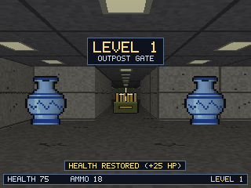

# Neo-Wolf-v1

[](https://github.com/Mizan-muf/Neo-Wolf-v1/actions/workflows/ci.yml)

A high-performance **2.5D software-rendered raycasting game engine** written in modern C++17 with SDL2, featuring a data-driven content pipeline, native particle simulation, audio system, and a comprehensive **DevKit CLI toolchain** (`tools/devkit/`).



How to play: [docs/GAMEPLAY.md](docs/GAMEPLAY.md) (campaign, exit switches, saves) and
[docs/CONTROLS.md](docs/CONTROLS.md) (all keys).

---

## Features

- **Software Raycasting Engine**: Fast DDA (Digital Differential Analysis) raycaster with fish-eye distortion correction and directional wall shading.
- **Textured Rendering**: Software-textured walls, floors, and ceilings with distance depth fog and per-cell ambient lighting.
- **Billboard Sprites**: Occlusion-culled, distance-sorted 2.5D sprites for enemies, pickups, and decorations with transparent magenta color keying.
- **Particle System**: Real-time particle simulation for wall sparks, pickup sparkles, and floating ambient dust motes.
- **Sound System**: SDL2 16-bit PCM audio mixer with configurable master volume and event-driven SFX triggers (doors, pickups, weapon fire, enemy alerts).
- **Campaign & Progression**: A level list (`game/defs/campaign.json`: the 10 levels of the Phase 8 design ([docs/levels/README.md](docs/levels/README.md)); levels 1–3 are the Phase 7 levels and levels 4–10 stubs until they are built), a main menu with New Game / Continue / Level Select / Quit, exit switches that complete a level, health and ammo carried between levels, restart from the level-entry snapshot on death, saved progress, and per-level texture themes. The state machine (`Menu`, `Gameplay`, `Paused`, `GameOver`, `LevelComplete`, `CampaignComplete`) is SDL-free and unit-tested ([docs/GAMEPLAY.md](docs/GAMEPLAY.md)).
- **Gameplay Combat & AI**: Hitscan weapon attacks, ammo management, health and ammo pickups, three enemy types (guard, brute, runner) with line of sight, hearing and grid path finding (Idle -> Alert -> Chase -> Attack, Search, Dead), and red/blue/gold key cards with locked doors ([docs/GAMEPLAY.md](docs/GAMEPLAY.md)).
- **C API Boundary & Interop Bridge**: Plain C ABI interface and bidirectional Command Bridge / Event Queue for decoupling gameplay scripting.
- **Data-Driven Architecture**: Grid map files (`.map`), texture/sprite/audio configuration files (`.cfg`), gameplay values (`gameplay.json`), and entity placements (`<level>.entities.json`, with an optional `.csv` export). Editing them changes the game without recompiling; an invalid `gameplay.json`, map or entity file stops the game with a message that names the file, entry and field. See [docs/CONTENT_DEFINITIONS.md](docs/CONTENT_DEFINITIONS.md).
- **DevKit CLI Toolchain**: Complete developer toolkit (`tools/devkit/`) for map inspection, reachability analysis, asset verification, procedural generation, CSV/JSON sync, system doctor diagnostics, and release packaging.
- **Dual-Engine Test Suite**: 100% automated test coverage across native C++ logic/asset loaders and Python DevKit validation suite.
- **Cross-Platform**: macOS (primary, verified), Windows (built and tested headless in CI; not yet played interactively on a Windows PC), Linux (best effort; built and tested headless in CI).

---

## Quick Start (macOS)

Needs the Xcode Command Line Tools, `brew install cmake ninja`, and Python 3. SDL2 is downloaded
and linked statically by CMake, so there is nothing else to install. Details: [docs/BUILD_MACOS.md](docs/BUILD_MACOS.md).

### 1. Build and Run Tests
```bash
./build.sh          # configure + build + run all tests (or: make check)
```

### 2. Launch Game
```bash
./build/macos/neo_wolf            # works from any directory: it finds the repository's game/ folder
./build/macos/neo_wolf --help     # options: --data, --pref-dir, --level, --frames, --fullscreen, --version,
                                  # developer tools --preview and --screenshot
```

If the game does not start, see [docs/TROUBLESHOOTING.md](docs/TROUBLESHOOTING.md) (log file
locations, missing content, no audio device, virtual machines).

---

## Quick Start (Linux)

**Best effort:** built and tested headless in CI (without desktop backends); not yet run on a Linux desktop. Needs a C++17
compiler, CMake 3.25+, Ninja and Python 3. Ubuntu 22.04's packaged CMake (3.22) is too old for
the presets: get a newer CMake (for example `pip install cmake`, or Kitware's apt repository).
SDL2 is built from source by CMake (no `libsdl2-dev` needed), but that needs the X11/Wayland and
audio development packages SDL builds against; see [docs/BUILD_AND_RELEASE.md](docs/BUILD_AND_RELEASE.md).

### 1. Build and Run Tests
```bash
./build.sh          # configure + build + run all tests (or: make check)
```

### 2. Launch Game
```bash
./build/linux/neo_wolf
```

---

## Quick Start (Windows)

Needs Visual Studio 2022 or newer (any edition) with the *Desktop development with C++* workload,
and Python 3. No vcpkg or SDL2 install is needed. Details: [docs/BUILD_WINDOWS.md](docs/BUILD_WINDOWS.md)
(built and tested headless in CI with MSVC; not yet played interactively on a Windows PC).

### 1. Build and Run Tests
```cmd
build.cmd Release
```

### 2. Launch Game
```cmd
build\windows-msvc\Release\neo_wolf.exe
```

Running a single test, test labels and adding tests: [docs/TESTING.md](docs/TESTING.md).

---

## DevKit CLI Toolchain (`tools/devkit/`)

The DevKit CLI provides developer tools for map inspection, asset validation, level creation, and distribution packaging.

```bash
# Run system doctor to check environment & compilers
./tools/devkit/neo_devkit doctor

# Validate all project maps, assets, and definitions
./tools/devkit/neo_devkit validate

# Inspect a campaign level: map, entities, statistics, reachability (non-zero exit if not finishable)
./tools/devkit/neo_devkit inspect-map --level level01

# Inspect texture or audio asset metadata
./tools/devkit/neo_devkit inspect-asset game/assets/sprites/guard.ppm
./tools/devkit/neo_devkit inspect-asset game/assets/sfx_door_open.wav

# Create a new level: map (exit switch X in the east wall) + entity stub + campaign entry
# (step-by-step checklist: docs/LEVEL_AUTHORING.md)
./tools/devkit/neo_devkit create-map --level-id level04 --width 20 --height 15 --style dungeon --register

# Prove every campaign level can be finished: the headless autoplay bot (after building)
build/macos/neo_wolf_autoplay --all --json /tmp/autoplay-report.json

# Regenerate the per-level theme textures (deterministic; --check verifies them)
python3 tools/devkit/gen_textures.py

# Export the entity placement JSON files to CSV (JSON is canonical)
./tools/devkit/neo_devkit sync-entities

# Assemble standalone release package
./tools/devkit/neo_devkit package --version 1.0.0 --out-dir release

# Run DevKit unit test suite
./tools/devkit/neo_devkit test
```

---

## Automated Test Suites

Neo-Wolf has native, DevKit and game-level automated tests, all registered with CTest
(`ctest --preset macos`; details in [docs/TESTING.md](docs/TESTING.md)):

| Test Suite | Implementation | Target | Coverage |
| :--- | :--- | :--- | :--- |
| **Native Engine Tests** | C++17 (`tests/LogicTests.cpp`) | `build/macos/neo_wolf_tests` (Windows: `build\windows-msvc\Release\neo_wolf_tests.exe`) | Math helpers, raycaster DDA, collision sliding, entity interactions, PPM/WAV asset loaders, map perimeter enclosure, reachability flood-fill |
| **DevKit Test Suite** | Python 3 (`tools/devkit/tests/`) | `neo_devkit test` | Map parser, reachability BFS, PPM token parser, WAV RIFF headers, CSV/JSON synchronizer, release packager, campaign validation rules on multi-level fixtures, engine/DevKit parsing parity, CLI commands |
| **Autoplay Bot** | C++17 (`engine/autoplay/`, `neo_wolf_autoplay`) | `build/macos/neo_wolf_autoplay --all` | Plays every campaign level headless through simulated input (keys, doors, enemies) and reports per level: result, time, damage, kills, pickups, keys, shots |

Run both test suites with one command:
```bash
make check
```

---

## Release Packaging (Phase 26)

Create a completely self-contained, standalone distribution bundle:

```bash
make package
# Or:
./package.sh 1.0.0 release
```

The output directory `release/neo-wolf-v1.0.0-<platform>/` is fully portable and includes the executable, game content (`assets/`, `maps/`, `defs/`), launch scripts (`launch.sh`, `launch.cmd`), documentation, and cryptographic checksums (`SHA256SUMS`). Compressed `.tar.gz` and `.zip` archives are generated alongside.

---

## Controls

The full list, per screen, is in [docs/CONTROLS.md](docs/CONTROLS.md) (it matches
`PlatformSDL::MapKeyToActions` in `engine/platform/PlatformSDL.cpp`). In short:

| Action | Keys |
| :--- | :--- |
| Move / strafe | `W` `S` or Up / Down; `A` `D` |
| Turn | Left / Right arrows, `Q` |
| Fire | `Space`, `F`, `Ctrl` |
| Use (doors, exit switch) | `E` |
| Pause | `P` or `Esc` (in pause: `Q` quits to the menu, `R` restarts the level) |
| Restart level | `R` |
| Minimap | `M` or `Tab` (off by default) |
| Menus | `W`/`S` or arrows to choose, `Enter`/`Space` to select, `Esc` to go back |
| Fullscreen | `F11`, `Alt+Enter`; macOS also `Cmd+Ctrl+F` |

The window can be resized freely; the 320×240 image is scaled with sharp (nearest-neighbour) pixels.

---

## Project Structure

```text
/neo-wolf
|-- engine/                 # Core engine subsystems
|   |-- core/               # Engine lifecycle, App host, Math, Color, InputState, Time
|   |-- platform/           # SDL2 platform abstraction and windowing
|   |-- render/             # Software Framebuffer, Raycaster DDA, Sprite/Particle renderers
|   |-- world/              # Map representation, Player, Entities, Collision & Interaction rules
|   |-- assets/             # PPM TextureLoader, AssetManager, Content/Audio configs
|   |-- audio/              # AudioSystem SDL audio device and playback
|   |-- particles/          # Particle manager, emitters, and physics
|   `-- ui/                 # HUD rendering, font glyphs, crosshair, pause screen
|-- game/                   # Game content and definitions
|   |-- assets/             # PPM textures/sprites and WAV sound effects
|   |-- maps/               # ASCII grid map files (.map)
|   `-- defs/               # campaign.json, gameplay.json, themes/, sprite/audio configs, entity placements
|-- tools/                  # Developer toolchain
|   `-- devkit/             # DevKit CLI: validator, doctor, map/asset tools, packager
|-- docs/                   # Technical documentation
|-- tests/                  # Native C++ test runner
|-- src/                    # Main executable entry point
|-- Makefile                # Linux build & automation targets
|-- build.sh / package.sh   # Unix build and packaging scripts
|-- build.cmd / package.cmd # Windows build and packaging scripts
`-- CMakeLists.txt          # CMake build configuration
```

---

## Documentation Index

- [Gameplay: campaign, states, saves](docs/GAMEPLAY.md)
- [Controls](docs/CONTROLS.md)
- [Architecture Specification](docs/ARCHITECTURE.md)
- [Map Format Specification](docs/MAP_FORMAT.md)
- [Asset Pipeline Guide](docs/ASSET_GUIDE.md)
- [Content Definitions Guide](docs/CONTENT_DEFINITIONS.md)
- [DevKit CLI Toolchain Guide](docs/DEVKIT_GUIDE.md)
- [Gameplay API & Mechanics](docs/GAMEPLAY_API.md)
- [Build & Release Engineering](docs/BUILD_AND_RELEASE.md)
- [Testing](docs/TESTING.md)
- [Troubleshooting](docs/TROUBLESHOOTING.md)
- [Known Issues](docs/KNOWN_ISSUES.md) and [Roadmap](docs/ROADMAP.md)
- [Implementation Checklist](docs/Checklist.md)
