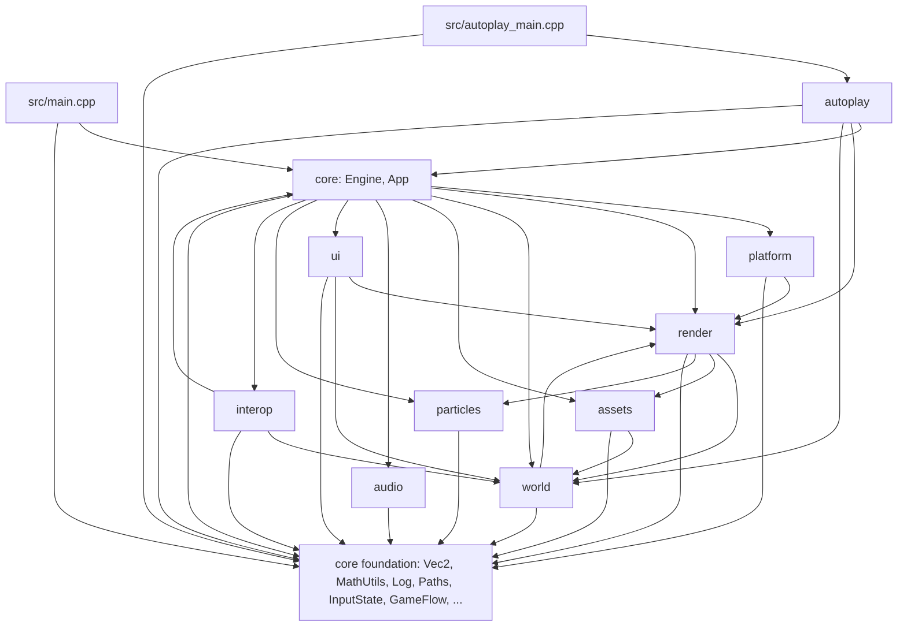

# Architecture

How the Neo-Wolf code is organised and what happens in a frame. Everything here was checked
against the code on branch `completion/v1` (Roadmap Phase 10); the module dependencies come
from the `#include` lines. Gameplay rules are in [GAMEPLAY.md](GAMEPLAY.md), file formats in
[CONTENT_DEFINITIONS.md](CONTENT_DEFINITIONS.md) and [MAP_FORMAT.md](MAP_FORMAT.md), the C API
in [C_API.md](C_API.md), tests in [TESTING.md](TESTING.md).

Neo-Wolf is a C++17 program on SDL2. It draws every frame on the CPU into a 320×240 pixel
buffer (a raycaster for walls, floor and ceiling, then billboard sprites, particles and the
UI), and SDL scales that buffer into the window. All game content (maps, entity placements,
gameplay values, the campaign, textures, sounds) is read from files at run time.

## Module map

All engine code is in `engine/<module>/` and is compiled into one static library,
`neowolf_engine`; the autoplay bot is a second static library on top of it.

| Module | Responsibility | Main files |
|---|---|---|
| `core` (foundation) | Types and services that include nothing from other engine modules: vectors and maths (`Vec2`, `Vec2i`, `MathUtils`), colours, logging (`Log`, the log file), content-root and per-user-folder resolution (`Paths`), the JSON wrapper (`JsonDocument`, nlohmann/json), the action-based `InputState`, `TimeState`, `GameState` values, the SDL-free state machine `GameFlow` (menus, progression, carry-over), `progress.json` (`Progress`), and command-line parsing (`CommandLine`). | `Vec2.h`, `MathUtils.h`, `Log.*`, `Paths.*`, `InputState.h`, `GameFlow.*`, `Progress.*`, `CommandLine.*` |
| `core` (orchestration) | `Engine` owns every subsystem and runs init, update, render and shutdown (split over `Engine.Init/Update/Render/Shutdown/Core/Campaign.cpp`). `App` is the game's main loop: log file, timing, frame pacing, screenshot. | `Engine.h`, `Engine.*.cpp`, `App.*` |
| `platform` | The SDL window, renderer and events: creates the window and renderer, turns keyboard and window events into `InputState` actions (`MapKeyToActions`), handles fullscreen and quit shortcuts, uploads and presents the framebuffer, shows the fatal-error message box, saves BMP screenshots. | `PlatformSDL.*` |
| `render` | Software rendering into the `Framebuffer` (ARGB pixels): the DDA `Raycaster` (walls, floor, ceiling; `CastRay` is also used for line of sight and shots), `SpriteRenderer` (billboards with a depth buffer) and `ParticleRenderer`; `RenderMath.h` holds the camera, projection and shading helpers they share. | `Framebuffer.*`, `Raycaster.*`, `SpriteRenderer.*`, `ParticleRenderer.*`, `RenderMath.h` |
| `world` | The simulation: the tile `Map` and `MapLoader`, `Player`, `Entity` / `EntityManager`, entity-file loading (`EntityPlacementLoader`, also light zones) and level building (`LevelBuilder`), movement and collision (`MovementRules`), pickups, doors, keys, triggers, the exit switch and the player's shot (`InteractionRules`), grid queries (`Navigation`) and the enemy AI (`EnemyAi`). Default gameplay values (`GameplayDefinitions.h`). | `Map.*`, `Entity.*`, `LevelBuilder.*`, `MovementRules.*`, `InteractionRules.*`, `Navigation.*`, `EnemyAi.*` |
| `assets` | Loading content other than levels: PPM (`P3`) textures and the checkerboard fallback (`TextureLoader`, `Texture`, `AssetManager`), theme, sprite and audio `.cfg` files (`ContentConfig`, `AudioConfig`), `gameplay.json` (`GameplayConfig`) and `campaign.json` (`CampaignConfig`). | `TextureLoader.*`, `ContentConfig.*`, `GameplayConfig.*`, `CampaignConfig.*` |
| `audio` | The SDL audio device: loads WAV files, converts them to the device format, plays a sound by queueing it on the device (`SDL_QueueAudio`; sounds play one after another, there is no mixer), master volume. Optional: the game runs without it. | `AudioSystem.*` |
| `ui` | Everything drawn on top of the world or instead of it: menu, level select, HUD, pause, level-complete, game-over and credits screens, minimap, crosshair, debug overlay, and the built-in bitmap font, all laid out from the framebuffer size. | `UiRenderer.*` |
| `particles` | A pool of at most 512 particles (position, velocity, lifetime, colour, size) and the preset effects (hit spark, pickup sparkle, ambient dust). | `Particle.*` |
| `interop` | The in-process C API (`nw_engine_*`) and the thread-safe command and event queues (`CommandBridge`). No shared library is built; see [C_API.md](C_API.md). | `EngineInterop.*`, `CommandBridge.*` |
| `autoplay` | The headless bot that plays the real engine through simulated input, and its JSON/trace report (static library `neowolf_autoplay`, tool `neo_wolf_autoplay`). | `AutoplayBot.*`, `AutoplayReport.*`, `AutoplayTrace.*` |

The entry points are `src/main.cpp` (the game: parses the command line, then `App::Run`; on
Windows it reads the UTF-16 command line and attaches to the parent console for `--help`) and
`src/autoplay_main.cpp` (the bot tool). `tests/LogicTests.cpp` is the native test runner.

### Dependencies

An arrow `A --> B` means that some file in A includes a header of B (found by grepping the
`#include "engine/..."` lines of every file in `engine/` and `src/`). `core` is shown as two
boxes because the foundation files include nothing outside `core`, while `Engine` and `App`
include almost every module.

Edges worth knowing:

- **`world` ⇄ `render`.** `render` draws `world` types (`Map`, `Player`, `Sprite`), and `world`
  uses `Raycaster::CastRay` (`Navigation::HasLineOfSight`, the exit-switch check and the
  player's shot in `InteractionRules`), so that exactly what blocks the view blocks sight and
  shots.
- **`interop` ⇄ `core` (Engine).** `Engine.h` holds a `CommandBridge` member, and the bridge
  and the C API operate on `Engine` directly (its members are public).
- **`assets` → `world`** only for plain type headers (`Sprite.h` for the sprite slots,
  `GameplayDefinitions.h` for the values `gameplay.json` fills).
- **`ui` → `core`** only for `GameFlow.h` (menu items) and the colour helpers.

**Where SDL is used.** SDL is linked into `neowolf_engine` (`neowolf_sdl2`, a public
dependency), and four engine files (and the test runner) include `<SDL.h>`:

| File | Why |
|---|---|
| `engine/platform/PlatformSDL.cpp` | Window, renderer, events, presentation, message box, BMP saving |
| `engine/audio/AudioSystem.cpp` | Audio device and WAV loading |
| `engine/core/App.cpp` | Logs the SDL version and platform; `SDL_Delay` for frame pacing |
| `engine/core/Paths.cpp` | `SDL_GetBasePath` (content root) and `SDL_GetPrefPath` (per-user folder) |
| `tests/LogicTests.cpp` | Synthetic SDL key and window events for the key-binding tests |

No engine header includes SDL: `PlatformSDL.h` and `AudioSystem.h` only forward-declare the SDL
types they hold, so files that include `Engine.h` do not see the SDL headers. Everything else
(`world`, `render`, `ui`, `particles`, `assets`, `GameFlow`) has no SDL dependency and runs in
the headless tests. Moving SDL out of `core` is a Phase 12 review item ([ROADMAP.md](ROADMAP.md#phase-12--clean-code-review)).

## Frame loop

`App::Run` (`engine/core/App.cpp`) in the game:

1. Resolve the per-user folder (`--pref-dir`, `NEOWOLF_PREF_DIR`, else `SDL_GetPrefPath`), start
   a fresh `neowolf.log` there (the previous one becomes `neowolf.prev.log`).
2. `Engine::Init` ([below](#startup-engineinit)). On failure: exit code 1.
3. Loop while the engine is running:
   - measure the time since the last frame and **clamp it to 0.1 s**;
   - `Engine::Update(dt)`, then `Engine::Render()` (one present per frame);
   - stop after `--frames N` frames, if given;
   - log the frame rate every 10 s;
   - **pacing:** with vsync the present waits for the display. Without vsync (software
     renderer, dummy driver, `SDL_RENDER_VSYNC=0`) or while the window is minimised, sleep
     until the next frame slot at the display's refresh rate (60 Hz if the reported rate is
     unknown or outside 30–500). There is no fixed 60 FPS target.
4. Save `--screenshot` if asked, `Engine::Shutdown`, exit code 0.

`Engine::Update(dt)` (`Engine.Update.cpp`), every frame:

1. Run the commands queued through the C API (`CommandBridge::ProcessCommands`).
2. Read input: `InputState::BeginFrame`, the platform's events (`PlatformSDL::PumpEvents`;
   none headless), then the input injector if one is set. A quit request ends the loop.
3. Advance the clock; a frozen preview (`--preview`) stops here.
4. Count down HUD message, fire and alert-sound timers.
5. In the `Gameplay` state only, `UpdateGameplay`:
   minimap and debug toggles → the shot (`PlayerAttack`) → turning → movement
   (`MoveWithSlidingAndBodies`: walls, closed doors and living enemies block) → pickups,
   triggers, doors, keys and the exit switch (`UpdateEntityInteractions`) → if the exit was
   used, stop here → enemy AI (`UpdateEnemyAi`, hearing the shot of this frame) → if the player
   died, stop here → sprites follow their entities (`SyncSpritesWithEntities`) → particles.
   Each step's results become HUD messages, sounds and C API events.
6. `GameFlow::Update` turns the input and the frame's events (level completed, player died,
   focus lost) into a state change and requests (load or restart a level, save progress,
   quit), which the engine carries out (`ExecuteFlowRequests`).
7. Push a `StateChanged` event if the state changed.

`Engine::Render()` (`Engine.Render.cpp`): on the `Menu` and `CampaignComplete` screens only the
UI is drawn; otherwise the world ([rendering pipeline](#rendering-pipeline)) and then the UI for
the state (HUD, minimap, debug overlay, pause or result panel). Finally the platform presents
the frame (nothing is presented headless).

## Game flow and states

`GameFlow` (`engine/core/GameFlow.{h,cpp}`) is a plain C++ class without SDL. It holds the
state (`Menu`, `Gameplay`, `Paused`, `GameOver`, `LevelComplete`, `CampaignComplete`; `Victory`
is a deprecated C API value that is never entered), the menu page and cursor, the unlocked
levels, the current campaign level, the level-entry snapshot (health and ammo to restart with)
and the carried health and ammo. It never loads anything itself: it returns `FlowRequest`s and
the engine executes them, so every transition is unit-tested without an engine. The states,
keys and transitions are drawn in [GAMEPLAY.md](GAMEPLAY.md#states-and-transitions).

`Engine::SetState` (C API) calls `GameFlow::ForceState`. Progress (`progress.json`, the highest
unlocked level) is loaded at init and saved on every level completion when a per-user folder is
set (`Engine.Campaign.cpp`, `Progress.cpp`).

## Startup (`Engine::Init`)

In this order (`Engine.Init.cpp`); a failure in steps 1–3, 5, 6 (the framebuffer, not the
audio), 10 or 11 is fatal (logged, an error box unless `--frames` is used, exit code 1):

1. Find the **content root** ([below](#content-loading-and-the-content-root)).
2. Load `game/defs/gameplay.json` (invalid = fatal, before any window opens).
3. Load `game/defs/campaign.json` (invalid = fatal); check `--level N` against it.
4. Load saved progress, if there is a per-user folder.
5. Unless headless: create the window and renderer (`PlatformSDL::Init`: 1024×768 resizable
   window (shrunk to fit 90% of the usable desktop), HiDPI, accelerated renderer with vsync, else the software renderer; logical size
   320×240, letterboxed, nearest-neighbour scaling).
6. Allocate the 320×240 framebuffer; unless headless, open the audio device (failure only
   means no sound).
7. Read `sprites.cfg` and `audio.cfg` (missing or broken files fall back to defaults with a
   warning).
8. Load the sprite textures (a checkerboard replaces any that fail).
9. Load the four sound effects, if there is an audio device.
10. Load the first level: level 1 behind the main menu, or level N with `--level N`.
11. Set up a `--preview` screen if asked.

## Content loading and the content root

The **content root** is the folder that contains `game/maps` and `game/defs`. It is resolved
once at startup (`engine/core/Paths.cpp`), from the first of these that exists:

1. `--data <dir>`, else the `NEOWOLF_DATA_DIR` environment variable. Either is the only place
   searched: if it is wrong, the game stops instead of using another copy.
2. The executable's folder (`SDL_GetBasePath`; inside a macOS `.app` that is
   `Contents/Resources`) and up to 3 folders above it, then `<that folder>/../Resources`.
3. The working directory and its parent.

Every content path in the code and in the content files (`campaign.json`, theme files) is
relative to the content root (`Engine::ResolveContentPath`). The log names the root and why it
was chosen. File formats:

| File | Read by | When |
|---|---|---|
| `game/defs/gameplay.json` | `GameplayConfig` | startup (fatal if invalid) |
| `game/defs/campaign.json` | `CampaignConfig` | startup (fatal if invalid) |
| `game/defs/sprites.cfg`, `audio.cfg` and the files they name | `ContentConfig`, `AudioConfig`, `TextureLoader`, `AudioSystem` | startup (fallbacks with warnings) |
| `game/defs/themes/<id>.cfg` and its textures | `ContentConfig`, `TextureLoader` (`Engine::ApplyTheme`) | when a level with a different theme loads |
| `game/maps/<level>.map` | `MapLoader` | every level load |
| `game/defs/<level>.entities.json` (or `.csv`) | `EntityPlacementLoader` | every level load |
| `progress.json` in the per-user folder | `Progress` | startup; written on level completion |

All loaders accept CRLF line endings. Details: [CONTENT_DEFINITIONS.md](CONTENT_DEFINITIONS.md),
[MAP_FORMAT.md](MAP_FORMAT.md), [TROUBLESHOOTING.md](TROUBLESHOOTING.md).

## Level building

`Engine::LoadCampaignLevel` (start, next level, restart) calls `Engine::LoadLevel` and then
applies the level's texture theme and sets the health and ammo to carry. `Engine::LoadLevel`
(`Engine.Core.cpp`) builds the new level **into local objects first**, so a level that fails to
load leaves the current one untouched:

1. `LoadMapFromFile`: the character grid → `Map` tiles (`.` empty, `#`/`A`/`B` walls, `D` door,
   `T` trigger, `X` exit switch).
2. `LoadEntityPlacementsFromFile`: the entity JSON (canonical) or CSV → placements and light
   zones. It checks each entry's types and values (entity type, pickup kind, enemy variant,
   key and lock colours, light ranges); errors name the file, the entity index and the field.
3. `BuildLevelFromPlacements` (`LevelBuilder.cpp`): checks the placements against the map
   (exactly one player, every position and door/trigger cell inside the map, light zones
   inside the map), then creates the entities with their `gameplay.json` values (enemy
   archetypes through `ApplyEnemyArchetype`), their sprites, and only then changes the map:
   door tiles and locks, trigger tiles, light levels. The engine does **not** check that a door
   sits on a `D` cell or that nothing is inside a wall; those level rules belong to the DevKit
   validator ([DEVKIT_GUIDE.md](DEVKIT_GUIDE.md#validate--content-and-campaign-validation)).
4. Swap the new map, entities, sprites and player in; reset health and ammo to the initial
   values (the caller then applies the carried or snapshot values), keys, timers, counters and
   particles; push `LevelLoaded`.

While the level runs, `SyncSpritesWithEntities` keeps sprites in step with entities every
frame (positions, visibility, the corpse texture after death, the hit flash, sprites for new
entities, none for destroyed ones).

## AI and navigation

`engine/world/Navigation.{h,cpp}` holds the grid queries, all based on `Map::IsWall` (walls,
closed doors and the exit switch are solid, so a door is part of the walkable graph exactly
while it is open):

- `HasLineOfSight`: one `Raycaster::CastRay` from one point to another.
- `HasClearCorridor`: the centre line and both edges of a moving body are clear.
- `FindPath`: breadth-first search over walkable cells, 8-connected, never cutting a wall
  corner.
- `ComputeSoundDistances`: 4-connected breadth-first path lengths from a noise, so sound goes
  round walls and stops at closed doors.

`engine/world/EnemyAi.{h,cpp}`: `UpdateEnemyAi` runs once per gameplay frame. It computes the
sound distances once if the player fired this frame, then for every living enemy: perception
(sight within the alert radius, hearing within `weapon.noiseRadius` path cells), the state
machine (`Idle → Alert → Chase ⇄ Attack`, `Chase → Search → Idle`, `Dead`), movement (straight
when the body fits along the line, else along a path recomputed at most every 0.3 s, or at once
when stuck) with `MoveWithSliding`, and attacks. Then it separates living enemies from each other
and from the player. Enemies never open doors. Rules, numbers and the state diagram:
[GAMEPLAY.md](GAMEPLAY.md#enemy-ai).

## Rendering pipeline

Per frame, in `Engine::RenderWorld` and `Engine::RenderUi`, all into the 320×240 framebuffer
(field of view 60°):

1. **Background fill:** the theme's floor and ceiling textures tiled in screen space
   (`RenderCeilingAndFloor`). Step 2 draws over almost all of it.
2. **Floor and ceiling** (`Raycaster::RenderWalls`, first loop): for every row below the
   horizon, the floor point under each column is found by perspective projection and the floor
   texture is sampled there; the ceiling row mirrored above the horizon samples the ceiling
   texture at the same point. Shading: distance falloff times the cell's light level.
3. **Walls** (`Raycaster::RenderWalls`, second loop): one DDA ray per screen column through the
   grid until a solid cell (`#`, `A`, `B`, a closed `D`, `X`; not `T`). The distance is
   measured along the view direction (no fish-eye). The texture is chosen by tile (theme walls,
   door, locked-door texture by lock colour, exit switch), the column from the hit point
   (mirrored on the faces where it would read backwards). Shading: side (north and south faces
   at 72 %), distance, and the light level of the cell in front of the face. The per-column
   distances form the depth buffer.
4. **Sprites** (`SpriteRenderer::Render`): enemies, corpses, pickups, keys and decorations as
   billboards, sorted far to near, clipped per column against the depth buffer, magenta
   (`#FF00FF`) transparent, shaded by distance and light (never darker than 0.35), brightened
   while an enemy's hit flash runs. A sprite taller than the screen is cropped.
5. **Particles** (`ParticleRenderer::Render`): small squares projected like sprites and
   clipped against the depth buffer.
6. **UI** (`UiRenderer`): minimap (if on), crosshair (gameplay), HUD, debug overlay (`F3`), and
   the pause, game-over or level-complete panel; the menu and credits screens replace the
   world entirely.
7. **Present** (`PlatformSDL::PresentFramebuffer`): upload the pixels into a streaming texture
   and draw it scaled to the window, keeping the 4:3 shape.

## Test seams

- **Headless engine.** `EngineOptions::headless` skips the window, renderer and audio; content,
  campaign, progress and levels load as usual, and `Update` and `Render` work on the
  framebuffer only. Used by native tests and the autoplay bot.
- **Input injection.** `Engine::SetInputInjector` installs a callback that runs once per
  `Update`, after the platform's events and before anything reads the input; it sets actions
  with `InputState::SetActionState`, and edges such as `WasPressed` follow from the previous
  frame. There is no separate input-system class: the platform layer and the injector both
  write the same `InputState`.
- **Pure functions and classes.** `GameFlow`, the loaders, `BuildLevelFromPlacements`, the
  movement, interaction, navigation and AI functions, and the renderers take their inputs as
  arguments, so tests call them directly on small hand-made maps.
- **Content and folders from outside.** `--data` / `NEOWOLF_DATA_DIR` and `--pref-dir` /
  `NEOWOLF_PREF_DIR` point the game at test content and keep tests away from the player's log
  and save. `--frames`, `--level`, `--preview` and `--screenshot` make runs finite and
  inspectable.
- **SDL dummy drivers.** With `SDL_VIDEODRIVER=dummy` and `SDL_AUDIODRIVER=dummy` the real
  game runs without a display or sound device (CTest `game_*` tests, CI smoke runs).

Details and the list of tests: [TESTING.md](TESTING.md).

## Build targets

Defined in `CMakeLists.txt` and `cmake/Packaging.cmake`:

| Target | Kind | What it is |
|---|---|---|
| `neowolf_engine` | static library | Every file in `engine/` except `autoplay/`. Links SDL2 (public) and nlohmann/json (private). |
| `neowolf_autoplay` | static library | `engine/autoplay/`, on top of `neowolf_engine`. |
| `neo_wolf` | executable | The game (`src/main.cpp`). On Windows a GUI-subsystem app in Release builds, with the icon and version resource. |
| `neo_wolf_autoplay` | executable | The bot tool (`src/autoplay_main.cpp`). |
| `neo_wolf_tests` | executable | The native tests (`tests/LogicTests.cpp`); only with `NEOWOLF_BUILD_TESTS=ON` (default). |
| `neo_wolf_app` | macOS app bundle | `NeoWolf.app` from the same `main.cpp` (option `NEOWOLF_MACOS_APP`, default on); filled with content only by `cmake --install`. |
| `neowolf_icon`, `neowolf_package_readme` | custom targets | The generated icon and the package `README.txt` (need Python 3). |
| `neowolf_sdl2`, `neowolf_json`, `neowolf_warnings` | interface libraries | SDL2 (pinned source build, or the system SDL2 with `NEOWOLF_SYSTEM_SDL2=ON`), the vendored JSON header, and the warning flags (`NEOWOLF_WERROR` makes them errors). |

The CMake presets (`macos`, `windows-msvc`, `linux`, their `-debug` variants, `ci-*` with
warnings as errors, `package-*`) and the build commands are in
[BUILD_MACOS.md](BUILD_MACOS.md), [BUILD_WINDOWS.md](BUILD_WINDOWS.md) and
[BUILD_AND_RELEASE.md](BUILD_AND_RELEASE.md); packaging in [RELEASE.md](RELEASE.md).

## Coordinates

- **Map cells:** integers, `(0, 0)` is the top-left cell; x grows to the right, y downwards.
- **World positions:** floats in cell units; the centre of cell `(x, y)` is `(x + 0.5, y + 0.5)`.
- **Angles:** radians; 0 points along +x (east), π/2 along +y (south, down the map), π west,
  3π/2 north.
- **Screen:** the framebuffer is always 320×240; column 0 is the left edge, row 0 the top.
