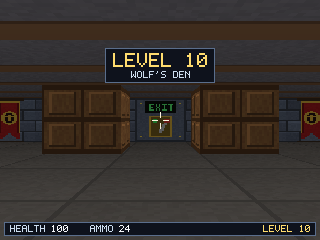
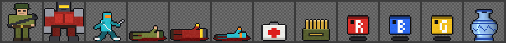

# Neo-Wolf Asset Pipeline & Technical Guide

## Asset Directory Structure

All game content assets reside under `game/assets/`:

```text
game/assets/
|-- sfx_door_open.wav     # Generated sound effects (section 6): door opens or closes
|-- sfx_pickup.wav        #   item or key card picked up
|-- sfx_enemy_alert.wav   #   an enemy notices the player; also played when the player is hit
|-- sfx_weapon_fire.wav   #   the player fires
|-- sprites/              # Generated billboard sprites (section 5): enemies, corpses, pickups,
|                         # keys and the decoration (the blue vase)
`-- themes/               # Generated per-level texture themes (section 4)
    |-- bunker/           # wall, wall_alt_a, wall_alt_b, door, door_red, door_blue, door_gold,
    |                     # floor, ceiling, exit (.ppm, 32x32)
    |-- stone/
    |-- tech/
    `-- classic/          # the finale's castle (level 10)
```

Every file in this folder is made by a generator in `tools/devkit/` and checked byte for byte
by DevKit test `test_asset_provenance` ([ASSET_CREDITS.md](ASSET_CREDITS.md)). `sprite_enemy.ppm`
and `sprite_pickup.ppm` were deleted in Phase 6; `game/assets/sprites/` replaces them. The
hand-made `sprite_decor.ppm` was replaced by the generated `sprites/decoration.ppm` in Phase 10.

The original 8×8 wall, floor and ceiling textures (`wall_main.ppm`, `wall_alt_a.ppm`,
`wall_alt_b.ppm`, `floor.ppm`, `ceiling.ppm`) were removed in Phase 8, when the `classic` theme
got its own generated textures. Which textures a level uses is decided by its theme
([CONTENT_DEFINITIONS.md](CONTENT_DEFINITIONS.md#themes)).

---

## 1. Texture Specifications (PPM Format)

Neo-Wolf uses the plain ASCII **Netpbm PPM (`P3`)** image format for software rasterization. This provides human-inspectable text files that require no external decoding libraries (e.g. libpng, stb_image).

### Format Specification
- **Magic Identifier**: `P3` (ASCII plaintext RGB format).
- **Dimensions**: Width and Height in pixels (recommended: `64x64`, `32x32`, `16x16`, `8x8`). Power-of-two dimensions ensure optimal sampling.
- **Max Color Value**: `255` (8 bits per channel).
- **Pixel Data**: White-space separated integer triplets representing `Red Green Blue` channels from `0` to `255`.

### Sample PPM File Structure
```text
P3
# Created for Neo-Wolf Engine
4 4
255
255 0 0    255 0 0    0 255 0    0 255 0
255 0 0    255 0 0    0 255 0    0 255 0
0 0 255    0 0 255    255 255 0  255 255 0
0 0 255    0 0 255    255 255 0  255 255 0
```

### Color Key Transparency for Sprites
For billboard sprites (`game/assets/sprites/*.ppm`), the pure magenta color `RGB(255, 0, 255)` (`#FF00FF`) is designated as the **alpha mask / transparent color key**.
- Pixels matching `R=255, G=0, B=255` are discarded by `SpriteRenderer` during depth-testing and framebuffer blitting.

---

## 2. Audio Specifications (WAV Format)

Neo-Wolf's `AudioSystem` loads and mixes uncompressed standard **RIFF WAVE** (`.wav`) audio files.

### Recommended Audio Profile
- **Container**: RIFF WAVE (`.wav`)
- **Format Tag**: `1` (Uncompressed Linear PCM)
- **Sample Rate**: `44,100 Hz`, the rate `AudioSystem::Init` asks the device for (other rates
  load too and are converted when the game starts)
- **Bit Depth**: `16-bit` signed integer (or `8-bit` unsigned)
- **Channels**: `1` (mono); the engine has no positional sound
- **Length**: short. `AudioSystem` queues effects one after another (no mixer), so a long
  effect delays the next one; keep effects at or under about 0.3 s (section 6).

---

## 3. Asset Tooling with DevKit CLI

The DevKit CLI provides procedural generation and inspection utilities for assets:

### Inspecting Texture Metadata
```bash
./tools/devkit/neo_devkit inspect-asset game/assets/sprites/decoration.ppm
```
The output lists the format, width, height, maximum value, whether the size is a power of two,
the average colour and how many pixels are the magenta colour key (transparent).

### Inspecting Audio Files
```bash
./tools/devkit/neo_devkit inspect-asset game/assets/sfx_door_open.wav
```

### Generating Procedural Assets
```bash
# Generate a 64x64 checkerboard texture (one-off assets; the theme textures come from gen_textures.py, section 4)
./tools/devkit/neo_devkit create-asset /tmp/wall_test.ppm --type checker --width 64 --height 64

# Generate a 64x64 brick texture
./tools/devkit/neo_devkit create-asset /tmp/wall_brick.ppm --type brick --width 64 --height 64

# Generate a 440 Hz test tone WAV audio file
./tools/devkit/neo_devkit create-asset /tmp/sfx_test.wav --type beep
```

Write test assets outside `game/assets/`: every file there must come from a generator
(`test_asset_provenance`).

---

## 4. Texture Themes

Each campaign level has a texture theme (`"theme"` in `game/defs/campaign.json`). A theme file,
`game/defs/themes/<id>.cfg`, names ten textures: `wall`, `wall_alt_a`, `wall_alt_b`, `door`,
`door_red`, `door_blue`, `door_gold` (doors locked with that key, Phase 6), `floor`, `ceiling`
and `exit` (the exit switch, map tile `X`). Format and loading:
[CONTENT_DEFINITIONS.md](CONTENT_DEFINITIONS.md#themes).

### The generator: `tools/devkit/gen_textures.py`

The textures of all four themes, `bunker`, `stone`, `tech` and `classic`, are drawn by a Python
script:

```bash
python3 tools/devkit/gen_textures.py            # (re)write game/assets/themes/<theme>/*.ppm
python3 tools/devkit/gen_textures.py --check    # exit 1 if a committed texture differs
python3 tools/devkit/gen_textures.py --out /tmp/themes   # write somewhere else
```

- **Standard library only** (no Pillow or other packages).
- **Deterministic:** every texture uses its own `random.Random`, seeded from the fixed `SEED`
  constant and the texture's name through `zlib.crc32` (Python's built-in `hash()` is salted per
  process and is not used). Running the script again, on any OS or Python 3 version, writes the
  same bytes; files are written with `\n` line endings.
- **Output:** 32×32 plain-text PPM (`P3`, max value 255) with a comment line naming the theme,
  the slot and the seed; 40 files, 9–12 KB each.
- The exit switch has the same layout in every theme (an "EXIT" label, a lever box, a green
  lamp) so it is recognisable by its shape, not only its colour.
- **Locked doors** (Phase 6) are the theme's own `door` texture (drawn from the same seed, so
  pixel for pixel the same) with a band in the lock's colour across rows 11–20, a light plate
  with the colour's initial (R, B, G) and a dark keyhole: distinct from a plain door, and from
  each other, by shape as well as colour. The lock colours (`LOCK_COLORS`) are shared with the
  sprite generator.
- DevKit test `test_gen_textures` checks that two runs are identical, that the committed
  files match the generator (`--check`), so the script and the files cannot drift apart, and
  that every theme's `door` differs from its three wall textures (a door must read as a door).

| Theme | `wall` | `wall_alt_a` (`A`) | `wall_alt_b` (`B`) | `door` | `floor` / `ceiling` | Levels |
|---|---|---|---|---|---|---|
| `bunker` | concrete with form-work seams | olive painted steel, rivets | hazard stripes | steel blast door, slats | worn concrete with a crack / dark panels with a light fixture | 1, 4, 7 |
| `stone` | stone bricks | mossy stone | dark granite blocks | wooden planks with iron bands | cobblestones / wooden beams | 2, 5, 9 |
| `tech` | blue panels with a cyan strip | circuit traces | server rack with status lights | sliding door with yellow edge stripes | grid tiles / light panels | 3, 6, 8 |
| `classic` | blue-grey castle blocks, a lit top edge per block | oak panelling, two raised panels | a red banner with a gold border and emblem, hung on the stone | riveted steel double door in a dark frame, brass handles | worn flagstones, one per cell / dark plaster between oak beams | 10 |

**Floor and ceiling: avoid stripes.** Floors and ceilings are sampled per pixel with nearest
filtering, one texture per cell, so fine high-contrast detail (a checkerboard, thin bright
lines) turns into moiré stripes and radial patterns towards the horizon; that is what the old
8×8 `classic` ceiling did. Keep them low in contrast with large features (one flagstone or one
beam per cell, mortar only slightly darker than the stone). The `classic` theme was checked in
headless screenshots of level 10's start view, the dim chapel, the barracks and blue doors and
the throne room ([level10.md](levels/level10.md)).



To change a theme, edit the drawing function for that theme in the script, run it, look at the
result in the game (`neo_wolf --level N`, or `--preview hud --screenshot out.bmp --frames 5`),
and commit both the script and the regenerated `.ppm` files. To add a theme, add a function and
an entry in `THEMES`, run the script, and add `game/defs/themes/<id>.cfg`.

---

## 5. Sprites



*Guard, brute, runner, their corpses, health, ammo, the red, blue and gold key cards and the
decoration vase (magenta shown as a grey checkerboard).*

Billboard sprites are drawn facing the camera, **one map cell tall from the floor to the
ceiling**, square, and depth-tested against the walls (`SpriteRenderer`). Rules for sprite
images:

- PPM `P3`, any size; the generated ones are **32×32**. They are sampled nearest-neighbour.
- Pure magenta `RGB(255, 0, 255)` is transparent (the colour key); every other colour is
  drawn, shaded by distance and the cell's light.
- A standing figure has its feet on the **bottom row**; an object lying on the floor (a
  corpse, a medkit) uses only the lower rows, so it appears on the floor.
- A hit enemy is drawn brightened for 0.15 s (the hit flash, done by the renderer; there is no
  separate image).

`game/defs/sprites.cfg` maps each sprite slot to a file
([CONTENT_DEFINITIONS.md](CONTENT_DEFINITIONS.md#spritescfg)):

| Slot (`sprites.cfg` key) | File | Look |
|---|---|---|
| `guard` | `sprites/guard.ppm` | upright olive soldier with helmet and rifle, 31 rows tall with its outline |
| `brute` | `sprites/brute.ppm` | fills the whole frame: dark red armour, wide metal shoulders, yellow visor |
| `runner` | `sprites/runner.ppm` | small (24 rows), slim, mid-stride; cyan suit, orange visor, blade |
| `guard_dead`, `brute_dead`, `runner_dead` | `sprites/<slot>.ppm` | the body lying in a pool of blood, in the lower half of the frame |
| `health` | `sprites/health.ppm` | white medkit with a red cross |
| `ammo` | `sprites/ammo.ppm` | olive ammo box with brass cartridges |
| `key_red`, `key_blue`, `key_gold` | `sprites/<slot>.ppm` | a key card in its colour with its initial (R, B, G), floating over a shadow |
| `decoration` | `sprites/decoration.ppm` | a blue-and-white porcelain floor vase, 26 rows tall (the level landmark, [levels/README.md](levels/README.md) rule 13) |

The enemies are told apart at 320×240 by **silhouette** (size and outline) as well as colour,
and every figure has a dark 1-pixel outline so it stands out against any wall. The key cards
carry their initial, so they do not depend on colour alone. Reference screenshots:
[GAMEPLAY.md](GAMEPLAY.md#enemies).

### The generator: `tools/devkit/gen_sprites.py`

```bash
python3 tools/devkit/gen_sprites.py            # (re)write game/assets/sprites/*.ppm
python3 tools/devkit/gen_sprites.py --check    # exit 1 if a committed sprite differs
python3 tools/devkit/gen_sprites.py --out /tmp/sprites
```

The same rules as `gen_textures.py`: standard library only, deterministic (one
`random.Random` per sprite, seeded from `SEED` and `zlib.crc32` of the name), `\n` line
endings, a comment line naming the sprite and the seed; 12 files. DevKit test
`test_gen_sprites` checks determinism, the 32×32 size and the magenta background, that the
three enemies differ in size and bulk, that the corpses lie in the lower half, that the vase
stands on the floor, and that the committed files match (`--check`).

The **decoration** (Phase 10) replaced the hand-made 16×16 `sprite_decor.ppm`, a light-blue
diamond that filled the whole frame and so floated at eye height. The vase keeps its role and
colour (the levels use it in pairs, lines and clusters as landmarks) but stands on the floor;
its pale glaze and dark blue bands read in the dim light zones. Checked in headless
screenshots of every level's start view and the dim crypt (level 5) and chapel (level 10);
the reference images in `docs/images/` were regenerated. To change a sprite, edit its drawing function, run the
script, check it in the game (`neo_wolf --preview enemies --frames 5 --screenshot out.bmp`, or
`--preview items`), and commit the script and the regenerated files.

---

## 6. Sound effects

`game/defs/audio.cfg` maps the engine's four sound slots to files
([CONTENT_DEFINITIONS.md](CONTENT_DEFINITIONS.md#audiocfg)). All four are synthesised by
`tools/devkit/gen_sounds.py`:

```bash
python3 tools/devkit/gen_sounds.py            # (re)write game/assets/sfx_*.wav
python3 tools/devkit/gen_sounds.py --check    # exit 1 if a committed sound differs
python3 tools/devkit/gen_sounds.py --out /tmp/sounds
```

Standard library only (`wave`, `math`, `random`, `struct`); deterministic (one `random.Random`
per sound, seeded from `SEED` and `zlib.crc32` of the name). Output: 16-bit PCM mono at
44,100 Hz. Every sound is high-passed at 30 Hz (no DC offset), faded in over 0.3 ms and out
over 8 ms (no clicks) and normalised to its own peak level, at least 3 dB below full scale.

| Slot / file | Played when | Length | Peak | Synthesis |
|---|---|---|---|---|
| `weapon_fire` / `sfx_weapon_fire.wav` | the player fires | 0.20 s | −3 dBFS | gunshot: a crack of high-passed white noise (decay τ 12 ms), a noise body whose low-pass falls from 4 kHz to 500 Hz (τ 45 ms), a sine thump sweeping 160 → 45 Hz (τ 50 ms), a dark 600 Hz noise tail (τ 90 ms) |
| `door_open` / `sfx_door_open.wav` | a door opens or closes | 0.30 s | −6 dBFS | heavy door: a latch clunk (110 Hz with 2nd and 3rd partials, τ 25 ms, and a 4 ms noise click), a whoosh of noise through a two-pole low-pass opening 300 Hz → 2.2 kHz and back, with a 55 Hz triangle roller rumble, and a stop thud (95 → 70 Hz) at 0.25 s |
| `pickup` / `sfx_pickup.wav` | a health pack, ammo or key card is picked up | 0.20 s | −8 dBFS | chime: a rising A-major arpeggio of triangle tones, E6, A6 and C♯7 (1318.5, 1760, 2217.5 Hz), 45 ms apart, each with a 2 ms attack, τ 60 ms and a quiet octave partial |
| `enemy_alert` / `sfx_enemy_alert.wav` | an enemy notices the player (at most every 2 s), and when the player is hit | 0.28 s | −12 dBFS | alarm bark: two square-wave tones falling a fourth, D5 (587 Hz, scooping up from 90 %) then A4 (440 Hz, drooping 15 % at the end), with a 35 Hz amplitude growl, a 3.5 kHz low-pass and a breath of noise; the lowest peak because a dense square wave sounds louder than its peak suggests |

The square and triangle waves are band-limited (sums of odd harmonics below 0.45 × the sample
rate), so they do not alias. The lengths matter: `AudioSystem` queues effects back to back,
so the gunshot is shorter than the weapon's fire interval (`weapon.fireRate`, 0.25 s) and
holding fire never builds a backlog. DevKit test `test_gen_sounds` checks determinism, that
every file `audio.cfg` names is generated, the format, the peak levels (between −12 and −3
dBFS), silent first and last samples, no DC offset, the lengths (0.1–0.3 s, gunshot shorter
than `fireRate`), that the effects differ in character (the gunshot's energy at its start, the
door's in its middle, the chime high, the alert low) and that the committed files match
(`--check`). `neo_wolf` logs `Sound effects loaded: 4` (also in headless runs with the `dummy` audio driver).

To change a sound, edit its function in the script, run it, listen to it in the game, and
commit the script and the regenerated `.wav` files.

---

### Licence and provenance

Every file under `game/assets` is made from scratch by this repository's generators
(`gen_textures.py`, `gen_sprites.py`, `gen_sounds.py`; the application icon by `gen_icon.py` at
build time): no third-party images, fonts, recordings or samples are used, so there is nothing
to attribute and no third-party licence applies to them. They fall under the project's licence,
the PolyForm Noncommercial License 1.0.0 ([LICENSE.md](../LICENSE.md), Roadmap decision 5).
DevKit test `test_asset_provenance` (`tools/devkit/asset_provenance.py`) fails if a file under
`game/assets` is not reproduced byte for byte by a generator. Details:
[ASSET_CREDITS.md](ASSET_CREDITS.md).
