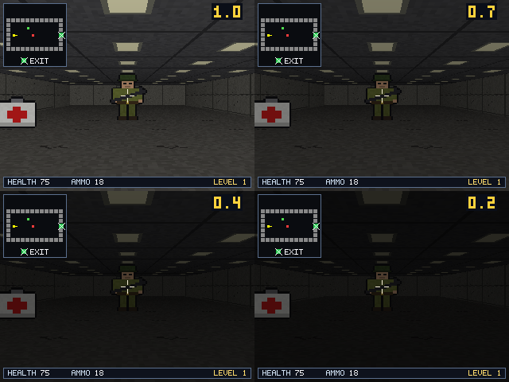

# Content Definitions

Everything the game loads lives under `game/` in the **content root** (the folder found at
startup; see [TROUBLESHOOTING.md](TROUBLESHOOTING.md)). Editing these files changes the game
without recompiling: the next start (or, for a level, the next level load) picks them up.
Test `edited_data_changes_game` proves this for `gameplay.json` and the entity files.

All paths inside the files are relative to the content root and use `/`.

```text
game/
|-- maps/
|   `-- level01.map ... level10.map  level grids (format: MAP_FORMAT.md)
|-- defs/
|   |-- campaign.json             the level list and order                     (required)
|   |-- gameplay.json             player, weapon, enemy type and pickup values (required)
|   |-- level01.entities.json     level 1 entity placements, canonical         (required by the campaign)
|   |-- level01.entities.csv      the same placements as a CSV export          (optional)
|   |-- level02..10.entities.*    the same for levels 2 to 10
|   |-- themes/<id>.cfg           texture themes: bunker, stone, tech, classic
|   |-- sprites.cfg               billboard sprite textures (enemies, corpses, pickups, keys)
|   `-- audio.cfg                 sound effects and master volume
`-- assets/                       .ppm textures and .wav sounds (ASSET_GUIDE.md)
    |-- sprites/                  generated sprites (tools/devkit/gen_sprites.py)
    `-- themes/<id>/              generated theme textures (tools/devkit/gen_textures.py)
```

| File | Read by | When | If it is missing or invalid |
|---|---|---|---|
| `defs/gameplay.json` | `engine/assets/GameplayConfig.cpp` | `Engine::Init`, before the window opens | **Fatal**: error message (and an error box, except with `--frames`), exit code 1 |
| `defs/campaign.json` | `engine/assets/CampaignConfig.cpp` | `Engine::Init`, before the window opens | **Fatal**: error message, exit code 1 |
| `maps/levelNN.map` | `engine/world/MapLoader.cpp` | every level load | The level load fails. For the first level: fatal, exit code 1; later: back to the menu |
| `defs/levelNN.entities.json` | `engine/world/EntityPlacementLoader.cpp` | every level load | The level load fails (as above) |
| `defs/themes/<id>.cfg` | `engine/assets/ContentConfig.cpp` (`LoadThemeTextureAssignments`) | every level load whose theme differs from the current one | Warning; affected textures are drawn as a checkerboard |
| `defs/sprites.cfg` | `engine/assets/ContentConfig.cpp` | `Engine::Init` | Warning; affected sprites are drawn as a checkerboard |
| `defs/audio.cfg` | `engine/assets/AudioConfig.cpp` | `Engine::Init` | Warning; affected sounds are silent |

`--level N` starts **campaign level N** (1-based index into `campaign.json`) directly, skipping
the menu and the unlocked-level check; it is meant for development and tests. A number larger
than the campaign is a startup error (exit code 1). Without `--level` the game starts on the
main menu ([GAMEPLAY.md](GAMEPLAY.md)).

Every loader accepts LF and CRLF line endings. The JSON loaders and the entity CSV loader also
skip a UTF-8 byte order mark.

---

## 1. `gameplay.json`

The numbers that define how the game plays. It is parsed with
[nlohmann/json](../third_party/README.md), section by section, so the same key name in two
sections (`damage`, `moveSpeed`, `health`) gives two independent values.

```json
{
  "player":  { "initialHealth": 100, "maxHealth": 100, "moveSpeed": 3.0, "turnSpeed": 1.8, "collisionRadius": 0.22 },
  "weapon":  { "damage": 35, "fireRate": 0.25, "range": 12.0, "initialAmmo": 24, "maxAmmo": 99, "noiseRadius": 10.0 },
  "enemies": {
    "guard":  { "health": 50,  "damage": 12, "moveSpeed": 1.6, "alertRadius": 6.5, "attackRadius": 1.1, "attackRate": 1.0, "reactionTime": 0.5, "score": 100 },
    "brute":  { "health": 140, "damage": 25, "moveSpeed": 1.0, "alertRadius": 5.5, "attackRadius": 1.3, "attackRate": 1.6, "reactionTime": 0.8, "score": 300 },
    "runner": { "health": 25,  "damage": 6,  "moveSpeed": 2.8, "alertRadius": 8.0, "attackRadius": 1.0, "attackRate": 0.6, "reactionTime": 0.2, "score": 150 }
  },
  "pickups": { "health": { "value": 25 }, "ammo": { "value": 12 } }
}
```

(The shipped file has the same values, one key per line.)

### Keys

Every key and every section is optional. A missing key uses the **default** below; the
defaults equal the shipped values and are defined once, in
`engine/world/GameplayDefinitions.h`. "Integer" means a JSON number without a fraction or
exponent (`35`, not `35.0`); "number" accepts both. Units: distances and speeds are in map
cells (one cell = one map character), turn speed in radians per second, times in seconds.

| Key | Type | Range | Default | Applied in |
|---|---|---|---|---|
| `player.initialHealth` | integer | 1–10000, ≤ `player.maxHealth` | 100 | Health for New Game, Continue, Level Select and `--level` (later levels inherit the previous level's health: [GAMEPLAY.md](GAMEPLAY.md#health-and-ammo-between-levels)), and for every level loaded by path through the C API (`Engine::LoadLevel`) |
| `player.maxHealth` | integer | 1–10000 | 100 | Cap for health pickups, the command bridge's `HealPlayer` and the health carried to the next level (`UpdateEntityInteractions`, `CommandBridge`, `GameFlow`) |
| `player.moveSpeed` | number | > 0, ≤ 20 (cells/s) | 3.0 | Walking and strafing speed (`Player::moveSpeed`, set by `BuildLevelFromPlacements`) |
| `player.turnSpeed` | number | > 0, ≤ 20 (rad/s) | 1.8 | Turning speed (`Player::turnSpeedRadians`) |
| `player.collisionRadius` | number | > 0, < 0.5 (cells) | 0.22 | Player collision with walls and closed doors (`MoveWithSliding`); a door does not close while the player overlaps its cell |
| `weapon.damage` | integer | 1–10000 | 35 | Health removed from an enemy per hit (`Engine::PlayerAttack` → `PerformPlayerAttack`); shown in "Hit enemy! (-N HP)" |
| `weapon.fireRate` | number | 0–60 (s) | 0.25 | **Seconds between two shots** (a cooldown, not shots per second) |
| `weapon.range` | number | > 0, ≤ 1000 (cells) | 12.0 | Maximum hitscan distance; a wall stops the shot earlier |
| `weapon.initialAmmo` | integer | 0–10000, ≤ `weapon.maxAmmo` | 24 | Ammo for New Game, Continue, Level Select and `--level` (later levels inherit the previous level's ammo), and for levels loaded by path |
| `weapon.maxAmmo` | integer | 0–10000 | 99 | Cap for ammo pickups, the command bridge's `AddAmmo` and the ammo carried to the next level |
| `weapon.noiseRadius` | number | 0–1000 (cells) | 10.0 | Enemies hear a shot when the path from the shooter to them through open cells is at most this long; closed doors block sound ([GAMEPLAY.md](GAMEPLAY.md#enemy-ai)) |
| `enemies.<type>.health` | integer | 1–10000 | guard 50, brute 140, runner 25 | Health (and maximum health) of every enemy of that type (`ApplyEnemyArchetype`) |
| `enemies.<type>.damage` | integer | 0–10000 | 12, 25, 6 | Health removed from the player per attack (`UpdateEnemyAi`); shown in "UNDER ATTACK! (-N HP)" |
| `enemies.<type>.moveSpeed` | number | 0–20 (cells/s) | 1.6, 1.0, 2.8 | Chase speed (0 = the enemy never moves) |
| `enemies.<type>.alertRadius` | number | 0–1000 (cells) | 6.5, 5.5, 8.0 | An idle enemy notices the player within this distance **with line of sight**; once alerted it sees up to twice as far |
| `enemies.<type>.attackRadius` | number | 0–1000 (cells) | 1.1, 1.3, 1.0 | The enemy attacks when the player is this close and in sight |
| `enemies.<type>.attackRate` | number | > 0, ≤ 60 (s) | 1.0, 1.6, 0.6 | **Seconds between two attacks** of one enemy |
| `enemies.<type>.reactionTime` | number | 0–60 (s) | 0.5, 0.8, 0.2 | Time between noticing the player (Alert) and chasing; the alert sound plays at the end |
| `enemies.<type>.score` | integer | 0–10000 | 100, 300, 150 | Points for a kill; the level's total is logged when the exit switch is used (not shown on screen yet) |
| `pickups.health.value` | integer | 1–10000 | 25 | Health added by a `health` pickup that has no `value` of its own; shown in "HEALTH RESTORED (+N HP)" |
| `pickups.ammo.value` | integer | 1–10000 | 12 | Ammo added by an `ammo` pickup that has no `value` of its own; shown in "AMMO REPLENISHED (+N AMMO)" |

The HUD messages show the pickup's value even when the maximum caps the amount actually added.
The values are logged at startup, for example
`Gameplay definitions loaded from .../game/defs/gameplay.json: player health 100/100, move 3.00, ...`.

Changed in Phase 4: `maxPlayerHealth` (under `pickups.health`) became `player.maxHealth`, and
`maxPlayerAmmo` (under `pickups.ammo`) became `weapon.maxAmmo`. The old keys are reported as
unknown keys, with a hint where they moved. Before Phase 4 the game did not read this file at
all (known issue C2).

### Validation

`gameplay.json` must be valid. Loading **fails**, and the game exits with code 1 before any
window opens, when:

- the file cannot be read, or is not valid JSON (the message has the line and column);
- a key appears twice in the same object (`duplicate key "damage" inside "weapon"`);
- the top level or a section is not an object;
- a value has the wrong type or is out of range
  (`weapon.damage must be an integer from 1 to 10000, got "35"`);
- `player.initialHealth` > `player.maxHealth`, or `weapon.initialAmmo` > `weapon.maxAmmo`;
- both `enemies` and the old `enemy` section are present.

All problems are collected, not only the first. Each message starts with the file path. The
log lists all of them; the error box shows the first three.

**Unknown keys** (a typo, or a key from a newer version) are warnings: they are logged and
ignored, and the game starts. Check the log after editing: for a misspelt key the default is
used.

### Enemy types (`enemies`) and the old `enemy` section

`enemies` has one section per enemy type: `guard`, `brute`, `runner`
([GAMEPLAY.md](GAMEPLAY.md#enemy-types)); each takes the keys above, and every key and section
is optional (missing ones keep the defaults). Another name under `enemies` is an unknown key
(warning). An enemy placement chooses its type with `"variant"`; without one it is a guard.

**Backward compatibility.** Before Phase 6 the file had a single `enemy` section. It is still
read, as `enemies.guard`, with a warning asking to move it (`section "enemy" is deprecated: it
is read as "enemies.guard"`). Having both `enemy` and `enemies` is an error. The shipped file
was migrated to `enemies`. The C++ field `GameplayDefinitions::enemy` became
`GameplayDefinitions::enemies` (with `guard`, `brute`, `runner`).

---

## 2. Entity placements: `<level>.entities.json`

Where the player starts and where the enemies, pickups, doors, the exit and the decorations
are. The JSON file is **canonical**: it is what the game loads. The map's tiles define the
walls; this file defines everything else.

```json
{
  "level": "level01",
  "entities": [
    { "type": "player", "x": 2.5, "y": 2.5, "angle": 0 },
    { "type": "enemy", "x": 6.5, "y": 2.7, "variant": "guard" },
    { "type": "pickup", "x": 11.8, "y": 6.6, "kind": "health" },
    { "type": "door", "x": 8.5, "y": 7.5, "mapX": 8, "mapY": 7 },
    { "type": "trigger", "x": 13.5, "y": 8.5, "mapX": 13, "mapY": 8 },
    { "type": "decoration", "x": 4.2, "y": 8.8 },
    { "type": "pickup", "x": 2.5, "y": 6.5, "kind": "ammo" }
  ]
}
```

A key card and the door it opens (level 2):

```json
    { "type": "pickup", "x": 7.5, "y": 5.3, "kind": "key", "key": "blue" },
    { "type": "door", "x": 9.5, "y": 3.5, "mapX": 9, "mapY": 3, "lock": "blue" }
```

### Top level

| Field | Type | Required | Meaning |
|---|---|---|---|
| `level` | string | no (a non-string is a warning) | The level id, for people and tools. The engine does not use it. |
| `entities` | array of objects | **yes** | The placements, in any order. |
| `lights` | array of objects | no | Light zones: dim or dark areas ([below](#light-zones-lights)). JSON only. |

Other top-level fields are warnings.

### Entity fields

`x`/`y` are world coordinates in map cells: `(0, 0)` is the top-left corner of the map, the
centre of cell `(cx, cy)` is `(cx + 0.5, cy + 0.5)`, x grows to the right and y downwards.

| Field | Type | Applies to | Required | Meaning |
|---|---|---|---|---|
| `type` | string | all | **yes** | `player`, `enemy`, `pickup`, `door`, `trigger` or `decoration` |
| `x`, `y` | number | all | **yes** | Position. Must lie inside the map (checked when the level is built). |
| `mapX`, `mapY` | integer ≥ 0 | `door`, `trigger` | **yes**, for those two | The map cell the entity controls; must lie inside the map |
| `angle` | number (degrees) | `player` | no (default 0) | Initial view direction: 0 = +x (right on the map), 90 = +y (down on the map) |
| `kind` | `"health"`, `"ammo"` or `"key"` | `pickup` | **yes**, for pickups | What the pickup gives |
| `value` | integer 1–10000 | `pickup` (health, ammo) | no | Amount restored; default `pickups.<kind>.value` from `gameplay.json`. Ignored (warning) on a key |
| `key` | `"red"`, `"blue"` or `"gold"` | `pickup` of kind `key` | **yes**, for key pickups | Which key card it is |
| `lock` | `"red"`, `"blue"` or `"gold"` | `door` | no (default: unlocked) | The key needed to open the door ([GAMEPLAY.md](GAMEPLAY.md#keys-and-locked-doors)) |
| `variant` | `"guard"`, `"brute"` or `"runner"` | `enemy` | no (default `"guard"`) | The enemy type: its stats come from `gameplay.json` `enemies.<variant>`. Any other value is an **error** (the level does not load) |

A field that does not apply to the entity's type (e.g. `kind` on an enemy), and an unknown
field, are warnings: logged and ignored.

### What each type becomes

`BuildLevelFromPlacements` (`engine/world/LevelBuilder.cpp`) turns the placements into the
level:

| Type | Becomes | Behaviour |
|---|---|---|
| `player` | The camera and an invisible `Player` entity | Exactly **one** per level (none or several is an error). Speeds and radius from `gameplay.json`. |
| `enemy` | `Enemy` entity + the sprite of its type | Stats from `gameplay.json` `enemies.<variant>`. Sees, hears, chases and attacks the player ([GAMEPLAY.md](GAMEPLAY.md#enemy-ai)); can be shot; when killed it stays as a corpse sprite that blocks nothing. |
| `pickup` | `Pickup` entity + a sprite per kind (health, ammo, each key colour) | Collected by walking within 0.6 cells of `x`/`y`. A key adds its colour to the keys held in this level. |
| `door` | `Door` entity; the map cell `(mapX, mapY)` becomes a closed door, drawn with the theme's locked-door texture when it has a `lock` | The interact key (`E`) within 1.05 cells of `x`/`y` opens or closes it instantly; a locked door opens only with its key. It does not close while the player or a living enemy overlaps the cell. |
| `trigger` | `Trigger` entity; the cell `(mapX, mapY)` becomes a `T` tile | Walking within 0.8 cells of `x`/`y` shows `CHECKPOINT REACHED` and sends the `TriggerActivated` interop event, once. It does **not** end the level (since Phase 5); the exit switch, an `X` map tile, does ([MAP_FORMAT.md](MAP_FORMAT.md)). |
| `decoration` | `Decoration` entity + decoration sprite | Nothing: not solid, not collectable, no interaction. Its sprite stays visible. |

Entity ids are assigned in file order, starting at 1. The C API reports the entity type as a
number: `Player` 0, `Enemy` 1, `Pickup` 2, `Door` 3, `Trigger` 4, `Decoration` 5.

### Validation

The level load **fails**, and the current level (if any) stays as it was, when:

- the file is missing or unreadable, or its extension is neither `.json` nor `.csv`;
- the JSON is invalid, a key repeats in one object, or `entities` is missing or not an array;
- an entity is not an object, has no or an unknown `type`, lacks `x`/`y` or has a non-number
  there, is a pickup without a valid `kind` (or a key pickup without a valid `key`), is a
  door/trigger without `mapX`/`mapY`, has a `lock` or `variant` that is not one of the listed
  values, or has a value of the wrong type or range;
- there is not exactly one player, or a position or a door/trigger cell lies outside the map;
- `lights` is not an array, or a light zone is invalid or not fully inside the map
  ([Light zones](#light-zones-lights)).

If the first level fails to load, startup fails (error message, exit code 1). There is **no
built-in fallback layout** any more (it hid known issue C1).

Every message names the file, the entity and the field, for example:

```text
.../level01.entities.json: entities[2] (pickup): field "kind" is required ("health" or "ammo")
.../level01.entities.json: entities[4] (door): map cell (20, 6) is outside the 20x13 map
.../level01.entities.csv:5 (entity 3) (door): fields "mapX" and "mapY" are required (...)
.../level03.entities.json: entities[7] (enemy): field "variant" must be "guard", "brute" or "runner", got "ninja"
.../level02.entities.json: entities[6] (pickup): field "key" must be "red", "blue" or "gold", got "green"
```

The engine does not check that a locked door's key exists in the level or can be reached;
`validate --strict` does (below).

### Light zones (`lights`)

Every map cell has a light level from 0 to 1 that darkens the walls, floor, ceiling, sprites
and particles drawn there (`Map::GetLightLevel`). A level sets it with an optional top-level
`lights` array of cell rectangles (known issue C21, resolved in Phase 8):

```json
{
  "level": "level05",
  "entities": [ ... ],
  "lights": [
    { "x": 3, "y": 12, "w": 7, "h": 6, "level": 0.5 },
    { "x": 5, "y": 14, "w": 3, "h": 2, "level": 0.35 }
  ]
}
```

| Field | Type | Required | Meaning |
|---|---|---|---|
| `x`, `y` | integer ≥ 0 | **yes** | The top-left cell of the rectangle (map cells, as `mapX`/`mapY`) |
| `w`, `h` | integer ≥ 1 | **yes** | Width and height in cells. The rectangle must lie **fully inside the map** (checked when the level is built) |
| `level` | number from **0.2 to 1.0** | **yes** | The light level of the cells: 1.0 full light, 0.5 dim, 0.35 dark, 0.2 the darkest allowed |

- Zones are applied **in file order**: where two overlap, the later one wins. Cells that no zone
  covers keep **1.0**. So a dark room with a dimmer corner is one zone for the room, then one
  for the corner.
- A **wall face** is lit like the floor cell in front of it (the one the viewer looks from),
  so a zone only needs to cover the floor cells of an area: a wall between a lit room and a
  dark room is lit on one side and dark on the other. The light of solid cells does not matter.
- What the levels look like: the renderer never draws anything darker than a minimum (walls
  0.18, floor and ceiling 0.20, **sprites 0.35**, after distance shading), so an enemy in a
  0.2 zone is still clearly visible. The HUD, the minimap and the menus are never darkened.
  Below about 0.4 the difference shows mostly close to the player. Comparison (1.0, 0.7, 0.4
  and 0.2, a guard four cells away; the same room, `--preview minimap`):

  
- **Light changes the picture only.** Enemy sight and hearing, the autoplay bot and every rule
  of the game ignore it: an enemy in a dark zone sees the player exactly as in the light, and
  the bot plays a dark level like a lit one. This is a deliberate v1 simplification (fair and
  predictable; `validate` and the bot prove levels without modelling light).
- A zone outside the range, with a missing or non-integer field, or not an object, is an
  **error** (the level does not load); an unknown field in a zone is a warning:

```text
.../level05.entities.json: lights[1]: field "level" must be a number from 0.2 to 1.0, got 0.1
.../level05.entities.json: lights[0]: field "w" must be an integer from 1 to 100000, got 0
.../level05.entities.json: lights[2]: cells (26, 3) to (29, 5) are not all inside the 28x24 map
```

`validate` checks the same rules (and the bounds against the level's map), and `inspect-map`
lists a level's zones. How to design dark areas fairly:
[LEVEL_AUTHORING.md](LEVEL_AUTHORING.md#dark-and-dim-areas-light-zones).

### The CSV export: `<level>.entities.csv`

A table in the pre-Phase 4 format, kept for backward compatibility. The engine reads a CSV when
the entity path ends in `.csv` (e.g. through the C API `nw_engine_load_level`), with the same
rules and messages as for JSON. The game itself always loads the `.json` file.

```text
# type,x,y,mapX,mapY,kind,value,angle,variant,key,lock
player,2.5,2.5,,,,,0
enemy,6.5,2.7,,,,,,guard
pickup,11.8,6.6,,,health
door,8.5,7.5,8,7
pickup,7.5,5.3,,,key,,,,blue
door,9.5,3.5,9,3,,,,,,blue
```

- Columns, in order: `type,x,y,mapX,mapY,kind,value,angle,variant,key,lock` (`key` and `lock`
  were appended in Phase 6). At least `type,x,y`; trailing columns may be left out; an empty
  column means "not given".
- Lines starting with `#` (after leading spaces) and blank lines are skipped. Columns after
  the eleventh are ignored with a warning.
- There is no quoting: values cannot contain commas.
- **The CSV is a lossy export: it cannot hold light zones.** A level loaded from its CSV (only
  possible through the C API) is fully lit.

Generate the CSV from the JSON with the DevKit. JSON → CSV is the default direction, and it
overwrites the CSV:

```bash
python3 tools/devkit/devkit.py sync-entities             # every <level>.entities.json -> .csv
python3 tools/devkit/devkit.py sync-entities --from-csv  # the reverse; overwrites the JSON
```

JSON → CSV drops a level's light zones: it prints a `Warning:` line for that level and writes a
`# lights: N light zone(s) in the JSON are not exported` comment line into the CSV (the loaders
skip `#` lines). CSV → JSON keeps the `lights` of the JSON it overwrites; if a JSON exists but
cannot be read, it stops before writing any file and says so (it could not keep that file's
light zones), so fix the JSON or delete it first.

`validate --strict` checks both files with the engine's rules (types, required `kind`,
`mapX`/`mapY` for doors and triggers, value ranges, bounds, exactly one player, `variant`,
`key` and `lock` values). For every campaign level it also checks that each lock colour has a
key of that colour in the level and that the keys can be collected before the doors they open:
a breadth-first search from the spawn treats a locked door as passable only once its key has
been reached, and the exit switch must be reachable at the end. Test
`entity_placements_json_csv` checks that the shipped JSON and CSV are equivalent.

---

## 3. Theme files, `sprites.cfg`, `audio.cfg`

Key/value files: one `key=value` per line; spaces around the key and the value are trimmed;
lines starting with `#` (after leading spaces) and blank lines are skipped. A later duplicate
key replaces an earlier one. Paths are relative to the content root.

A line without `=`, or with an empty key or value, is a syntax error: then **none** of the
file's entries are used (every texture of that file becomes a checkerboard, or every sound is
silent). A missing required key affects only that entry. Problems are logged as warnings and
the game still starts.

### Theme files (`themes/<id>.cfg`)

See [Themes](#themes) below. Ten required keys: `wall` (`#` tiles), `wall_alt_a` (`A`),
`wall_alt_b` (`B`), `door` (closed doors), `door_red`, `door_blue`, `door_gold` (closed doors
locked with that key, Phase 6), `floor`, `ceiling` and `exit` (`X` exit switches).

### `sprites.cfg`

The mapping from the engine's sprite slots to files. Twelve required keys (Phase 6):

| Key | Drawn for | File (generated by `tools/devkit/gen_sprites.py`) |
|---|---|---|
| `guard`, `brute`, `runner` | living enemies of that type | `game/assets/sprites/<key>.ppm` |
| `guard_dead`, `brute_dead`, `runner_dead` | their corpses | `game/assets/sprites/<key>.ppm` |
| `health`, `ammo` | pickups | `game/assets/sprites/<key>.ppm` |
| `key_red`, `key_blue`, `key_gold` | key cards | `game/assets/sprites/<key>.ppm` |
| `decoration` | decorations | `game/assets/sprite_decor.ppm` (hand-made, pre-Phase 6) |

```ini
guard=game/assets/sprites/guard.ppm
brute=game/assets/sprites/brute.ppm
runner=game/assets/sprites/runner.ppm
guard_dead=game/assets/sprites/guard_dead.ppm
brute_dead=game/assets/sprites/brute_dead.ppm
runner_dead=game/assets/sprites/runner_dead.ppm
health=game/assets/sprites/health.ppm
ammo=game/assets/sprites/ammo.ppm
key_red=game/assets/sprites/key_red.ppm
key_blue=game/assets/sprites/key_blue.ppm
key_gold=game/assets/sprites/key_gold.ppm
decoration=game/assets/sprite_decor.ppm
```

A missing key or file draws that sprite as the checkerboard (warning). The pre-Phase 6 keys
`enemy` and `pickup` were renamed to `guard` and `health`; the engine ignores them with a
warning that names the new key, and `validate` reports them as errors. Transparency and sizes:
[ASSET_GUIDE.md](ASSET_GUIDE.md#5-sprites).

### `audio.cfg`

Required: `door_open`, `pickup`, `enemy_alert`. Optional: `weapon_fire`, and `master_volume`
(a number, clamped to 0.0–1.0; default 0.85). If a required key is missing or `master_volume`
is not a number, the master volume is not applied, but the sounds that are named still load.
Without an audio device no sound is loaded.

```ini
master_volume=0.85
door_open=game/assets/sfx_door_open.wav
pickup=game/assets/sfx_pickup.wav
enemy_alert=game/assets/sfx_enemy_alert.wav
weapon_fire=game/assets/sfx_weapon_fire.wav
```

---

## Removed in Phase 4

`textures.json`, `sprites.json` and `entities.json` were deleted (known issue C5). No part of
the engine read them. `textures.json` and `sprites.json` duplicated the `.cfg` files above.
`entities.json` was a level registry with its own copy of the player spawn; only the DevKit
used it (`validate` checked that its paths existed, `doctor` listed it as a required file).
Those two checks were removed, and `doctor` then required `gameplay.json` and
`level01.entities.json` instead (since Phase 7 it checks `campaign.json`, `gameplay.json` and
the whole content through `validate`: [DEVKIT_GUIDE.md](DEVKIT_GUIDE.md#doctor--can-this-machine-build-and-run-neo-wolf)).
The level list returned in Phase 5 as `game/defs/campaign.json` (below), which the engine reads.

## Changed in Phase 6

- `gameplay.json`: the `enemy` section became `enemies.guard` (the old section is still read,
  with a warning), with new `enemies.brute` and `enemies.runner`, new keys `reactionTime` and
  `score`, and `weapon.noiseRadius`.
- Entity placements: `variant` is now checked (`guard`, `brute`, `runner`); new pickup kind
  `key` with the field `key`; new door field `lock`. The CSV export gained the columns `key`
  and `lock`.
- `sprites.cfg`: twelve keys instead of three (`enemy` → `guard`, `pickup` → `health`).
  `game/assets/sprite_enemy.ppm` and `sprite_pickup.ppm` were deleted; their replacements are
  generated into `game/assets/sprites/`.
- Theme files: three new required keys `door_red`, `door_blue`, `door_gold`.

## Changed in Phase 5

`game/defs/wall_textures.cfg` was migrated to `game/defs/themes/classic.cfg` (same keys plus
`exit`); the loader is shared by every theme (`LoadThemeTextureAssignments`, formerly
`LoadWallTextureAssignments`). `--level N` now selects a campaign entry instead of building
the file names `levelNN.map` / `levelNN.entities.json`.

---

## Campaign

`game/defs/campaign.json` lists the levels in play order. It is loaded by
`engine/assets/CampaignConfig.cpp` in `Engine::Init` and validated like `gameplay.json`:
any problem is fatal (exit code 1), every problem is logged, and the error box shows the first
three. Test `campaign_manifest_validation`; the DevKit's `validate` checks it too.

```json
{
  "title": "Operation Neo-Wolf",
  "levels": [
    { "id": "level01", "name": "Outpost Gate", "map": "game/maps/level01.map",
      "entities": "game/defs/level01.entities.json", "theme": "bunker" }
  ]
}
```

| Field | Type | Rules |
|---|---|---|
| `title` | non-empty string | Shown on the menu, level select and credits |
| `levels` | array of objects | At least one |
| `levels[].id` | non-empty string | `a-z`, `0-9`, `_`, `-`; unique |
| `levels[].name` | non-empty string | Shown in the HUD, level select, pause, game-over and level-complete screens |
| `levels[].map` | content-relative path | The file must exist |
| `levels[].entities` | content-relative path | The file must exist (`.json`, or a `.csv` export) |
| `levels[].theme` | theme id | `a-z`, `0-9`, `_`, `-`; `game/defs/themes/<theme>.cfg` must exist |

Errors: the file cannot be read; invalid JSON or a repeated key; a missing or mistyped field;
an empty `levels`; a repeated or malformed id; a missing map, entity or theme file. Unknown keys
are warnings. A title or name longer than 32 characters is a warning and is shortened on
screen. The shipped campaign has its final 10 levels (ids `level01` to `level10`, names and
themes from the Phase 8 design, [levels/README.md](levels/README.md)), all built in Phase 8
(one page per level in `docs/levels/`). CTest
`content_validation_campaign_size` requires exactly 10 (`validate --strict --require-levels 10`).

Every campaign level must contain at least one exit switch (`X`) that the player can reach
(DevKit rule, [MAP_FORMAT.md](MAP_FORMAT.md#devkit-rules-stricter-than-the-engine)).

## Themes

A theme gives a level its look: `game/defs/themes/<id>.cfg`, in the key/value format above,
with the ten keys `wall`, `wall_alt_a`, `wall_alt_b`, `door`, `door_red`, `door_blue`,
`door_gold`, `floor`, `ceiling`, `exit`.

```ini
wall=game/assets/themes/bunker/wall.ppm
wall_alt_a=game/assets/themes/bunker/wall_alt_a.ppm
wall_alt_b=game/assets/themes/bunker/wall_alt_b.ppm
door=game/assets/themes/bunker/door.ppm
door_red=game/assets/themes/bunker/door_red.ppm
door_blue=game/assets/themes/bunker/door_blue.ppm
door_gold=game/assets/themes/bunker/door_gold.ppm
floor=game/assets/themes/bunker/floor.ppm
ceiling=game/assets/themes/bunker/ceiling.ppm
exit=game/assets/themes/bunker/exit.ppm
```

| Theme | Textures | Used by |
|---|---|---|
| `bunker` | concrete, olive steel, hazard stripes, blast door (generated, 32×32) | level01, level04, level07 |
| `stone` | stone bricks, moss, granite, wooden door (generated, 32×32) | level02, level05, level09 |
| `tech` | blue panels, circuits, server racks, sliding door (generated, 32×32) | level03, level06, level08 |
| `classic` | castle: blue-grey stone blocks, oak panelling, a red banner, a riveted steel door (generated, 32×32; replaced the original 8×8 textures in Phase 8) | level10 |

Each full theme's locked doors are its own door with a band in the lock's colour (see
[ASSET_GUIDE.md](ASSET_GUIDE.md#4-texture-themes)).

When a level with a different theme loads, `Engine::ApplyTheme` reads the theme file, loads
all ten textures first and then replaces them in the asset manager; a texture that fails
becomes the checkerboard (warning in the log). The engine's cached texture pointers stay valid
(the asset manager keeps each texture in a stable map node) and are refreshed after every swap.
Sprites (`sprites.cfg`) are shared by all themes. Test `theme_loading_and_swap`.

The generated textures come from `tools/devkit/gen_textures.py` ([ASSET_GUIDE.md](ASSET_GUIDE.md#4-texture-themes)).
