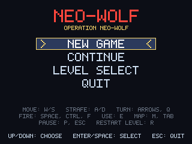
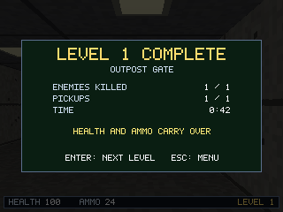
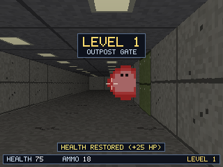
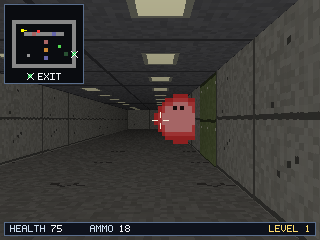
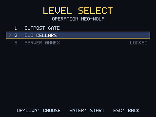

# Gameplay: campaign, states and rules

How a game of Neo-Wolf flows from the main menu through the campaign to the credits. The
rules live in SDL-free code: `engine/core/GameFlow.{h,cpp}` (states, menus, progression,
carry-over) and `engine/world/InteractionRules.cpp` (exit switch, triggers, doors, pickups).
Every transition below is covered by the native tests `game_flow_menu`,
`game_flow_progression` and `game_flow_death_pause`; `campaign_playthrough` plays the whole
campaign through the real engine with simulated input. Keys per screen: [CONTROLS.md](CONTROLS.md).



## The campaign

The levels and their order come from `game/defs/campaign.json`
([CONTENT_DEFINITIONS.md](CONTENT_DEFINITIONS.md#campaign)). The campaign has three levels for
now:

| # | Id | Name | Theme | Status |
|---|---|---|---|---|
| 1 | `level01` | Outpost Gate | `bunker` | The original level, now with an exit switch |
| 2 | `level02` | Old Cellars | `stone` | **Placeholder**: a short level that only exercises progression |
| 3 | `level03` | Server Annex | `tech` | **Placeholder**: a short level that only exercises progression |

Roadmap Phase 8 replaces level 1 with a tutorial and the two placeholders with real levels
(10 in total).

## States and transitions

`GameState` (`engine/core/GameState.h`) has these values: `Menu` (0), `Gameplay` (1),
`Paused` (2), `GameOver` (3), `Victory` (4, deprecated, never entered), `LevelComplete` (5) and
`CampaignComplete` (6). The numbers are part of the C API.

```text
            +-------------------------------------------------------+
  start --> |                        Menu                           |
            |  main page:   New Game | Continue | Level Select | Quit --> exit
            |  level select: the unlocked levels                    |
            +-------------------------------------------------------+
                 | start a level              ^
                 v                            | Q (paused), Esc (game over, level complete),
                                              | Enter / Esc (campaign complete)
   R: restart +----------+  P / Esc / focus lost  +--------+
   +--------->| Gameplay |----------------------->| Paused |  R: restart
   |          |          |<-----------------------|        |
   |          +----------+   Esc / P / Enter      +--------+
   |            |      |
   | player dies|      | exit switch (E)
   |            v      v
   |   +----------+  +---------------+  Enter, more levels: next level
   +---| GameOver |  | LevelComplete |---------------------------------> Gameplay
 R or  +----------+  +---------------+
 Enter                       | Enter, last level
                             v
                    +------------------+
                    | CampaignComplete |  (credits)
                    +------------------+
```

| From | Input or event | To | What happens |
|---|---|---|---|
| Menu (main) | Up/Down (`W`/`S`, arrows) | Menu | Moves the highlight (wraps around) |
| Menu (main) | Enter/Space on **New Game** | Gameplay | Level 1 is loaded from its files (a full reset of the world: known issue C7) with the `gameplay.json` initial health and ammo |
| Menu (main) | Enter/Space on **Continue** | Gameplay | The highest unlocked level, with the initial health and ammo (see below). Only shown when saved progress exists |
| Menu (main) | Enter/Space on **Level Select** | Menu (level select) | Lists every level by number and name; locked ones are dimmed **and** marked `LOCKED` |
| Menu (main) | Enter/Space on **Quit**, or Esc | (exit) | The game closes (exit code 0) |
| Menu (level select) | Enter/Space on an unlocked level | Gameplay | That level, with the initial health and ammo. Locked levels do nothing |
| Menu (level select) | Esc | Menu (main) | |
| Gameplay | `P` or Esc, or the window loses focus | Paused | |
| Gameplay | `R` | Gameplay | The level restarts with its level-entry health and ammo |
| Gameplay | `E` facing an exit switch in reach | LevelComplete | Progress is saved; health and ammo are remembered for the next level |
| Gameplay | health reaches 0 | GameOver | |
| Paused | Esc, `P` or Enter | Gameplay | |
| Paused | `R` | Gameplay | Restart with the level-entry health and ammo |
| Paused | `Q` | Menu (main) | |
| GameOver | `R` or Enter | Gameplay | Restart with the level-entry health and ammo |
| GameOver | Esc | Menu (main) | |
| LevelComplete | Enter | Gameplay | The next level, with the carried health and ammo |
| LevelComplete (last level) | Enter | CampaignComplete | Credits screen |
| LevelComplete | Esc | Menu (main) | Progress is already saved |
| CampaignComplete | Enter or Esc | Menu (main) | Continue is offered from now on |

`--level N` (development and tests) skips the menu: it starts campaign level N directly in
Gameplay with the initial health and ammo and ignores the unlock state. Completing a level
started that way still unlocks the next one in the save.

## Winning and losing a level

- **Win:** walk up to an **exit switch** (an `X` tile: a wall with an "EXIT" panel and a lever)
  and press `E`. The switch must be within **1.1 cells** of the player (player centre to the
  switch face) and roughly in front: one of five rays fanned up to about **20°** either side of
  the view direction must hit it, and walls block those rays. A switch behind you, beside you,
  behind a wall or further away does nothing. If the same `E` press toggles a door, the switch
  is not used in that frame. Constants: `kExitReach`, `kExitFacingHalfAngle`
  (`engine/world/InteractionRules.h`); test `exit_switch_activation`.
- **Lose:** health reaches 0 (enemy attacks). The game-over screen offers a restart.
- The level-complete screen shows the level name, enemies killed / total, pickups collected /
  total, and the time spent in play on that level (pauses and menus do not count).



## Triggers

A `T` tile with a `trigger` entity is a walk-over marker. Stepping within 0.8 cells of the
trigger entity shows `CHECKPOINT REACHED` in the HUD and sends the `TriggerActivated` interop
event, once. **It no longer ends the level** (before Phase 5 it did); only the exit switch does.

## Health and ammo between levels

- **New Game, Continue and Level Select** start with `player.initialHealth` and
  `weapon.initialAmmo` from `gameplay.json`.
- **Next level:** the health and ammo you had when you used the exit switch carry over,
  clamped to `player.maxHealth` and `weapon.maxAmmo` (health is at least 1).
- **Death or restart:** the level restarts with the health and ammo you had **when you
  entered it** (the level-entry snapshot), not the initial values and not what you had when
  you died.
- **Continue** starts the highest unlocked level with the initial values, not with what you
  had when you last played. The save holds only which levels are unlocked (see below), so
  there is no remembered health or ammo to restore; starting fresh keeps Continue predictable.

## Saves

- Progress is saved to `progress.json` in the per-user folder (the same folder as the log;
  [TROUBLESHOOTING.md](TROUBLESHOOTING.md#saved-progress)) every time a level is completed.
- The file holds a schema version and the highest unlocked level:

  ```json
  { "version": 1, "highestUnlocked": 2 }
  ```

- It is written atomically: first `progress.json.tmp`, then renamed over `progress.json`, so a
  crash while saving keeps the previous file.
- A missing file means no progress (first start). A corrupt file, an unknown version or an
  out-of-range value is ignored with a warning in the log, and the game starts without
  progress (no Continue, only level 1 unlocked). A saved level beyond the campaign is clamped.
- Level 1 is always unlocked. Completing level N unlocks level N+1. New Game does not erase
  the save.
- `--pref-dir <dir>` or the `NEOWOLF_PREF_DIR` environment variable moves the log and the save
  to another folder; all automated runs use a temporary folder (known issue B15).
- Through the C API (`nw_engine_init`) no per-user folder is set, so progress is neither
  loaded nor saved.

## Pausing

The game pauses when you press `P` or Esc, and by itself when its window loses focus. The world
stands still; the HUD stays visible behind the pause panel.


## HUD and minimap

- The bottom bar shows health (red at 25 or less), ammo (red at 0) and the level number. The
  space between the ammo counter and the level number is kept free for key-card icons
  (Roadmap Phase 6).
- At the start of a level a banner shows the level number and name for 3 seconds.
- Messages (pickups, hits, checkpoints) appear above the bar.
- `M` or `Tab` toggles the minimap (off by default). It sits in a square panel of a third of
  the screen height in the top-left corner. Small maps are scaled to fill it; maps too big for
  3 pixels per cell are drawn at 3 pixels per cell, centred on the player. The exit switch is a
  green cell with a white **X cross** over it (a shape, not only a colour), and a legend under
  the map repeats the symbol when there is room.
- `F3` toggles a debug overlay (frame rate, position, angle, cell).

 

## Texture themes

Each campaign level names a texture theme (`bunker`, `stone`, `tech`, or `classic`, the
original textures). The walls, doors, floor, ceiling and the exit switch change when a level
with a different theme loads. See [CONTENT_DEFINITIONS.md](CONTENT_DEFINITIONS.md#themes) and
[ASSET_GUIDE.md](ASSET_GUIDE.md#4-texture-themes).

## Screens

All screens are drawn for the 320×240 framebuffer with a 4-pixel margin (test
`ui_layout_bounds`). Reference images, produced with `--preview <screen> --frames 5
--screenshot <file>` ([TESTING.md](TESTING.md#screen-previews)):

| Menu | Level select | Pause |
|---|---|---|
|  |  |  |
| **Level complete** | **Game over** | **Campaign complete** |
|  |  |  |
