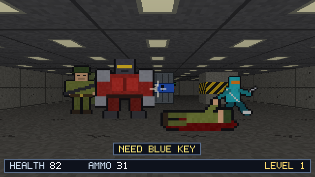
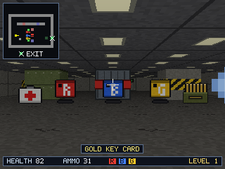
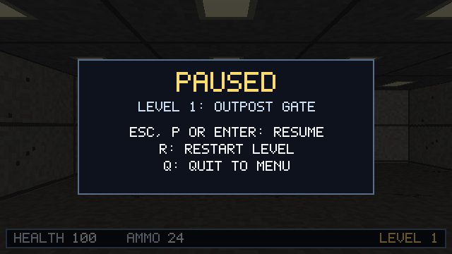
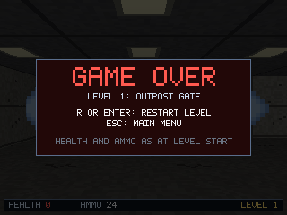
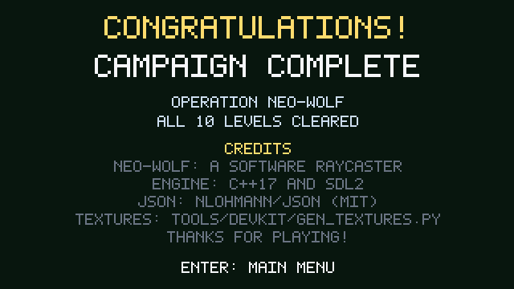

# Gameplay: campaign, states and rules

How a game of Neo-Wolf flows from the main menu through the campaign to the credits. The
rules live in SDL-free code: `engine/core/GameFlow.{h,cpp}` (states, menus, progression,
carry-over), `engine/world/InteractionRules.cpp` (exit switch, triggers, doors, keys, pickups)
and `engine/world/EnemyAi.cpp` with `engine/world/Navigation.cpp` (enemy AI, line of sight,
path finding).
Every transition below is covered by the native tests `game_flow_menu`,
`game_flow_progression`, `game_flow_death_pause` and `game_flow_test_level`;
`campaign_playthrough` plays the whole campaign through the real engine with simulated input,
and `test_level` checks the Test Chamber in the real engine. Keys per screen: [CONTROLS.md](CONTROLS.md).


## The campaign

The levels and their order come from `game/defs/campaign.json`
([CONTENT_DEFINITIONS.md](CONTENT_DEFINITIONS.md#campaign)). The campaign has its final ten
levels (Roadmap Phase 8, built and integrated); the design, difficulty curve, resource economy
and the autoplay bot's measured results are in [levels/README.md](levels/README.md), and each
level has its own page:

| # | Id | Name | Theme | Enemies G/B/R | Keys | New idea |
|---|---|---|---|---|---|---|
| 1 | [`level01`](levels/level01.md) | Outpost Gate | `bunker` | 2/0/0 | – | Tutorial: move, pick up, shoot, open a door (`E`), use the exit switch |
| 2 | [`level02`](levels/level02.md) | Old Cellars | `stone` | 4/0/0 | blue | Key cards: meet the locked door first, then fetch its key |
| 3 | [`level03`](levels/level03.md) | Server Annex | `tech` | 6/0/0 | red | Gunfire is heard (closed doors block it); a ring corridor; the first checkpoint |
| 4 | [`level04`](levels/level04.md) | Motor Pool | `bunker` | 6/1/0 | gold | The brute, first seen across an open garage |
| 5 | [`level05`](levels/level05.md) | Catacombs | `stone` | 6/1/4 | red, blue | Runners; two keys in sequence; a branching route; a dim crypt |
| 6 | [`level06`](levels/level06.md) | Relay Station | `tech` | 8/2/4 | blue, gold | Ambush rooms behind closed doors; an optional duct loop |
| 7 | [`level07`](levels/level07.md) | Blackout Barracks | `bunker` | 8/2/6 | red, gold (either order) | Dark wings; two keys in parallel |
| 8 | [`level08`](levels/level08.md) | Reactor Spine | `tech` | 10/3/6 | blue → red → gold | Three keys in a chain; mixed squads along a spine |
| 9 | [`level09`](levels/level09.md) | Sunken Archive | `stone` | 12/4/8 | red, blue (either order), gold | A non-linear hub with three wings; an optional sealed vault |
| 10 | [`level10`](levels/level10.md) | Wolf's Den | `classic` | 12/5/8 | red → blue → gold | Finale: a gauntlet of the earlier ideas, a supply room with a checkpoint, a throne-room arena |

## The Test Chamber

During the 1.5 development the game opens straight into the **Test Chamber**
([levels/testchamber.md](levels/testchamber.md)): a development level **outside the campaign**
with one signposted area per thing to test, reachable from a central hub (enemy gallery,
pickups row, lock test, props row, weapon range, dark room). Walking into an area's entrance
shows its name on the HUD, once per start of the level (signs are triggers, which fire once; a
restart shows them again). It is set up in `campaign.json` (`"testLevel"`, and
`"bootIntoTestLevel": true` for starting in it; [CONTENT_DEFINITIONS.md](CONTENT_DEFINITIONS.md#test-level)).

- It starts with the initial health and ammo of `gameplay.json` and no keys, every time.
- The HUD shows `TEST CHAMBER` instead of `LEVEL N`, and the start banner says that progress is
  not saved.
- **The exit switch restarts it** (a quick way to reset everything: enemies, doors, pickups,
  signs); the HUD then says `EXIT SWITCH: TEST CHAMBER RESTARTED`. Restarting is clearer than leaving: the Test Chamber is where development happens, and the
  main menu is one key press away (below).
- Dying shows the game-over screen as in any level: `R` or `Enter` restarts the Test Chamber,
  `Esc` goes to the main menu. `R` during play restarts it too.
- `P` or `Esc` pauses as in any level; on the pause panel `Q` quits to the main menu.
- **To play the campaign:** `Esc`, `Q`, then **New Game** (or **Continue**) on the main menu.
  The main menu's **TEST CHAMBER** item comes back.
- It never changes saved progress: nothing is unlocked or saved, it is not in Level Select,
  and the campaign plays exactly as without it.
- `--level N` still starts campaign level N, and `--preview` still shows its screen.

## States and transitions

`GameState` (`engine/core/GameState.h`) has these values: `Menu` (0), `Gameplay` (1),
`Paused` (2), `GameOver` (3), `Victory` (4, deprecated, never entered), `LevelComplete` (5) and
`CampaignComplete` (6). The numbers are part of the in-process C API ([C_API.md](C_API.md#gamestate)).

```text
            +-------------------------------------------------------+
  start --> |                        Menu                           |
            |  main page:   New Game | Continue | Level Select | Quit --> exit
            |  level select: the unlocked levels                    |
            +-------------------------------------------------------+
                 | start a level              ^
                 v                            | Q (paused), Esc (game over, level complete),
                                              | Enter / Esc (campaign complete)
   R: restart +----------+  P / Esc / focus lost  +--------+
   +--------->| Gameplay |----------------------->| Paused |  R: restart
   |          |          |<-----------------------|        |
   |          +----------+   Esc / P / Enter      +--------+
   |            |      |
   | player dies|      | exit switch (E)
   |            v      v
   |   +----------+  +---------------+  Enter, more levels: next level
   +---| GameOver |  | LevelComplete |---------------------------------> Gameplay
 R or  +----------+  +---------------+
 Enter                       | Enter, last level
                             v
                    +------------------+
                    | CampaignComplete |  (credits)
                    +------------------+
```

| From | Input or event | To | What happens |
|---|---|---|---|
| Menu (main) | Up/Down (`W`/`S`, arrows) | Menu | Moves the highlight (wraps around) |
| Menu (main) | Enter/Space on **New Game** | Gameplay | Level 1 is loaded from its files (a full reset of the world: known issue C7) with the `gameplay.json` initial health and ammo |
| Menu (main) | Enter/Space on **Continue** | Gameplay | The highest unlocked level, with the initial health and ammo (see below). Shown when saved progress exists or a level was completed in this session |
| Menu (main) | Enter/Space on **Level Select** | Menu (level select) | Lists every level by number and name; locked ones are dimmed **and** marked `LOCKED` |
| Menu (main) | Enter/Space on **Test Chamber** | Gameplay | The [Test Chamber](#the-test-chamber) with the initial health and ammo. Shown when `campaign.json` has a `testLevel` |
| Menu (main) | Enter/Space on **Quit**, or Esc | (exit) | The game closes (exit code 0) |
| Menu (level select) | Enter/Space on an unlocked level | Gameplay | That level, with the initial health and ammo. Locked levels do nothing |
| Menu (level select) | Esc | Menu (main) | |
| Gameplay | `P` or Esc, or the window loses focus | Paused | |
| Gameplay | `R` | Gameplay | The level restarts with its level-entry health and ammo |
| Gameplay | `E` facing an exit switch in reach | LevelComplete | Progress is saved; health and ammo are remembered for the next level |
| Gameplay (Test Chamber) | `E` facing its exit switch | Gameplay | The Test Chamber restarts with the initial health and ammo; nothing is saved |
| Gameplay | health reaches 0 | GameOver | |
| Paused | Esc, `P` or Enter | Gameplay | |
| Paused | `R` | Gameplay | Restart with the level-entry health and ammo |
| Paused | `Q` | Menu (main) | |
| GameOver | `R` or Enter | Gameplay | Restart with the level-entry health and ammo |
| GameOver | Esc | Menu (main) | |
| LevelComplete | Enter | Gameplay | The next level, with the carried health and ammo |
| LevelComplete (last level) | Enter | CampaignComplete | Credits screen |
| LevelComplete | Esc | Menu (main) | Progress is already saved |
| CampaignComplete | Enter or Esc | Menu (main) | Continue is offered from now on |

`--level N` (development and tests) skips the menu: it starts campaign level N directly in
Gameplay with the initial health and ammo and ignores the unlock state. Completing a level
started that way still unlocks the next one in the save.

With `"bootIntoTestLevel": true` in `campaign.json` the game starts in Gameplay in the
[Test Chamber](#the-test-chamber) instead of on the main menu (unless `--level` or `--preview`
is given); the main page's items are then New Game, Continue (with progress), Level Select,
Test Chamber and Quit.

## Winning and losing a level

- **Win:** walk up to an **exit switch** (an `X` tile: a wall with an "EXIT" panel and a lever)
  and press `E`. The switch must be within **1.1 cells** of the player (player centre to the
  switch face) and roughly in front: one of five rays fanned up to about **20°** either side of
  the view direction must hit it, and walls block those rays. A switch behind you, beside you,
  behind a wall or further away does nothing. An `E` press that uses the switch is not also
  used on a door within reach (since Phase 6; before, a nearby door took the press and the
  switch did nothing). Constants: `kExitReach`, `kExitFacingHalfAngle`
  (`engine/world/InteractionRules.h`); tests `exit_switch_activation`, `locked_doors_and_keys`.
- **Lose:** health reaches 0 (enemy attacks). The game-over screen offers a restart.
- The level-complete screen shows the level name, enemies killed / total, pickups collected /
  total, and the time spent in play on that level (pauses and menus do not count). The log line
  for a completed level also has the **score**: the sum of the killed enemies' `score` values
  from `gameplay.json` (it is not shown on screen yet).

## The player and the weapon

The values are the shipped `gameplay.json` (`player`, `weapon`;
[CONTENT_DEFINITIONS.md](CONTENT_DEFINITIONS.md#1-gameplayjson)); the code is
`Engine::UpdateGameplay` (`engine/core/Engine.Update.cpp`), `engine/world/MovementRules.cpp` and
`PerformPlayerAttack` (`engine/world/InteractionRules.cpp`).

- **Movement:** 3.0 cells/s (`player.moveSpeed`) forward, back and sideways; moving diagonally
  is not faster. Turning: 1.8 radians/s (`player.turnSpeed`). The view is about 53° high; its
  width follows the image shape: about 67° at 4:3 (320×240), 83° at the default 16:9
  (640×360).
- **Collision:** the player is a circle of radius 0.22 cells (`player.collisionRadius`). Walls,
  closed doors, the exit switch and living enemies stop it; corpses, pickups, decorations and
  triggers do not. Each move is tried along x and then along y in steps of at most 0.05 cells,
  so walking into a wall at an angle slides along it instead of stopping. (Known issue C20: a
  body that starts closer to a wall than its radius cannot slide along that wall.)
- **Weapon:** a hitscan shot. One shot every 0.25 s at most (`weapon.fireRate`), one ammo per
  shot, 35 damage (`weapon.damage`), range 12 cells (`weapon.range`). The shot travels from the
  player's centre along the view direction and stops at the first wall or closed door; it hits
  the nearest living enemy whose centre is within 0.45 cells of that line. With no ammo the HUD
  shows `OUT OF AMMO!` (the HUD shows messages in capitals) and nothing is fired. The player starts with 24 ammo (`weapon.initialAmmo`,
  at most `weapon.maxAmmo` 99) and 100 health (`player.initialHealth`, at most `player.maxHealth`
  100). Every shot is a noise enemies can hear ([Enemy AI](#enemy-ai)).
- **Pickups:** walking within 0.6 cells (centre to centre) of a health or ammo pickup collects
  it, even when health or ammo is already full; the gain is capped at the maximum. The amount is
  the placement's `value` or `pickups.<kind>.value` (health 25, ammo 12). Key cards: see
  [Keys and locked doors](#keys-and-locked-doors).
- **Particles** (cosmetic, `engine/particles/Particle.cpp`, at most 512 at a time): a spark at
  the muzzle and where each shot ends, sparkles where a pickup is collected and where an enemy
  dies, a spark on the player when an enemy hits, and dust drifting near the player.

## Enemies



*From left: guard, runner, a guard's corpse, brute; behind them a door locked with the blue
key (preview `--preview enemies`).*

### Enemy types

Every enemy placement names an archetype with `"variant"`; a placement without one is a
**guard**. The values below are the shipped `gameplay.json` (`enemies.<variant>`,
[CONTENT_DEFINITIONS.md](CONTENT_DEFINITIONS.md#1-gameplayjson)); test
`enemy_archetypes_from_data`.

| Type | Looks like | Health | Damage | Speed (cells/s) | Notices within | Attacks within | Attack every | Reaction | Score | Role |
|---|---|---|---|---|---|---|---|---|---|---|
| `guard` | upright olive soldier, helmet, rifle | 50 | 12 | 1.6 | 6.5 | 1.1 | 1.0 s | 0.5 s | 100 | the basic enemy |
| `brute` | fills the whole frame: red armour, metal shoulders, yellow visor | 140 | 25 | 1.0 | 5.5 | 1.3 | 1.6 s | 0.8 s | 300 | tanky, slow, hits hard (4 shots) |
| `runner` | small, slim, mid-stride; cyan suit, orange visor | 25 | 6 | 2.8 | 8.0 | 1.0 | 0.6 s | 0.2 s | 150 | fast, fragile (1 shot), low damage |

The player's weapon does 35 damage per hit. The three types differ in silhouette (size and
shape) as well as colour, so they read at 320×240 (and at every larger render size) without
relying on colour alone.

- **Hit flash:** an enemy that is hit is drawn brightened for 0.15 s (`kEnemyHitFlashSeconds`).
- **Corpses:** a killed enemy stays where it fell, drawn with its type's corpse sprite on the
  floor. A corpse blocks nothing: not the player, not other enemies, not shots, and not a door
  closing over it. Test `corpse_and_hit_flash`.
- **Living enemies block the player** (since Phase 7, known issue C15): the player cannot walk
  closer to a living enemy than the two bodies' radii (0.22 + 0.25 cells), and an enemy that
  ends up closer is pushed back out (the player is never pushed). A player who already overlaps
  an enemy can always step back. Living enemies also keep apart from **each other** (below);
  corpses block nothing. Test `player_enemy_collision`.

### Enemy AI

The AI runs once per frame for every living enemy (`UpdateEnemyAi`, `engine/world/EnemyAi.cpp`,
known issue C10).

```text
               sees the player (within alertRadius, line of sight)
               or hears a shot
      +------+ -------------------------------------------> +-------+
      | Idle |                                              | Alert |  stands still for reactionTime
      +------+                                              +-------+
         ^                                                      |  reaction time over
         | 4 s without contact                                  |  (the alert sound plays)
         |                                                      v
    +--------+   no sight of the player for 3 s            +-------+  in attackRadius,  +--------+
    | Search | <------------------------------------------ | Chase | -----------------> | Attack |
    +--------+ ------------------------------------------> +-------+ <----------------- +--------+
                 sees or hears the player                 line of sight     out of range or
                                                                    no line of sight

  Idle, Alert or Search --(hit by the player's shot)--> Chase at once (no reaction delay)
  any state --(health 0)--> Dead: a corpse on the floor
```

| Rule | Detail |
|---|---|
| **Sight** | A straight line from the enemy to the player, traced with the raycaster's DDA (`HasLineOfSight`, `engine/world/Navigation.cpp`): walls, the exit switch and **closed doors** block it, an open door does not. An idle enemy notices the player only within its `alertRadius`; once alerted it keeps sight up to twice that distance. There is no field-of-view cone: an enemy sees all round. **Light does not matter**: a level's dark zones (`lights`, [CONTENT_DEFINITIONS.md](CONTENT_DEFINITIONS.md#light-zones-lights)) only change the picture, for enemies and for the autoplay bot alike (a deliberate v1 simplification). |
| **Hearing** | Every shot the player fires is a noise at the player's position. An idle or searching enemy hears it when the path from the shot to the enemy through **open cells** is at most `weapon.noiseRadius` cells long (default 10; breadth-first search, so the distance goes round walls). Closed doors block sound. A heard shot alerts an idle enemy like seeing the player does; the enemy then heads for where the shot came from. An enemy that is already alerted but does not see the player heads for the shot too. |
| **Alert** | The enemy stands still for its `reactionTime`, then the alert sound plays (at most once every 2 s for all enemies together) and it chases. The `enemy_alert` sound also plays each time an enemy hits the player. |
| **Chase** | The enemy moves to the player while it sees the player, otherwise to the player's **last known position**. Where a body of radius 0.25 fits along the straight line it goes straight; otherwise it follows a grid path (8-connected breadth-first search over walkable cells, never cutting a wall corner), steering for the centre of the next cell and sliding along walls. A path is recomputed at most every 0.3 s (`kEnemyRepathInterval`), and at once if the enemy makes no progress for 0.5 s. |
| **Attack** | Within `attackRadius` **and** with line of sight, the enemy stops and hits for `damage` every `attackRate` seconds (the first hit lands at once unless that enemy attacked within its last `attackRate` seconds). It goes back to Chase when the player is out of sight or more than 0.15 cells beyond the attack radius. |
| **Losing the player** | After 3 s in Chase without seeing the player the enemy searches: it walks to the last known position and waits there. Seeing or hearing the player again resumes the chase; after 4 s of Search without contact it gives up (Idle) where it stands. |
| **Shot** | A hit alerts an idle, alerted or searching enemy at once (no reaction delay). |
| **Doors** | Enemies **never open doors**. A closed door is a wall for their paths, sight and hearing; an enemy whose path is shut stops, and after the lose timer searches and gives up. An enemy standing in an open doorway stops the door from closing (see [Doors](#doors)). |
| **Separation** | After moving, every pair of living enemies closer than 0.5 cells (two radii) is pushed apart by half the overlap each, sliding along walls; then every living enemy closer to the player than 0.47 cells (the player's radius plus its own) is pushed out of the player by the whole overlap (`SeparateEnemiesFromPlayer`). Corpses are ignored. |

The constants are in `engine/world/EnemyAi.h`. Tests: `line_of_sight`, `enemy_ai_behavior`
(every transition, no waking through walls, losing the player), `enemy_hearing` (open versus
closed doors, path length), `enemy_pathfinding` (round a wall, no corner cutting, no passing a
closed door), `enemy_separation`, `ai_stress_20_enemies` (20 enemies in a 48×48 map: none
stuck in a wall, and the time per frame).

## Doors

- `E` within 1.05 cells of a door's centre opens a closed door or closes an open one.
- A door **does not close** while the player's body or a **living enemy** overlaps its cell;
  the HUD shows `BLOCKED`. A corpse in the doorway does not stop it. Test
  `door_close_blocked`.
- A door may be **locked** with a key colour (below).

## Keys and locked doors



*Health, the red, blue and gold key cards, ammo; all three keys held (HUD); the minimap shows
the key cards and the red-locked door (preview `--preview items`).*

- A door placement with `"lock": "red"` (or `"blue"`, `"gold"`) is locked: in 3D it has a band
  in the lock's colour across the middle with the colour's initial (R, B, G) and a keyhole.
- A pickup with `"kind": "key", "key": "red"` is a key card. Walking over it picks it up
  (`RED KEY CARD`).
- `E` at a locked door opens it only if you hold its key; otherwise the HUD shows
  `NEED RED KEY` (`NEED BLUE KEY`, `NEED GOLD KEY`) and the door stays shut. With the key it
  opens and closes like any door; the key is not used up.
- **Keys belong to the level.** They are cleared whenever a level is loaded: when it starts,
  on restart (`R`, or after death) and when you go on to the next level. They do not carry
  over like health and ammo.
- The HUD shows a card for each key you hold, in a fixed slot per colour (red, blue, gold)
  between the ammo counter and the level number; each card carries its initial.
- On the minimap a key card is a small **key shape** in its colour, and a locked door is a
  cell in the lock's colour **crossed by a dark bar**, so neither depends on colour alone.
- `validate --strict` checks that every lock colour in a level has a key of that colour in
  the same level and that the keys can be collected before the doors they open, with the exit
  reachable at the end ([DEVKIT_GUIDE.md](DEVKIT_GUIDE.md)).

Tests: `locked_doors_and_keys`, `hud_key_icons_layout`, `entity_variant_validation`, and
`autoplay_fixture_level` and the autoplay bot (`autoplay.level.2`), which fetch a blue key card
before they can reach the exit ([TESTING.md](TESTING.md#autoplay-bot)).


## Triggers

A `T` tile with a `trigger` entity is a walk-over marker. Stepping within 0.8 cells of the
trigger entity shows its `message` in the HUD for 3 seconds (a sign, such as `WEAPON RANGE` in
the Test Chamber), or `CHECKPOINT REACHED` for 2 seconds when it has none, and sends the
`TriggerActivated` interop event, once. **It no longer ends the level** (before Phase 5 it did); only the exit switch does.

## Health and ammo between levels

- **New Game, Continue and Level Select** start with `player.initialHealth` and
  `weapon.initialAmmo` from `gameplay.json`.
- **Next level:** the health and ammo you had when you used the exit switch carry over,
  clamped to `player.maxHealth` and `weapon.maxAmmo` (health is at least 1).
- **Death or restart:** the level restarts with the health and ammo you had **when you
  entered it** (the level-entry snapshot), not the initial values and not what you had when
  you died.
- **Continue** starts the highest unlocked level with the initial values, not with what you
  had when you last played. The save holds only which levels are unlocked (see below), so
  there is no remembered health or ammo to restore; starting fresh keeps Continue predictable.

## Saves

- Progress is saved to `progress.json` in the per-user folder (the same folder as the log;
  [TROUBLESHOOTING.md](TROUBLESHOOTING.md#saved-progress)) every time a level is completed.
- The file holds a schema version and the highest unlocked level:

  ```json
  { "version": 1, "highestUnlocked": 2 }
  ```

- It is written atomically: first `progress.json.tmp`, then renamed over `progress.json`, so a
  crash while saving keeps the previous file.
- A missing file means no progress (first start). A corrupt file, an unknown version or an
  out-of-range value is ignored with a warning in the log, and the game starts without
  progress (no Continue, only level 1 unlocked). A saved level beyond the campaign is clamped.
- Level 1 is always unlocked. Completing level N unlocks level N+1. New Game does not erase
  the save. The [Test Chamber](#the-test-chamber) never saves or unlocks anything.
- `--pref-dir <dir>` or the `NEOWOLF_PREF_DIR` environment variable moves the log and the save
  to another folder; all automated runs use a temporary folder (known issue B15).
- Through the C API (`nw_engine_init`, [C_API.md](C_API.md)) no per-user folder is set, so progress is neither
  loaded nor saved.

## Pausing

The game pauses when you press `P` or Esc, and by itself when its window loses focus. The world
stands still; the HUD stays visible behind the pause panel.



## HUD and minimap

- The bottom bar shows health (red at 25 or less), ammo (red at 0), the key cards you hold
  (see [Keys and locked doors](#keys-and-locked-doors)) and the level number (`TEST CHAMBER`
  in the Test Chamber).
- At the start of a level a banner shows the level number and name for 3 seconds.
- Messages (pickups, hits, checkpoints) appear above the bar.
- `M` or `Tab` toggles the minimap (off by default). It sits in a square panel in the top-left
  corner, a third of the screen height at 4:3 and a little under half at 16:9, so it shows the
  same part of the map at every render size. Small maps are scaled to fill it; maps too big for
  3 UI pixels per cell are drawn at 3 UI pixels per cell, centred on the player. The exit switch is a
  green cell with a white **X cross** over it (a shape, not only a colour), and a legend under
  the map repeats the symbol when there is room. Enemies are red dots, pickups green dots, key
  cards key shapes and locked doors barred cells in the key's colour; corpses are not shown.
- `F3` toggles a debug overlay (frame rate, position, angle, cell).

 

## Texture themes

Each campaign level names a texture theme (`bunker`, `stone`, `tech`, or `classic`, the
original textures). The walls, doors, floor, ceiling and the exit switch change when a level
with a different theme loads. See [CONTENT_DEFINITIONS.md](CONTENT_DEFINITIONS.md#themes) and
[ASSET_GUIDE.md](ASSET_GUIDE.md#4-texture-themes).

## Screens

All screens are laid out on a canvas of at least 320×180 UI pixels with a 4-pixel margin and
drawn at a whole-number UI scale (2 at the default 640×360 render size, 1 at 320×240;
[ARCHITECTURE.md](ARCHITECTURE.md#ui-scale), test `ui_layout_bounds`). Reference images, produced with `--preview <screen> --frames 5
--screenshot <file>` ([TESTING.md](TESTING.md#screen-previews)):

| Menu | Level select | Pause |
|---|---|---|
|  |  |  |
| **Level complete** | **Game over** | **Campaign complete** |
|  |  |  |
| **Enemies** (`enemies`) | **Pickups and keys** (`items`) | |
|  |  | |
