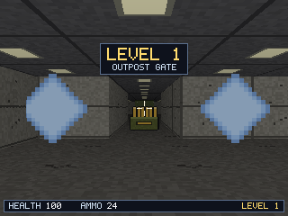

# level01: Outpost Gate

| Id | Name | Theme | Size | Difficulty | New mechanic |
|---|---|---|---|---|---|
| `level01` | Outpost Gate | `bunker` | 20 × 13 | 1 of 10 | Tutorial: move and turn, walk over a pickup, shoot a guard at range, open a door (`E`), use the exit switch |



*Start view: the spawn bay, the vase pair framing the corridor C1 and the ammo crate in it.*

## Idea

Every basic action once, in a safe order, with nothing else going on: walk down a short corridor over an ammo crate (`AMMO REPLENISHED`), meet a guard across an open yard and shoot it, open the only door with `E`, shoot a second guard that is in plain view the moment the door opens, pick up the first health pack right after the two fights, and follow a line of vases to the exit switch. No keys, no trigger, no enemy in sight of the spawn and no enemy behind a corner.

## Map

`game/maps/level01.map` as shipped:

```text
; level01 - Outpost Gate (bunker)
; Tutorial: walk over a pickup, shoot a guard at range, open a door (E), use the exit switch.
####################
#....####..........#
#..............A...#
#....####..........#
#....####..A.......#
#########..........#
#########ADA###BBBBB
#######........B...B
#######............X
#######............B
#######........B...B
########.######BBBBB
####################
```

The same grid with the entities of `game/defs/level01.entities.json` drawn in:

```text
####################
#...v####..........#
#p....a........A...#
#...v####..........#
#....####..A.......#
#########........g.#
#########AdA###BBBBB
#######........B...B
#######............X
#######............B
#######.g..vvv.B...B
########h######BBBBB
####################
```

Legend of the annotated grid (documentation only: lower case and digits are not valid map tiles; the shipped `.map` above has `.` or `D`/`T` there): `p` player start, `g` guard, `b` brute, `n` runner, `h` health, `a` ammo, `r` / `u` / `y` red / blue / gold key card, `d` unlocked door, `1` / `2` / `3` red / blue / gold locked door, `t` checkpoint trigger, `v` decoration (vase); `#` wall, `A` / `B` wall variants, `X` exit switch.

Coordinates below are cells `(x, y)`: column, row from the top-left; entities stand at cell centres.

## Areas

| Area | Cells | What is there |
|---|---|---|
| R1 spawn bay | (1, 1)–(4, 4) | player start facing east (angle 0); vase **pair** at the mouth of C1 |
| C1 | (5, 2)–(8, 2), 1 wide | the ammo crate |
| R2 yard | (9, 1)–(18, 5) | guard G1 in the far south-east corner; two `A` crates; D1 in the south wall framed by `A` |
| R3 hall | (7, 7)–(14, 10) | guard G2; the health alcove (8, 11); vase **line** along the south wall pointing east |
| R4 exit room | (16, 7)–(18, 10), `B` walls | open to the hall through (15, 8)–(15, 9); exit switch on the east wall |

## Enemies

| Type | Cell | Where and why |
|---|---|---|
| guard | (17, 5) | G1, yard's far corner: not in line with C1 and not in sight of the spawn; 8.5 cells from C1's mouth, so it notices the player a few steps into the yard and walks into plain sight |
| guard | (8, 10) | G2, hall: 3.6 cells from D1's far side (10, 7) and visible through the door as soon as it opens |

Total: 2 guards, 0 brutes, 0 runners (threat T = 4 shots).

## Pickups

| Kind | Cell | On the critical path? |
|---|---|---|
| ammo (+12 ammo) | (6, 2) | yes: in the 1-wide corridor C1 |
| health (+25 HP) | (8, 11) | side: a 1-cell alcove of the hall, right after the two fights |

Total: 1 health (25 HP), 1 ammo (12 rounds); all at the default values.

## Keys, doors and triggers

| Thing | Cell | Notes |
|---|---|---|
| door (unlocked) | (10, 6) | D1, in the yard's south wall between two `A` walls so it reads as a door to open |
| exit switch `X` | (19, 8), east outer wall | framed by `B` walls (hazard stripes), straight ahead from the hall/exit-room opening |

No keys or locks.

## Landmarks (decorations)

Pair: (4.65, 1.35) and (4.65, 3.65), flanking the mouth of C1 (nudged into the corners so they frame the corridor without filling the start view). Line: (10.6, 10.6), (12.1, 10.6), (13.6, 10.6) along the hall's south wall, pointing east at the exit room. (5 vases in total.)

## Light zones

None (every cell at 1.0).

## Walkthrough (critical path)

Walk east down C1 over the ammo into the yard; G1 (south-east corner) is seen at about 8 cells and dies before it gets close. Turn to D1 in the yard's south wall (between the green `A` walls), press `E`; G2 is in view 4–5 cells inside. Step into the hall, (optionally) take the health from the alcove at (8, 11), follow the vase line east through the opening into the exit room and press `E` at the exit switch.

## Bot results

Measured 2026-11-16 on macOS with the existing `build/macos/neo_wolf_autoplay` (runs are deterministic per build).

**Fresh start** (`neo_wolf_autoplay --level 1`, 100 HP and 24 ammo):

| Time s | Damage | HP at exit | Ammo at exit | Kills | Pickups | Keys | Shots | Doors opened |
|---|---|---|---|---|---|---|---|---|
| 8.58 | 0 | 100 | 32 | 2/2 | 1/2 | - | 4 | 1 |

| Target (README) | Value | Met |
|---|---|---|
| Damage taken 0–12 | 0 | yes |
| HP at exit ≥ 88 | 100 | yes |
| Kills ≥ 1 of 2 | 2 | yes |
| Bot time ≤ 45 s | 8.58 | yes |

**Campaign** (`neo_wolf_autoplay --all`, health and ammo carried over; result `PASS (10 of 10 level(s) completed, campaign complete)`, `Carry-over: OK`):

| Start HP / ammo | Time s | Damage | HP at exit | Ammo at exit | Kills | Target HP ≥ | Target ammo ≥ | Met |
|---|---|---|---|---|---|---|---|---|
| 100 / 24 | 8.58 | 0 | 100 | 32 | 2/2 | 85 | 12 | yes |

Within every target. The bot never gets close to either guard (0 damage), as intended for the tutorial.
