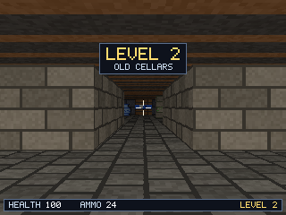

# level02: Old Cellars

| Id | Name | Theme | Size | Difficulty | Human time | New mechanic |
|---|---|---|---|---|---|---|
| `level02` | Old Cellars | `stone` | 24 × 14 | 2 of 10 | 2–3 min | Key cards and locked doors: meet the blue door first (`NEED BLUE KEY`), then fetch the key from a side room |



*Start view: the entry corridor C1 with the blue door Db and its vase pair straight ahead at the far end of the hall.*

## Idea

Teach keys by showing the lock first. From the spawn the player looks straight down C1, across the vaulted hall, at the blue door Db framed by a vase pair. Walking up and pressing `E` gives `NEED BLUE KEY`; turning round, the unlocked door D2 in the hall's north wall is in view. Behind it a long cellar narrows into a 1-wide passage (ammo on the way) and ends at a small mossy (`A`) key cellar with the blue key and one guard. The player comes back through the hall and opens Db into the exit vault.

## Map

`game/maps/level02.map` as shipped:

```text
; level02 - Old Cellars (stone)
; Key cards: meet the blue door first (NEED BLUE KEY), fetch the key from the cellar behind D2, come back.
########################
#A....AAAA.......#######
#A............A..#######
#A....AAAA.......#######
#AAAAAA######D###BBBBBBB
#########........B.....B
#....####...A....B.....B
#....####........B.....B
#................D.....B
#....####...A....B.....B
#....####........B.....B
#################B.....X
#################B.....B
#################BBBBBBB
```

The same grid with the entities of `game/defs/level02.entities.json` drawn in (generated by `python3 -m tools.devkit.level_docs --write`):

```text
   0         1         2
   012345678901234567890123
 0 ########################
 1 #A....AAAA.......#######
 2 #Aug...a......A..#######
 3 #A....AAAA.......#######
 4 #AAAAAA######d###BBBBBBB
 5 #########......g.B...g.B
 6 #....####...A....B.....B
 7 #....####.......vB.....B
 8 #.p..............2.....B
 9 #....####...A...vB.....B
10 #....####......g.B..h..B
11 #################B.....X
12 #################B.vvv.B
13 #################BBBBBBB
```

Legend (documentation only: lower case and digits are not valid map tiles; the shipped `.map` above has `.` or `D`/`T` there): `p` player start, `g` guard, `b` brute, `n` runner, `h` health, `a` ammo, `r` / `u` / `y` red / blue / gold key card, `d` unlocked door, `1` / `2` / `3` red / blue / gold locked door, `t` checkpoint trigger, `v` decoration (vase); `#` wall, `A` / `B` wall variants, `X` exit switch. Column numbers run along the top (tens, then units), row numbers down the left. Coordinates are cells `(x, y)`: column, row from the top-left, starting at 0; entities stand at cell centres unless a position is given.


## Areas

| Area | Cells | What is there |
|---|---|---|
| R1 entry cellar | (1, 6)–(4, 10) | player start facing east (angle 0) |
| C1 | (5, 8)–(8, 8), 1 wide | leads straight at Db |
| R2 vaulted hall | (9, 5)–(16, 10) | two `A` pillars (12, 6), (12, 9); two guards in the far corners; D2 north, Db east |
| R3 key cellar | (10, 1)–(16, 3) room, (6, 2)–(9, 2) passage, (2, 1)–(5, 3) key cellar (`A` walls) | ammo in the passage, guard and blue key at the far west end; an `A` pillar at (14, 2) |
| R4 exit vault | (18, 5)–(22, 12), `B` walls | one guard, the health, the vase line, the exit switch |

## Enemies

| Type | Cell | Where and why |
|---|---|---|
| guard | (3, 2) | key cellar, next to the key: seen straight down the 1-wide passage from 6 cells; 10 cells from D2 |
| guard | (15, 5) | hall, north-east corner: 6.3 cells from the hall entrance, hidden from the spawn and from the entrance by the pillar (12, 6) |
| guard | (21, 5) | exit vault, north end: 4.2 cells from Db's far side (18, 8) |
| guard | (15, 10) | hall, south-east corner: as above, behind the pillar (12, 9) |

Total: 4 guards, 0 brutes, 0 runners (threat T = 8 shots).

## Pickups

| Kind | Cell | On the critical path? |
|---|---|---|
| ammo (+12 ammo) | (7, 2) | yes: in the 1-wide passage to the key |
| health (+25 HP) | (20, 10) | side/after the fight: in the exit vault between Db and the exit |

Total: 1 health (25 HP), 1 ammo (12 rounds); all at the default values.

## Keys, doors and triggers

| Thing | Cell | Notes |
|---|---|---|
| door (unlocked) | (13, 4) | D2, hall's north wall, visible from Db (rule 10: 5 cells from Db) |
| door locked blue | (17, 8) | Db, hall's east wall, straight ahead of the hall entrance, vase pair |
| blue key card | (2, 2) | far end of the key cellar; reachable without passing Db |
| exit switch `X` | (23, 11), east outer wall | framed by `B`; the vault is `B`-walled; the vase line along the south wall leads to it |

Order: Db is met first (from the spawn it is straight ahead), then D2 → blue key → back through the hall → Db → exit. `inspect-map` keys: `blue`.

## Landmarks (decorations)

Pair: (16.5, 7.5) and (16.5, 9.5) flanking Db. Line: (19.5, 12.5), (20.5, 12.5), (21.5, 12.5) along the exit vault's south wall, pointing at the exit. (5 vases in total.)

## Light zones

None (every cell at 1.0).

## Walkthrough (critical path)

C1 → hall (both corner guards come out from behind the pillars and are shot in the open) → D2 → east part of the cellar → the 1-wide passage over the ammo (the key-cellar guard is seen straight down it) → blue key → back to the hall → Db → the vault guard → exit switch at (23, 11). The bot goes for the key directly (it never tries Db first); a person meets Db first because it is straight ahead.

## Bot results

Measured 2026-11-16 by the integrator on macOS (the Phase 8 integration build). The JSON reports are byte-identical for the arm64 and x86_64 (Rosetta) slices of the universal `build/macos` binary and for the `ci-macos` build; runs are deterministic per build.

| Run | Start HP / ammo | Time s | Damage | HP at exit | Ammo at exit | Kills | Pickups | Keys | Shots |
|---|---|---|---|---|---|---|---|---|---|
| Fresh (`--level 2`) | 100 / 24 | 22.62 | 0 | 100 | 28 | 4/4 | 3/3 | blue | 8 |
| Campaign (`--all`) | 100 / 32 | 22.62 | 0 | 100 | 36 | 4/4 | 3/3 | blue | 8 |

| Target ([README](README.md#bot-difficulty-targets)) | Value | Met |
|---|---|---|
| Fresh: damage taken 0–20 | 0 | yes |
| Fresh: HP at exit ≥ 80 | 100 | yes |
| Fresh: kills ≥ 2 of 4 | 4 | yes |
| Fresh: bot time ≤ 60 s | 22.6 | yes |
| Campaign: HP at exit ≥ 70 | 100 | yes |
| Campaign: ammo at exit ≥ 12 | 36 | yes |

The campaign run ends `Carry-over: OK` and `Result: PASS (10 of 10 level(s) completed, campaign complete)`.

**Where the bot takes its damage** (fresh run, `hit-taken` lines of `--trace`; the cell is where the enemy stood when it hit):

- none

No damage: all four guards are met across open ground or down a straight passage, which the band allows for level 2.

**Robustness:** with every enemy moved by up to ±0.15 cells (8 seeded variants in scratch copies), the bot's damage was 0 (all 8 completed).

## Deviations and exceptions

- None from the brief.
- Arc rule: the exit-vault guard is behind the closed blue door Db, 4.2 cells from its far side and in view from the doorway: allowed (at least 2 cells back).
