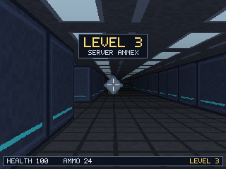

# level03: Server Annex

| Id | Name | Theme | Size | Difficulty | New mechanic |
|---|---|---|---|---|---|
| `level03` | Server Annex | `tech` | 26 × 17 | 3 of 10 | Gunfire is heard along open cells, closed doors block it: a ring corridor round a closed server room; the first checkpoint trigger |



*Start view: looking east along the 2-wide south ring; the vase pair at the server-room door Ds in the distance.*

## Idea

A 2-wide ring corridor runs round a closed server room. The player starts in a short loading stub at the ring's south-west corner. The server room's door Ds (south side, vase pair, ammo in its approach) hides two guards and the red key; while it is shut they sleep through any fight in the ring. In the north-east of the ring a guard stands in the north corridor and a second waits in a small L-shaped server closet off the east corridor: the first shot at one wakes the other, and it comes from the other direction (round the corner, out of the closet). The red door Dr in the ring's north-east corner leads to the `B`-walled exit wing, with a checkpoint trigger just inside it.

## Map

`game/maps/level03.map` as shipped:

```text
; level03 - Server Annex (tech)
; Hearing and loops: gunfire carries along the ring corridor, closed doors block it; first checkpoint.
##########################
############.#############
####................DT...#
####................###..#
####..############....#..#
####..#..........#..#.#..#
####..#..........#..###..#
####..#..AA..AA..#..###..#
####..#..........#..###..#
####..#..........#..B....B
####..#..........#..B....B
####..#..........#..B....B
####..#####D######..B....B
#...................B....B
#...................B....B
####################B....B
####################BBXBBB
```

The same grid with the entities of `game/defs/level03.entities.json` drawn in:

```text
##########################
############h#############
####...........g....1t...#
####................###..#
####..############....#..#
####..#....r.....#..#g#..#
####..#.a........#..###g.#
####..#..AA..AA..#..###..#
####..#..........#..###..#
####..#..........#..B....B
####..#..g...g...#..B.g..B
####..#..........#..B....B
####..#####d######..Bv.h.B
#p........vav.......Bv...B
#...................Bv...B
####################B....B
####################BBXBBB
```

Legend of the annotated grid (documentation only: lower case and digits are not valid map tiles; the shipped `.map` above has `.` or `D`/`T` there): `p` player start, `g` guard, `b` brute, `n` runner, `h` health, `a` ammo, `r` / `u` / `y` red / blue / gold key card, `d` unlocked door, `1` / `2` / `3` red / blue / gold locked door, `t` checkpoint trigger, `v` decoration (vase); `#` wall, `A` / `B` wall variants, `X` exit switch.

Coordinates below are cells `(x, y)`: column, row from the top-left; entities stand at cell centres.

## Areas

| Area | Cells | What is there |
|---|---|---|
| Loading stub (spawn) | (1, 13)–(3, 14) | player start facing east (angle 0) along the south ring |
| Ring | outer (4, 2)–(19, 14), 2 wide | south ring y 13–14, north ring y 2–3, west x 4–5, east x 18–19; health alcove (12, 1) off the north ring |
| Server closet | (20, 4), (21, 4), (21, 5) | L-shaped closet off the east ring, one guard, invisible from the ring |
| R3 server room | (7, 5)–(16, 11) | closed by Ds; `A` server racks (9–10, 7), (13–14, 7); two guards, ammo, red key at the back |
| R5 exit wing | passage (21, 2)–(24, 2), corridor (23, 3)–(24, 8), exit room (21, 9)–(24, 15), `B` walls | checkpoint trigger at (21, 2), two guards, health, vase line, exit switch |

## Enemies

| Type | Cell | Where and why |
|---|---|---|
| guard | (15, 2) | north ring, 3 cells west of the north-east corner: seen only from the corner (the server room's corner hides it from the east ring) |
| guard | (21, 5) | server closet off the east ring: hears the first shot at the north-ring guard and comes out behind the player (the level's 'both directions' lesson) |
| guard | (23, 6) | exit wing corridor, round the bend from the passage; 4.5 cells from the trigger |
| guard | (9, 10) | server room, 2.2 cells from Ds's far side (11, 11), diagonally to one side; asleep while Ds is shut |
| guard | (13, 10) | as above, the other side |
| guard | (22, 10) | exit room, 8 cells beyond the trigger |

Total: 6 guards, 0 brutes, 0 runners (threat T = 12 shots).

## Pickups

| Kind | Cell | On the critical path? |
|---|---|---|
| health (+25 HP) | (12, 1) | side: alcove of the north ring |
| ammo (+12 ammo) | (8, 6) | side: in the server room, off the straight line Ds → key |
| health (+25 HP) | (23, 12) | after the exit-wing fight, on the way to the exit |
| ammo (+12 ammo) | (11, 13) | yes: the approach to Ds, between the vase pair (before any fight) |

Total: 2 health (50 HP), 2 ammo (24 rounds); all at the default values.

## Keys, doors and triggers

| Thing | Cell | Notes |
|---|---|---|
| door locked red | (20, 2) | Dr, the ring's north-east corner, east wall; seen from the north and east rings |
| door (unlocked) | (11, 12) | Ds, server room south wall, vase pair, ammo in front |
| trigger (checkpoint) | (21, 2) | just inside Dr: `CHECKPOINT REACHED` |
| red key card | (11, 5) | at the back of the server room |
| exit switch `X` | (22, 16), south outer wall of the exit wing | end of the exit wing, south wall, framed by `B` (the whole wing is `B`); vase line on the west wall |

Order: red key (server room) → Dr → exit. `inspect-map` keys: `red`.

## Landmarks (decorations)

Pair: (10.5, 13.5) and (12.5, 13.5) flanking Ds. Line: (21.5, 12.5), (21.5, 13.5), (21.5, 14.5) along the exit room's west wall, leading south to the exit. (5 vases in total.)

## Light zones

None (every cell at 1.0).

## Walkthrough (critical path)

East along the south ring over the ammo to Ds → open it: the two server guards close in from both sides of the doorway → red key at the back → out through Ds, east and north up the east ring → at the north-east corner the north-ring guard is seen; shooting it wakes the closet guard, which comes out of (20, 4) beside/behind the player → Dr (red) → checkpoint → round the bend (guard) → exit room (guard, health) → exit switch.

## For a person playing it

Going the other way round (west, then the north ring) works too: the north-ring guard is then seen down the long north corridor and the closet guard comes along the same corridor. The checkpoint only shows a message; death still restarts the level.

## Bot results

Measured 2026-11-16 on macOS with the existing `build/macos/neo_wolf_autoplay` (runs are deterministic per build).

**Fresh start** (`neo_wolf_autoplay --level 3`, 100 HP and 24 ammo):

| Time s | Damage | HP at exit | Ammo at exit | Kills | Pickups | Keys | Shots | Doors opened |
|---|---|---|---|---|---|---|---|---|
| 30.32 | 12 | 100 | 24 | 6/6 | 3/5 | red | 12 | 2 |

| Target (README) | Value | Met |
|---|---|---|
| Damage taken 5–30 | 12 | yes |
| HP at exit ≥ 70 | 100 | yes |
| Kills ≥ 3 of 6 | 6 | yes |
| Bot time ≤ 75 s | 30.32 | yes |

**Campaign** (`neo_wolf_autoplay --all`, health and ammo carried over; result `PASS (10 of 10 level(s) completed, campaign complete)`, `Carry-over: OK`):

| Start HP / ammo | Time s | Damage | HP at exit | Ammo at exit | Kills | Target HP ≥ | Target ammo ≥ | Met |
|---|---|---|---|---|---|---|---|---|
| 100 / 36 | 30.32 | 12 | 100 | 36 | 6/6 | 60 | 12 | yes |

Within every target. The 12 damage is exactly the intended moment: the closet guard reaches the bot while it is still turned towards the north-ring guard (a scratch per-frame trace of the same run, not in the repository: the hit lands at 20.1 s at (19.3, 4.6)). The margin above the 5-damage floor is that one hit; the bot picks the exit-wing health back up, so it leaves at 100.

## Deviations from the brief

- Ring guards: the brief puts one in the north-west and one in the north-east of the ring. Both are now in the north-east (one in the north ring, one in a small closet off the east ring), because with a north-west guard the bot never met the two at once and took 0 damage (below the 5–30 band); the closet makes 'the first shot wakes both, they come from both directions' happen on the critical path.
- The exit wing's first passage is 1 wide (row 2) so that the closet fits beside the north-east corner.
