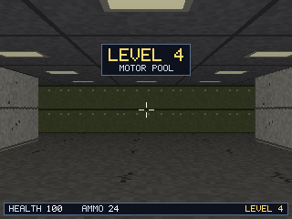

# level04: Motor Pool

| Id | Name | Theme | Size | Difficulty | New mechanic |
|---|---|---|---|---|---|
| `level04` | Motor Pool | `bunker` | 26 × 20 | 4 of 10 | The brute: first seen across an open garage (4 shots while it lumbers in), then the gold key and door |



*Start view: the gatehouse opening onto the green `A` checkpoint booth.*

## Idea

Introduce the brute safely: from the garage's south entrance the brute stands at the far north end, 8 cells away across open floor, so the player sees it before it notices them and has time for the four shots it takes. Nothing else is in the garage. Then the gold key: the pit office behind the unlocked D3 (west), and the gold door Dg (east, vase pair) that is visible from the garage entrance. Behind Dg the fuel depot bends south; at the bend a guard steps out of a dead-end fuel store while another comes up the south leg: two guards at short range from two sides, the level's real test.

## Map

`game/maps/level04.map` as shipped:

```text
; level04 - Motor Pool (bunker)
; The brute: first seen across an open garage (4 shots while it lumbers in), then the gold key and door.
##########################
#.....A............####.##
#.....A.........A..####.##
#.....A..A.........####.##
#.....D............D.....#
#.....A............#####.#
#.....A..A.........#####.#
#AAAAA..........A..####..#
#######............####..#
############..#########..#
############..#########..#
#######..........######..#
#######..........BBBBBB..#
#######A.AAAAAAAAB.......B
#######..........B.......B
###########...###X.......B
#########.......#B.......B
#########.......#B.......B
#########.......#BBBBBBBBB
##########################
```

The same grid with the entities of `game/defs/level04.entities.json` drawn in:

```text
##########################
#y...aA.....b......####.##
#.g...A.........A..####g##
#.....A..A........v####.##
#.....d............3.....#
#.g...A...........v#####.#
#.....A..A.........#####g#
#AAAAAh.........A..####..#
#######............####..#
############..#########..#
############..#########h.#
#######........g.######..#
#######.........gBBBBBB..#
#######AaAAAAAAAAB.......B
#######..........B.......B
###########...###X.v.v.v.B
#########.......#B.......B
#########.......#B.......B
#########...p...#BBBBBBBBB
##########################
```

Legend of the annotated grid (documentation only: lower case and digits are not valid map tiles; the shipped `.map` above has `.` or `D`/`T` there): `p` player start, `g` guard, `b` brute, `n` runner, `h` health, `a` ammo, `r` / `u` / `y` red / blue / gold key card, `d` unlocked door, `1` / `2` / `3` red / blue / gold locked door, `t` checkpoint trigger, `v` decoration (vase); `#` wall, `A` / `B` wall variants, `X` exit switch.

Coordinates below are cells `(x, y)`: column, row from the top-left; entities stand at cell centres.

## Areas

| Area | Cells | What is there |
|---|---|---|
| R1 gatehouse | (9, 16)–(15, 18) | player start facing north (angle 270); 3-wide opening at (11–13, 15) |
| R2 checkpoint | (7, 11)–(16, 14) round an `A` booth wall (row 13) | chicane: west along row 14, through the 1-cell gap (8, 13) (ammo), back east along rows 11–12; two guards |
| R3 garage | (7, 1)–(18, 8) | `A` pillars (9, 3), (9, 6), (16, 2), (16, 7); the brute; health alcove (6, 7); D3 west, Dg east |
| R4 pit office | (1, 1)–(5, 6), `A` walls | two guards, ammo, gold key |
| R5 fuel depot | (20, 4)–(24, 4), fuel store (23, 1)–(23, 3), leg (24, 5)–(24, 6) then (23, 7)–(24, 12) | one guard in the store, one in the leg, health after the bend |
| R6 exit bay | (18, 13)–(24, 17), `B` walls | vase line, exit switch on the west wall |

## Enemies

| Type | Cell | Where and why |
|---|---|---|
| guard | (2, 2) | pit office, 3.6 cells from D3's far side (5, 4) |
| guard | (23, 2) | fuel store north of the depot corridor, out of sight until the player is at the bend |
| guard | (2, 5) | pit office, 3.2 cells from D3's far side |
| guard | (24, 6) | south leg, 2 cells round the bend: with the store guard it closes in from the other side |
| guard | (15, 11) | checkpoint, east end of the upper lane: hidden from the spawn by the booth; seen across 7 cells after the gap |
| guard | (16, 12) | as above |
| brute | (12, 1) | the brute, far north end of the garage: 8 cells from the entrance, in a straight open line from it; notices at 5.5, so it is seen first |

Total: 6 guards, 1 brute, 0 runners (threat T = 16 shots).

## Pickups

| Kind | Cell | On the critical path? |
|---|---|---|
| ammo (+12 ammo) | (5, 1) | pit office, beside the key |
| health (+25 HP) | (6, 7) | side: 1-cell alcove in the garage's west wall |
| health (+25 HP) | (23, 10) | yes/after the fight: in the depot leg after the bend |
| ammo (+12 ammo) | (8, 13) | yes: the 1-cell gap of the checkpoint chicane (before every fight) |

Total: 2 health (50 HP), 2 ammo (24 rounds); all at the default values.

## Keys, doors and triggers

| Thing | Cell | Notes |
|---|---|---|
| door (unlocked) | (6, 4) | D3, garage west wall |
| door locked gold | (19, 4) | Dg, garage east wall, vase pair, visible from the garage entrance |
| gold key card | (1, 1) | pit office, far corner |
| exit switch `X` | (17, 15), west wall of the exit bay | framed by `B` (the bay is `B`-walled); visible from the bay entrance; vase line leads to it |

Order: D3 → gold key → Dg → exit. `inspect-map` keys: `gold`.

## Landmarks (decorations)

Pair: (18.5, 3.5) and (18.5, 5.5) flanking Dg. Line: (19.5, 15.5), (21.5, 15.5), (23.5, 15.5) across the exit bay towards the exit switch. (5 vases in total.)

## Light zones

None (every cell at 1.0).

## Walkthrough (critical path)

North out of the gatehouse, west along the booth, through the gap over the ammo, east along the upper lane (two guards, seen at 7–8 cells) and north up the 2-wide passage into the garage. The brute is straight ahead at the far end; shoot it as it lumbers in. D3 (west) → pit office (two guards) → gold key → back across the garage → Dg → east along the depot corridor; at the bend the store guard (north) and the leg guard (south) close in from both sides → health in the leg → exit bay → exit.

## Bot results

Measured 2026-11-16 on macOS with the existing `build/macos/neo_wolf_autoplay` (runs are deterministic per build).

**Fresh start** (`neo_wolf_autoplay --level 4`, 100 HP and 24 ammo):

| Time s | Damage | HP at exit | Ammo at exit | Kills | Pickups | Keys | Shots | Doors opened |
|---|---|---|---|---|---|---|---|---|
| 35.05 | 12 | 100 | 20 | 7/7 | 3/5 | gold | 16 | 2 |

| Target (README) | Value | Met |
|---|---|---|
| Damage taken 5–35 | 12 | yes |
| HP at exit ≥ 65 | 100 | yes |
| Kills ≥ 4 of 7 | 7 | yes |
| Bot time ≤ 90 s | 35.05 | yes |

**Campaign** (`neo_wolf_autoplay --all`, health and ammo carried over; result `PASS (10 of 10 level(s) completed, campaign complete)`, `Carry-over: OK`):

| Start HP / ammo | Time s | Damage | HP at exit | Ammo at exit | Kills | Target HP ≥ | Target ammo ≥ | Met |
|---|---|---|---|---|---|---|---|---|
| 100 / 36 | 35.05 | 12 | 100 | 32 | 7/7 | 50 | 12 | yes |

Within every target. The 12 damage comes from the fuel-depot bend (one hit from the leg guard while the bot finishes the store guard); the garage brute dies 9 cells away, as intended for its first appearance.

## Deviations from the brief

- Fuel depot: the brief has two guards 'round the bend'. Placed together in the leg (2–4 cells round it) the bot shot both before they reached it (0 damage, below the 5–35 band); one now waits in a short dead-end fuel store on the other side of the bend, so the pair arrives from two directions.
