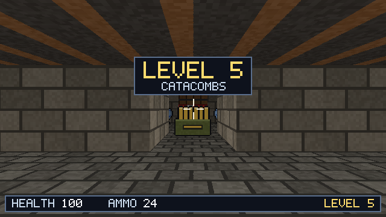
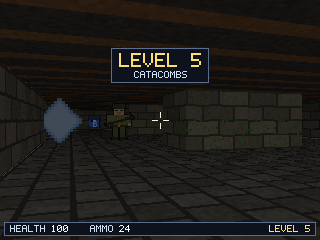

# level05: Catacombs

| Id | Name | Theme | Size | Difficulty | Human time | New mechanic |
|---|---|---|---|---|---|---|
| `level05` | Catacombs | `stone` | 28 × 24 | 5 of 10 | 5–7 min | Runners; two keys in sequence; a branching route (two ways to the red key); a dim crypt (light zone) |



*Start view: down the stair from the landing, ammo on the steps, the red door Dr and its vase pair below.*

## Idea

Runners and a branch. From the stair the player sees the red door Dr straight ahead in the junction's south wall. Two ways lead to the chapel with the red key: the west **ossuary gallery** (1 wide, burial niches whose occupants are invisible until they come out, with a jog near the bottom) and the **flooded tunnel** (2 wide, winding, runners round the bends). Both hold 2 runners and 1 guard, and they form a loop through the chapel. Behind Dr is the **dim crypt** (light 0.5) with sarcophagi, two guards, the blue key at the far end and the blue door Db in sight from the entrance; behind Db the `B`-walled exit tomb, where the brute is seen across the room.

## Map

`game/maps/level05.map` as shipped:

```text
; level05 - Catacombs (stone)
; Runners, two keys in sequence (red, then blue behind it), a branching route to the red key, a dim crypt.
############################
###########......###########
###########......###########
###########......###########
#############.##############
#############.##############
###..............###########
###..............###########
###..............###########
###.##..#####D######.#######
###.##..####..............##
#...##..####..............##
#.#.##.....#.....A...A....##
#...##.....#.....A...A....##
###.#####..#..............##
#...#####..#..............##
#.##.#.....###D#############
#....#.....#..............B#
#.####..####..............B#
#..........#..............B#
#..........#..............B#
#....A..A..#..............B#
#..........#BBBBBBBXBBBBBBB#
############################
```

The same grid with the entities of `game/defs/level05.entities.json` drawn in (generated by `python3 -m tools.devkit.level_docs --write`):

```text
   0         1         2
   0123456789012345678901234567
 0 ############################
 1 ###########..p...###########
 2 ###########......###########
 3 ###########......###########
 4 #############.##############
 5 #############a##############
 6 ###..............###########
 7 ###..g...........###########
 8 ###.........v.v..###########
 9 ###.##..#####1######h#######
10 ###.##..####.......v.v....##
11 #a..##..####.......g.....u##
12 #n#.##.....#.....A...A....##
13 #...##...n.#.....A...A....##
14 ###.#####..#...........g..##
15 #...#####.g#..............##
16 #.##g#.....###2#############
17 #....#n....#..............B#
18 #n####..####..............B#
19 #a.........#............b.B#
20 #.h........#........h.....B#
21 #....A..Ag.#...vvv........B#
22 #.r........#BBBBBBBXBBBBBBB#
23 ############################
```

Legend (documentation only: lower case and digits are not valid map tiles; the shipped `.map` above has `.` or `D`/`T` there): `p` player start, `g` guard, `b` brute, `n` runner, `h` health, `a` ammo, `r` / `u` / `y` red / blue / gold key card, `d` unlocked door, `1` / `2` / `3` red / blue / gold locked door, `t` checkpoint trigger, `v` decoration (vase); `#` wall, `A` / `B` wall variants, `X` exit switch. Column numbers run along the top (tens, then units), row numbers down the left. Coordinates are cells `(x, y)`: column, row from the top-left, starting at 0; entities stand at cell centres unless a position is given.


## Areas

| Area | Cells | What is there |
|---|---|---|
| R1 stair landing | (11, 1)–(16, 3); stair (13, 4)–(13, 5) | player start facing south (angle 90) |
| R2 junction | (3, 6)–(16, 8) | one guard; Dr in the south wall below the stair, vase pair |
| West branch: ossuary gallery | (3, 9)–(3, 15), jog (1–2, 15), (1, 16)–(1, 18) | 1 wide; L-shaped niches (1–2, 11) ammo, (1–2, 13)+(1, 12) runner, (2–4, 17)+(4, 16) guard; runner at the bottom |
| East branch: flooded tunnel | (6, 9)–(7, 11), (6, 12)–(10, 13), (9, 14)–(10, 15), (6, 16)–(10, 17), (6, 18)–(7, 18) | 2 wide, an S-bend; two runners and a guard round the bends |
| R3 chapel | (1, 19)–(10, 22) | `A` pillars (5, 21), (8, 21); one guard; ammo, health, red key |
| R4 crypt (dim) | (12, 10)–(25, 15) | sarcophagi `A` (17, 12–13), (21, 12–13); two guards; blue key; dark health alcove (20, 9) with a vase pair |
| R5 exit tomb | (12, 17)–(25, 21), `B` south and east walls | brute, health, vase line, exit switch |

## Enemies

| Type | Cell | Where and why |
|---|---|---|
| guard | (5, 7) | junction, west end: 8 cells from the stair foot, seen as the player arrives |
| guard | (19, 11) | crypt, north aisle, 6 cells from Dr's far side (13, 10) |
| guard | (23, 14) | crypt, south-east, behind the sarcophagi |
| guard | (10, 15) | tunnel, middle of the S-bend |
| guard | (4, 16) | gallery: L-shaped niche, invisible from the gallery; wakes on the first shot in the lower gallery and steps out at (2, 17), beside the player |
| guard | (9, 21) | chapel, east side |
| brute | (24, 19) | the brute, exit tomb's far east end: 10 cells from Db's far side (14, 17), seen across the room |
| runner | (1, 12) | gallery: L-shaped niche at row 13, invisible from the gallery; when the player is at the jog it comes from behind |
| runner | (9, 13) | tunnel, round the first bend |
| runner | (6, 17) | tunnel, round the last bend before the chapel |
| runner | (1, 18) | gallery, bottom: the first thing seen after the jog (3 cells); shooting it wakes the two niche enemies (pincer) |

Total: 6 guards, 1 brute, 4 runners (threat T = 20 shots).

## Pickups

| Kind | Cell | On the critical path? |
|---|---|---|
| ammo (+12 ammo) | (13, 5) | yes: on the 1-wide stair |
| health (+25 HP) | (20, 9) | side: the crypt's dark alcove (light 0.35), vase pair at its mouth |
| ammo (+12 ammo) | (1, 11) | side: gallery niche (reward for the 1-wide route) |
| ammo (+12 ammo) | (1, 19) | yes: the gallery's mouth into the chapel |
| health (+25 HP) | (2, 20) | yes: chapel, just after the gallery fight |
| health (+25 HP) | (20, 20) | exit tomb, after the brute, on the way to the exit |

Total: 3 health (75 HP), 3 ammo (36 rounds); all at the default values.

## Keys, doors and triggers

| Thing | Cell | Notes |
|---|---|---|
| door locked red | (13, 9) | Dr, junction's south wall straight below the stair, vase pair; the cell in front (13, 8) is at full light |
| door locked blue | (14, 16) | Db, crypt's south wall, in sight from the crypt entrance; its crypt side (14, 15) at 0.5 |
| blue key card | (25, 11) | crypt's far east end (light 0.5, readable) |
| red key card | (2, 22) | chapel, south-west corner |
| exit switch `X` | (19, 22), south wall of the exit tomb | framed by `B`; visible from Db; vase line along the tomb's south wall |

Order: Dr is met first (straight below the stair) → red key (chapel, via either branch) → Dr → crypt → blue key (far end) → Db → exit. `inspect-map` keys: `red, blue`.

## Landmarks (decorations)

Pair: (12.5, 8.5) and (14.5, 8.5) flanking Dr (also marks the dim zone's entrance). Pair: (19.3, 10.3) and (21.7, 10.3) flanking the dark health alcove (20, 9). Line: (15.5, 21.5), (16.5, 21.5), (17.5, 21.5) along the tomb's south wall towards the exit. (7 vases in total.)

## Light zones

| # | Rectangle (`x`, `y`, `w`, `h`) | Cells | Level | Covers |
|---|---|---|---|---|
| 0 | 12, 10, 14, 6 | (12, 10) to (25, 15) | 0.5 | the whole crypt floor, from Dr's far side (13, 10) to the far east end and Db's crypt side (14, 15); Db, the blue key and the crypt guards read at 0.5 |
| 1 | 20, 9, 1, 1 | (20, 9) to (20, 9) | 0.35 | the crypt's side alcove with the health (a later, darker zone) |



*The crypt at 0.5 from just inside Dr: a guard, the blue key card at the far end, a vase of the dark alcove's pair.*

Rules checked: no brute in the crypt; the cell in front of Dr (13, 8), the blue key's cell and Db's crypt side stay at 0.5 or brighter; the exit tomb is at 1.0; the only zone below 0.5 is a 1-cell side alcove holding a pickup, marked by a vase pair. The bot and the AI ignore light, so the bot numbers below are the same as without the zones.

## Walkthrough (critical path)

Down the stair over the ammo to the junction (guard at the west end) and Dr (`NEED RED KEY`). West branch (the bot's route, because the key is in the chapel's west corner): down the 1-wide gallery past two silent niches; at the jog the runner at the bottom is seen and shot, which wakes the niche guard beside the player and the niche runner behind them (the pincer) → ammo and health at the chapel mouth → the chapel guard and the tunnel's enemies (they hear the chapel fight) → red key → back up the gallery → Dr → dim crypt (two guards) → blue key at the far end → Db → the brute across the tomb → health → exit switch.

## For a person playing it

The east tunnel is the other half of the loop: 2 wide, an S-bend with a runner round each bend and a guard in the middle; a person can go out one way and back the other. The ammo niche in the gallery and the dark health alcove in the crypt reward exploring.

## Bot results

Measured 2026-11-16 by the integrator on macOS (the Phase 8 integration build). The JSON reports are byte-identical for the arm64 and x86_64 (Rosetta) slices of the universal `build/macos` binary and for the `ci-macos` build; runs are deterministic per build.

| Run | Start HP / ammo | Time s | Damage | HP at exit | Ammo at exit | Kills | Pickups | Keys | Shots |
|---|---|---|---|---|---|---|---|---|---|
| Fresh (`--level 5`) | 100 / 24 | 50.32 | 24 | 100 | 29 | 10/11 | 5/8 | red, blue | 19 |
| Campaign (`--all`) | 100 / 32 | 50.32 | 24 | 100 | 37 | 10/11 | 5/8 | red, blue | 19 |

| Target ([README](README.md#bot-difficulty-targets)) | Value | Met |
|---|---|---|
| Fresh: damage taken 10–45 | 24 | yes |
| Fresh: HP at exit ≥ 55 | 100 | yes |
| Fresh: kills ≥ 6 of 11 | 10 | yes |
| Fresh: bot time ≤ 100 s | 50.3 | yes |
| Campaign: HP at exit ≥ 45 | 100 | yes |
| Campaign: ammo at exit ≥ 12 | 37 | yes |

The campaign run ends `Carry-over: OK` and `Result: PASS (10 of 10 level(s) completed, campaign complete)`.

**Where the bot takes its damage** (fresh run, `hit-taken` lines of `--trace`; the cell is where the enemy stood when it hit):

- 13.2 s: guard #10 at (2, 17), 12 damage (HP 88 after)
- 13.4 s: runner #6 at (1, 16), 6 damage (HP 82 after)
- 14.0 s: runner #6 at (1, 16), 6 damage (HP 76 after)

The gallery pincer: the niche guard beside the bot and the niche runner behind it. The crypt guards and the tomb brute cost nothing (seen across open ground). The bot never walks the tunnel, so one tunnel runner survives.

**Robustness:** with every enemy moved by up to ±0.15 cells (8 seeded variants in scratch copies), the bot's damage was 12–24 (all 8 completed).

## Deviations and exceptions

- Chapel position: south-west as in the brief, but the two branches meet it from the north (gallery x 1–3, tunnel x 6–10), with the crypt and the tomb east of them, so that both branch lengths stay within 4 cells of each other.
- Gallery: 'runners burst out of alcoves' is built with L-shaped niches (a straight 1-cell alcove lets the bot see and shoot the runner first, 0 damage). The gallery's guard also waits in a niche, and one runner stands in the open at the gallery's bottom; with the guard in the open instead the bot took only 6 (below the 10–45 band).
- The red key is in the chapel's west corner, so the bot's shortest route is the gallery (the brief leaves the choice open).
- Ammo: junction (stair), chapel (gallery mouth) and a gallery niche (side), as briefed.
