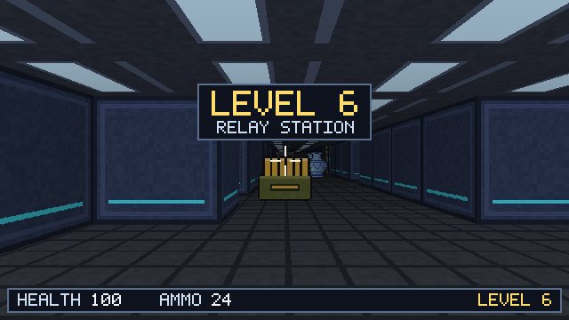

# level06: Relay Station

| Id | Name | Theme | Size | Difficulty | Human time | New mechanic |
|---|---|---|---|---|---|---|
| `level06` | Relay Station | `tech` | 30 × 26 | 6 of 10 | 6–8 min | Ambush rooms behind closed doors; an optional duct loop |



*Start view (headless `--frames 5` screenshot, 640×360).*

## Idea

Level 6 introduces **ambush rooms**: a closed door blocks sight and sound, so a squad waits
behind it until the player opens it. Both ambush doors are signposted the same way, with a decoration
**pair** and a **health pickup within 6 cells before the door**, so the player learns the pattern. The first
(R2) holds three guards standing back from the door; the second (R5) a brute right behind it (the one
allowed close enemy). Between them, the relay hall is an open fight and the antenna wing a short pincer.
The **duct loop** is an optional 1-wide side route with two runners and an ammo pickup that rewards
exploring; the bot never needs it. Keys run blue → gold; the gold door at the east end of the main corridor
is in sight from the start, so the goal is clear from the first second.

## Map

`game/maps/level06.map` as shipped:

```text
; level06 - Relay Station (tech)
; Ambush rooms behind closed doors (a pair and health before each), an optional duct loop; blue -> gold.
######################AAAAAAAA
##################.#..A......A
#########.............D......A
##########.###.#####..A......A
##############D#######A......A
########.............#A......A
##...................#A.A..A.A
##.#####...A.....A...#A......A
##.#####...A.....A...#A......A
##.#####.............#A......A
##.....#.............#A......A
######.#######..######AAAAAAAA
#....#.#######..###...B......B
#.....................DT.....B
#.....................B......B
#....####.###D########B......B
#######AAAAAA.AAAAAA##B......B
#######A...........A##B......B
#######A...........A##B......B
#######A...........A##B......B
#######A..A.....A..A##B......B
#######A...........A##B......B
#######A...........A##B......B
#######A...........A##B......B
#######AAAAAAAAAAAAA##B#B.B##B
######################BBBXBBBB
```

The same grid with the entities of `game/defs/level06.entities.json` drawn in (generated by `python3 -m tools.devkit.level_docs --write`):

```text
   0         1         2
   012345678901234567890123456789
 0 ######################AAAAAAAA
 1 ##################g#hvA......A
 2 #########.......a.....db.g...A
 3 ##########g###.#####.vA......A
 4 ##############2#######A......A
 5 ########.....vav...n.#A......A
 6 ##..n.......g........#A.A..A.A
 7 ##a#####...A.....A...#A......A
 8 ##n#####...A.....A...#A......A
 9 ##.#####.n.........g.#A....y.A
10 ##.....#.............#A......A
11 ######.#######..######AAAAAAAA
12 #....#.#######..###..vB......B
13 #.p...a...............3t.....B
14 #...........v.v......vB......B
15 #....####h###d########B......B
16 #######AAAAAA.AAAAAA##B......B
17 #######A...........A##B.v....B
18 #######A...g.g.g...A##B......B
19 #######A...........A##B.v....B
20 #######A..A.....A..A##B...b..B
21 #######A...........A##B.v....B
22 #######A.....u.....A##B......B
23 #######A...........A##B..h...B
24 #######AAAAAAAAAAAAA##B#B.B##B
25 ######################BBBXBBBB
```

Legend (documentation only: lower case and digits are not valid map tiles; the shipped `.map` above has `.` or `D`/`T` there): `p` player start, `g` guard, `b` brute, `n` runner, `h` health, `a` ammo, `r` / `u` / `y` red / blue / gold key card, `d` unlocked door, `1` / `2` / `3` red / blue / gold locked door, `t` checkpoint trigger, `v` decoration (vase); `#` wall, `A` / `B` wall variants, `X` exit switch. Column numbers run along the top (tens, then units), row numbers down the left. Coordinates are cells `(x, y)`: column, row from the top-left, starting at 0; entities stand at cell centres unless a position is given.

## Areas

- **R1 airlock** x 1–4, y 12–15: spawn (2, 13) facing east into C1.
- **C1 main corridor** x 5–21, y 13–14 (2 wide), with a health alcove (9, 15) and a 3×3 lobby x 19–21,
  y 12–14 in front of the gold door.
- **R2 switch room = ambush 1** x 8–18, y 17–23 (`A` walls, two `A` switch cabinets), behind D2 (13, 15) and a
  1-cell vestibule (13, 16). Blue key at the back.
- **R3 relay hall** x 8–20, y 5–10, four `A` relay racks, open to C1 through a 2-wide passage (14–15, 11–12);
  the blue door Db (14, 4) in its north wall.
- **Duct loop** (optional), 1 wide: from R3's west side (7, 6) west to (2, 6), south to (2, 10), east to
  (6, 10) and down into C1 at (6, 12).
- **R4 antenna wing** behind Db: a neck (14, 3), a corridor along y 2 (x 9–19) with two alcoves (10, 3) and
  (18, 1), and a lobby x 20–21, y 1–3 in front of D5.
- **R5 control room = ambush 2** x 23–28, y 1–10 (`A` walls, two consoles), behind D5 (22, 2). Gold key in the
  far corner.
- **R6 uplink** x 23–28, y 12–23 (`B` walls) behind the gold door Dg (22, 13): the trigger just inside, an exit
  niche (25, 24) with the switch `X` at (25, 25).

## Enemies

| Type | Cell | Where |
|---|---|---|
| guard | (11, 18) | R2 (ambush 1) |
| guard | (15, 18) | R2 (ambush 1) |
| guard | (13, 18) | R2 (ambush 1): the three stand in a line 3 cells in |
| guard | (12, 6) | R3 |
| guard | (19, 9) | R3 |
| guard | (10, 3) | R4 west alcove (pincer) |
| guard | (18, 1) | R4 east alcove (pincer) |
| guard | (25, 2) | R5, 3 cells behind D5 |
| brute | (23, 2) at x 23.7, y 2.5 | R5 (ambush 2): 1.2 cells behind D5, in reach when it opens |
| brute | (26, 20) | R6, 7.6 cells from the first cell behind Dg (8.1 from Dg itself), in the open |
| runner | (9, 9) | R3 |
| runner | (19, 5) | R3 |
| runner | (2, 8) | duct |
| runner | (4, 6) | duct |

Total 8/2/4 (guard/brute/runner) = 14, as in the design table. Threat T = 2·8 + 4·2 + 4 = 28 shots.

## Pickups

All at the default values (+25 HP, +12 ammo).

| Kind | Cell | Where | On the critical path? |
|---|---|---|---|
| ammo | (6, 13) | C1, at the airlock mouth | yes |
| health | (9, 15) | C1 alcove, 4 cells before D2 | side (1 cell off) |
| ammo | (14, 5) | R3, in front of Db | yes (doorway approach) |
| ammo | (2, 7) | duct loop | side (optional loop) |
| ammo | (16, 2) | R4 wing corridor | yes |
| health | (20, 1) | lobby, 2 cells before D5 | side |
| health | (25, 23) | R6, in front of the exit niche (after the brute) | yes |

3 health (75 HP), 4 ammo (48 rounds): as in the economy table.

## Keys, doors and triggers

| Door | Cell | Lock | Key card at | Notes |
|---|---|---|---|---|
| D2 | (13, 15) | none | – | Ambush 1 (R2); pair; health 4 cells before |
| Db | (14, 4) | blue | (13, 22) | R3's north wall; pair |
| D5 | (22, 2) | none | – | Ambush 2 (R5); pair; health 2 cells before |
| Dg | (22, 13) | gold | (27, 9) | End of C1, seen from the spawn; pair |

Order: **blue** (R2) → Db → **gold** (R5) → Dg. `inspect-map --level 6`: keys `blue, gold`.

Checkpoint trigger `T` at (23, 13): the first cell behind Dg; `CHECKPOINT REACHED` as the player enters the uplink.

## Landmarks (decorations)

- **Pairs**: D2 (12, 14) / (14, 14); Db (13, 5) / (15, 5); D5 (21, 1) / (21, 3); Dg (21, 12) / (21, 14).
- **Line**: (24, 17), (24, 19), (24, 21) along R6's west side, pointing south to the exit niche.
- No cluster: one in the airlock filled the start view, and one in the relay hall hid the blue door from the
  passage, so both were removed (a cluster is optional).

## Light zones

None (full light everywhere).

## Walkthrough (critical path)

1. From the airlock, east along C1 (ammo at the mouth). The gold door (pair) is in view at the far end.
2. D2 on C1's south side (pair; the health alcove is 4 cells before it): open it; the three guards stand in
   a line 3 cells in. The blue key is at the back of R2.
3. Back to C1 and north through the passage into R3: 2 guards and 2 runners in the open. Ammo in front of
   Db (pair).
4. Db → neck → wing corridor: the guards in the two alcoves close in from both sides. Ammo on the corridor;
   the lobby with health and the D5 pair.
5. D5: the brute is in reach as the door opens, the guard 3 cells back. Gold key in the far corner (27, 9).
6. Back through the wing, R3 and C1 to the lobby at the east end; Dg → checkpoint → the uplink: the brute is
   7.6 cells away in the open; health in front of the exit niche; the switch at (25, 25).
7. Optional: the duct loop from R3's west side (2 runners, ammo) back to C1 by the airlock.

## Bot results

Measured 2026-11-16 by the integrator on macOS (the Phase 8 integration build). The JSON reports are byte-identical for the arm64 and x86_64 (Rosetta) slices of the universal `build/macos` binary and for the `ci-macos` build; runs are deterministic per build.

| Run | Start HP / ammo | Time s | Damage | HP at exit | Ammo at exit | Kills | Pickups | Keys | Shots |
|---|---|---|---|---|---|---|---|---|---|
| Fresh (`--level 6`) | 100 / 24 | 52.93 | 37 | 88 | 33 | 13/14 | 6/9 | blue, gold | 27 |
| Campaign (`--all`) | 100 / 37 | 52.93 | 37 | 88 | 46 | 13/14 | 6/9 | blue, gold | 27 |

| Target ([README](README.md#bot-difficulty-targets)) | Value | Met |
|---|---|---|
| Fresh: damage taken 20–55 | 37 | yes |
| Fresh: HP at exit ≥ 45 | 88 | yes |
| Fresh: kills ≥ 7 of 14 | 13 | yes |
| Fresh: bot time ≤ 110 s | 52.9 | yes |
| Campaign: HP at exit ≥ 40 | 88 | yes |
| Campaign: ammo at exit ≥ 12 | 46 | yes |

The campaign run ends `Carry-over: OK` and `Result: PASS (10 of 10 level(s) completed, campaign complete)`.

**Where the bot takes its damage** (fresh run, `hit-taken` lines of `--trace`; the cell is where the enemy stood when it hit):

- 6.1 s: guard #8 at (13, 17), 12 damage (HP 88 after)
- 28.6 s: brute #18 at (22, 2), 25 damage (HP 63 after)

Ambush 1 (one guard reaches the bot in D2's vestibule) and ambush 2 (the brute behind D5). The relay hall, the wing pincer and the uplink brute cost nothing.

**Robustness:** with every enemy moved by up to ±0.15 cells (8 seeded variants in scratch copies), the bot's damage was 24–49 (all 8 completed).

## Deviations and exceptions

- None in the counts.
- Ambush 1's guards stand **3.0–3.6 cells** from D2 (a line across R2, 3 cells in) instead of 2–3. At about
  2.2 cells, two of them would be within 1.5 cells of the door's far-side cell (the vestibule), and rule 9
  allows only one such enemy per ambush door. Spreading them to the sides instead made a pincer that cost
  the bot 61 HP.
- No decoration cluster (see Decorations).
- The ambush-2 brute stands at (23.7, 2.5), 0.2 cells east of its cell's centre, so that it is 1.2 cells behind D5 (the one allowed close enemy, rule 9). It is 0.5 from the walls above and below it, so the C20 margin (≥ 0.25 from walls, rule 4) holds and `validate --strict` passes.
- The checkpoint trigger is just inside the gold door Dg, in front of the uplink's brute, the level's last fight (the brief's placement), at about 90 % of the route rather than at its halfway point. Rule 16 allows 'in front of an arena'; the uplink is the level's arena.
