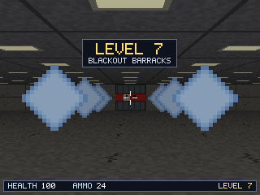
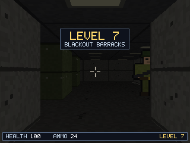

# Level 7: Blackout Barracks (`level07`)

| Id | Theme | Size | Difficulty | Human time | New idea |
|---|---|---|---|---|---|
| `level07` | `bunker` | 32×28 | 7 | 7–9 min | Dark wings (light zones); two keys collected in parallel |



*Start view (headless `--frames 5` screenshot, 320×240).*



*West wing (light 0.35) from the corridor at (7, 15), looking north into bunk room W1: the guard reads against the dark wall.*

## Design intent

Two new ideas, each simple on its own: **dark areas** and **keys in parallel**. Both wings have the
same structure (a dark corridor with side rooms, then a lit key room at the far end), so the second wing is a
variation, not a surprise. The west key room is entered **round a corner** (the brute is met close); the east
one **in line of sight** (the brute is seen across the room). Light is cosmetic for the AI, so the dark wings
hold only guards and runners; the light change marks them off from the lit, safe parade ground. The player
sees the red door straight ahead at the start, and learns that both keys are needed when the gold door
appears behind it.

## Map

`game/maps/level07.map` (grid only; the file starts with two `;` comment lines). Coordinates are (column, row) from the top-left, starting at 0.

```text
AAAAAAAAABBBBBBBBBBBXBBAAAAAAAAA
A.......#B............B#.......A
A.......#B............B........A
A........B............B#.......A
A.......#B............B#.......A
A.......#BBBBBBDBBBBBBB#.......A
A.AAAAAAAA#####.######A#.......A
#.#############.######AAAAAAAA.A
#.#############.##############.#
#.#......######.#######......#.#
#.#.A.A..######.#######..A.A.#.#
#........######D#######......#.#
#.#.A.A..##..........##..A.A.#.#
#.#......##..........##......#.#
#.#####.###..........###.#####.#
#..............................#
######.####..........####.######
##.......##..........##.......##
##.......##..........##....A.A##
##.A.A.A.##..........##.......##
##.......########..####.......##
##.......########..#############
#############...............####
#############..AA...AA......####
#############...........AA..####
#############...............####
#############...............####
################################
```

Legend: `.` floor, `#` wall, `A` wall variant A, `B` wall variant B, `D` door (see the doors below), `T` checkpoint trigger, `X` exit switch.

The same grid with the entities (generated from the entity file): `P` player, `g` guard, `b` brute, `r` runner, `h` health, `a` ammo, `k` key card, `v` decoration (vase), drawn on its floor cell.

```text
   0         1         2         3
   01234567890123456789012345678901
 0 AAAAAAAAABBBBBBBBBBBXBBAAAAAAAAA
 1 A.......#B........g.h.B#.......A
 2 A.......#B..g.........Bkhb.....A
 3 A......hkB.......vvv..B#.......A
 4 A.......#B............B#.......A
 5 A.b.....#BBBBBBDBBBBBBB#.......A
 6 A.AAAAAAAA#####.######A#.......A
 7 #.#############.######AAAAAAAA.A
 8 #.#############.##############.#
 9 #.#.g....######.#######.....g#.#
10 #.#.A.A..######.#######..A.A.#.#
11 #........######D#######...r..#.#
12 #.#.A.A.g##...v.v....##..A.A.#.#
13 #.#r.....##..........##......#.#
14 #.#####.###v..v.v...v###.#####.#
15 #...a......a...............a...#
16 ######.####v..v.v...v####.######
17 ##......r##..........##......g##
18 ##.......##..........##....A.A##
19 ##.A.A.A.##....P.....##.....r.##
20 ##.......########..####.g.....##
21 ##g......########..#############
22 #############h..............####
23 #############..AA...AA...r..####
24 #############...........AA..####
25 #############.a...........r.####
26 #############...............####
27 ################################
```

### Areas

- **R1 parade ground** (lit hub) x 11–20, y 12–19: spawn (15, 19) facing north; the red door straight ahead,
  framed by the cluster.
- **R5 exit wing**: Dr (15, 11) in the hub's north wall, a corridor (15, 6–10), Dg (15, 5), the **exit hall**
  x 10–21, y 1–4 (`B` walls), switch `X` at (20, 0) on its north wall.
- **R2 west wing** (dark): mouth (10, 15), corridor along y 15 (x 1–9), north leg x 1 (y 7–14). Bunk room
  **W1** x 3–8, y 9–13 (`A` bunks) opens to both the leg (2, 11) and the corridor (7, 14); bunk room **W2**
  x 2–8, y 17–21 opens to the corridor at (6, 16).
- **West key room** (lit) x 1–7, y 1–5 (`A` walls), entered at its south-west corner (1, 6) from the north leg;
  red key in a nook (8, 3).
- **R3 east wing** (dark): mouth (21, 15), corridor along y 15 (x 22–30), north leg x 30 (y 7–14). Armoury
  **E1** x 23–28, y 9–13 (racks; doorway (24, 14)); armoury **E2** x 23–29, y 17–20 (doorway (25, 16)).
- **East key room** (lit) x 24–30, y 1–6 (`A` walls), entered at its south-east corner (30, 7); gold key in a
  nook (23, 2).
- **R4 mess hall** (lit, optional) x 13–27, y 22–26 (tables), through a 2-wide passage (17–18, 20–21) from the
  hub's south wall.

## Enemies

| Type | Cell | Where |
|---|---|---|
| guard | (4, 9) | W1 |
| guard | (8, 12) | W1 |
| guard | (2, 21) | W2 |
| guard | (28, 9) | E1 |
| guard | (24, 20) | E2 |
| guard | (29, 17) | E2 |
| guard | (12, 2) | exit hall, 5 cells from Dg |
| guard | (18, 1) | exit hall, 5 cells from Dg |
| brute | (2, 5) | west key room, 1.4 cells round the corner from its doorway |
| brute | (25, 2) | east key room, seen across the room (7.8 cells) from its doorway |
| runner | (3, 13) | W1 |
| runner | (8, 17) | W2 |
| runner | (26, 11) | E1 |
| runner | (28, 19) | E2 |
| runner | (25, 23) | mess hall |
| runner | (26, 25) | mess hall |

Total 8/2/6 (guard/brute/runner) = 16, as in the design table. Threat T = 2·8 + 4·2 + 6 = 30 shots.

## Pickups

All at the default values (+25 HP, +12 ammo).

| Kind | Cell | Where | On the critical path? |
|---|---|---|---|
| ammo | (11, 15) | hub, at the west wing's mouth | yes (the bot's first leg; a person going east passes 9 cells away) |
| ammo | (4, 15) | west wing corridor | yes |
| health | (7, 3) | west key room, in front of the key nook (after the brute) | yes |
| ammo | (27, 15) | east wing corridor | yes |
| health | (24, 2) | east key room, in front of the key nook (after the brute) | yes |
| ammo | (14, 25) | mess hall | side |
| health | (13, 22) | mess hall | side |
| health | (20, 1) | exit hall, in front of the switch (after the 2 guards) | yes |

4 health (100 HP), 4 ammo (48 rounds): as in the economy table.

## Keys, locks and doors

| Door | Cell | Lock | Key card at | Notes |
|---|---|---|---|---|
| Dr | (15, 11) | red | (8, 3) | Hub's north wall, in view from the spawn; pair |
| Dg | (15, 5) | gold | (23, 2) | 5 cells behind Dr (rule 10) |

**Red** (west) and **gold** (east) in **either order**; the exit wing needs both: Dr, then Dg.
`inspect-map --level 7`: keys `gold, red` (either order is intended). The bot fetched red first.

## Decorations (landmarks)

- **Pairs**: Dr (14, 12) / (16, 12); the dark west wing's entrance (11, 14) / (11, 16); the dark east wing's
  entrance (20, 14) / (20, 16).
- **Cluster**: (14, 14), (16, 14), (14, 16), (16, 16) round the parade square; from the spawn they frame the red
  door.
- **Line**: (17, 3), (18, 3), (19, 3) in the exit hall, pointing east to the switch.

## Light zones

From the `lights` array of the entity file, applied in order (later zones win); every other cell is 1.0.

| # | x | y | w | h | Level | Covers |
|---|---|---|---|---|---|---|
| 0 | 1 | 7 | 8 | 15 | 0.35 | **West wing**: corridor, north leg, W1, W2; stops at the key room's doorway (1, 6) |
| 1 | 9 | 15 | 2 | 1 | 0.5 | Soft edge at the west wing's mouth, (9–10, 15) |
| 2 | 22 | 7 | 9 | 14 | 0.35 | **East wing**: corridor, north leg (with the doorway (30, 7)), E1, E2 |
| 3 | 21 | 15 | 2 | 1 | 0.5 | Soft edge at the east wing's mouth, (21–22, 15) |

The hub, the mess hall, both key rooms and the exit wing stay at 1.0, so both key cards, both locked
doors and the exit are in full light. The dark zones hold only guards and runners. Both brutes stand in the
lit key rooms, 2+ cells beyond the zone, and there are no doors in the wings. Checked by screenshot: a guard
in W1 reads clearly against the dark wall (image above).

## Intended route (walkthrough)

1. From the spawn the red door is straight ahead between the vases. Choose a wing.
2. **West**: through the pair into the dark (ammo at the mouth and on the corridor). The bunk rooms open off
   both sides, and W1 also opens to the north leg, so its squad can come from two doorways. North up the
   leg into the lit key room: the brute stands just round the corner. Health, then the red key in its nook.
3. **East**: ammo on the corridor, two armoury rooms, north up the leg. From the doorway the brute is in plain
   view across the room: shoot it as it comes. Health, gold key.
4. Optional: the mess hall south of the spawn (2 runners, health, ammo).
5. Dr → corridor → Dg → the exit hall: 2 guards; health in front of the switch at (20, 0).

## Bot results

Measured 2026-11-16 on macOS with the existing `build/macos/neo_wolf_autoplay` (build of commit `04b86d0`, no rebuild); runs are deterministic per build.

| Run | Result | Time s | Damage | HP start → exit | Ammo start → exit | Kills | Pickups | Keys | Shots |
|---|---|---|---|---|---|---|---|---|---|
| Fresh (`--level 7`) | complete | 70.23 | 49 | 100 → 100 | 24 → 36 | 12/16 | 8/10 | red, gold | 24 |
| Campaign (`--all`) | complete | 70.23 | 49 | 88 → 100 | 46 → 58 | 12/16 | 8/10 | red, gold | 24 |

| Target (README) | Value | Met |
|---|---|---|
| Fresh: damage taken 25–60 | 49 | yes |
| Fresh: HP at exit ≥ 40 | 100 | yes |
| Fresh: kills ≥ 8 of 16 | 12 | yes |
| Fresh: bot time ≤ 120 s | 70.2 | yes |
| Campaign: HP at exit ≥ 35 | 100 | yes |
| Campaign: ammo at exit ≥ 12 | 58 | yes |

The campaign run used builder A's levels 1–5 as they were in the working tree at the time (still in progress); the integrator re-measures the final campaign.

Where the bot takes its damage (fresh run, from `--time-limit` cut-offs and removing one enemy at a time in a scratch copy):

- West wing (bunk rooms): **18**; west key-room brute round the corner: **25**;
- east wing: **6**; east key room (brute seen across): **0**; exit hall: **0**.
- The bot heals at the key-room health pickups and leaves at 100.

## Deviations from the brief

- None in the counts.
- The east wing's first armoury room (E1) has one doorway. An earlier version had a second doorway to the
  north leg, and its squad pincered the bot for 42 HP in two seconds.
