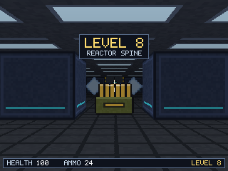

# level08: Reactor Spine

| Id | Name | Theme | Size | Difficulty | Human time | New mechanic |
|---|---|---|---|---|---|---|
| `level08` | Reactor Spine | `tech` | 34 × 34 | 8 of 10 | 8–11 min | Three keys in a chain; mixed squads along a spine with side bays |



*Start view (headless `--frames 5` screenshot, 320×240).*

## Idea

The level's ideas are the **three-key chain** and **mixed squads**. The spine is the backbone:
every lock is across it, so the player always knows where the next door is, and each section has one
on-path bay with the key and one side bay with extra supplies. Squads mix types so the player has to choose
targets: a brute shielding two guards, runner pairs with a guard, a brute guarding a key with runners at the
door. The two unlocked bay doors keep those squads asleep until opened (closed doors block sound), so the
player fights them one bay at a time instead of having them all pour into the spine.

## Map

`game/maps/level08.map` as shipped:

```text
; level08 - Reactor Spine (tech)
; Three keys in a chain (blue -> red -> gold) along a north-south spine; mixed squads in the side bays.
#####BBBBBBBBBBBBBBBBBBBXBBBB#####
#####B......................B#####
#####B......................B#####
#####B.........AAAAA........B#####
#####B.........AAAAA........B#####
#####B......................B#####
#####B......................B#####
#####B......................B#####
#####BBBBBBBBBBB#D#BBBBBBBBBB#####
##.............#...###############
##...A..A..A...#.T..##############
#..............D...#........######
##...A..A..A...#............######
##.............#...#........######
#################D#AAAAAAAAAAAAAAA
##.............#...A....A...A...#A
##.............#...A............#A
##....A...A....#...D.............A
##....A...A........A............#A
##.............#...A............#A
##.............#...A....A...A...#A
AAAAAAAAAAAAAAAA#D#AAAAAAAAAAAAAAA
A#.............A...#............##
A#.............A...#............##
A#...A...A.....A...#....AA......##
A..................#............##
A#...A...A.....A........AA......##
A#.............A...#............##
A#.............A...#............##
AAAAAAAAAAAAAAAA#.################
##########...............#########
##########...............#########
##########...............#########
##################################
```

The same grid with the entities of `game/defs/level08.entities.json` drawn in (generated by `python3 -m tools.devkit.level_docs --write`):

```text
   0         1         2         3
   0123456789012345678901234567890123
 0 #####BBBBBBBBBBBBBBBBBBBXBBBB#####
 1 #####B......................B#####
 2 #####B........v.....v.......B#####
 3 #####B..b......AAAAA......g.B#####
 4 #####B.........AAAAA........B#####
 5 #####B........v.....v.v.....B#####
 6 #####B....g..........v......B#####
 7 #####B..............v.......B#####
 8 #####BBBBBBBBBBB#3#BBBBBBBBBB#####
 9 ##........n....#v.v###############
10 ##..bA..A..A...#.t.h##############
11 #y.............d...#........######
12 ##...A..A..A...#.........g..######
13 ##........n....#.a.#......h.######
14 #################1#AAAAAAAAAAAAAAA
15 ##.............#v.vAb...A...A...#A
16 ##..n.......g..#...A...g........#A
17 ##....A...A....#..ad...........hrA
18 ##....A...A........A...g........#A
19 ##..n..........#...A............#A
20 ##.a...........#...A....A...A...#A
21 AAAAAAAAAAAAAAAA#2#AAAAAAAAAAAAAAA
22 A#..........g.gAv.v#..........h.##
23 A#.............A.n.#.......g....##
24 A#...A...A.....A...#....AA..a...##
25 Au..n..............#............##
26 A#...A...A.....A........AA......##
27 A#.............A...#.........g..##
28 A#.............A...#............##
29 AAAAAAAAAAAAAAAA#a################
30 ##########...............#########
31 ##########...............#########
32 ##########.......p.......#########
33 ##################################
```

Legend (documentation only: lower case and digits are not valid map tiles; the shipped `.map` above has `.` or `D`/`T` there): `p` player start, `g` guard, `b` brute, `n` runner, `h` health, `a` ammo, `r` / `u` / `y` red / blue / gold key card, `d` unlocked door, `1` / `2` / `3` red / blue / gold locked door, `t` checkpoint trigger, `v` decoration (vase); `#` wall, `A` / `B` wall variants, `X` exit switch. Column numbers run along the top (tens, then units), row numbers down the left. Coordinates are cells `(x, y)`: column, row from the top-left, starting at 0; entities stand at cell centres unless a position is given.

## Areas

- **R1 loading dock** x 10–24, y 30–32: spawn (17, 32) facing north; a 1-wide neck (17, 29) into the spine.
- **Spine** x 16–18 (3 wide), y 9–28, cut by Db (17, 21), Dr (17, 14) and Dg (17, 8).
- **Lower section**: **Bay 1** coolant pumps (west, on path) x 2–14, y 22–28 (`A` walls and pumps), doorway
  (15, 25), blue key in a nook (1, 25). **Bay 2** supply (east, side) x 20–31, y 22–28 (crates), doorway (19, 26).
- **Mid section**: **Bay 3** reactor control (east, on path) x 20–31, y 15–20 (`A` walls), unlocked door D3
  (19, 17), red key in a nook (32, 17). **Bay 4** (west, side) x 2–14, y 15–20, doorway (15, 18).
- **Upper section**: **Bay 5** turbine hall (west, on path) x 2–14, y 9–13 (six `A` turbines), unlocked door
  D5 (15, 11), gold key in a nook (1, 11). **Bay 6** (east, side) x 20–27, y 11–13, doorway (19, 12). A health
  alcove (19, 10) and the trigger (17, 10) before Dg.
- **R7 reactor core** (arena) x 6–27, y 1–7 (`B` walls), the reactor block (`A`) x 15–19, y 3–4; exit switch `X`
  at (24, 0).

## Enemies

| Type | Cell | Where |
|---|---|---|
| guard | (14, 22) | Bay 1, north-east corner, 3 cells from the doorway |
| guard | (12, 22) | Bay 1 |
| guard | (27, 23) | Bay 2 |
| guard | (29, 27) | Bay 2 |
| guard | (23, 16) | Bay 3, behind the brute |
| guard | (23, 18) | Bay 3, behind the brute |
| guard | (12, 16) | Bay 4 |
| guard | (25, 12) | Bay 6 |
| guard | (10, 6) | core |
| guard | (26, 3) | core, east |
| brute | (20, 15) | Bay 3, beside D3 inside (round the door frame; 2 cells from its far side) |
| brute | (4, 10) | Bay 5, by the gold key nook |
| brute | (8, 3) | core, west of the reactor block |
| runner | (17, 23) | lower spine (9 cells from the spawn) |
| runner | (4, 25) | Bay 1, by the key |
| runner | (4, 16) | Bay 4 |
| runner | (4, 19) | Bay 4 |
| runner | (10, 9) | Bay 5, near D5 |
| runner | (10, 13) | Bay 5, near D5 |

Total 10/3/6 (guard/brute/runner) = 19, as in the design table. Threat T = 2·10 + 4·3 + 6 = 38 shots.

## Pickups

All at the default values (+25 HP, +12 ammo).

| Kind | Cell | Where | On the critical path? |
|---|---|---|---|
| ammo | (17, 29) | dock neck | yes |
| ammo | (28, 24) | Bay 2 | side |
| health | (30, 22) | Bay 2 | side |
| ammo | (18, 17) | spine, in front of D3 | yes |
| health | (31, 17) | Bay 3, in front of the red key nook (after the fight) | yes |
| ammo | (3, 20) | Bay 4 | side |
| ammo | (17, 13) | upper spine, just past Dr | yes |
| health | (26, 13) | Bay 6 | side |
| health | (19, 10) | alcove 2 cells before Dg, beside the trigger | side |

4 health (100 HP), 5 ammo (60 rounds): as in the economy table.

## Keys, doors and triggers

| Door | Cell | Lock | Key card at | Notes |
|---|---|---|---|---|
| Db | (17, 21) | blue | (1, 25) | Across the spine; pair |
| Dr | (17, 14) | red | (32, 17) | Across the spine; pair |
| Dg | (17, 8) | gold | (1, 11) | Into the reactor core; pair; health and trigger before it |
| D3 | (19, 17) | none | – | Bay 3 (east): the one unlocked door on this side |
| D5 | (15, 11) | none | – | Bay 5 (west): the one unlocked door on this side |

Chain: **blue** (Bay 1) → Db → **red** (Bay 3) → Dr → **gold** (Bay 5) → Dg. `inspect-map --level 8`: keys `blue, red, gold`.

Checkpoint trigger `T` at (17, 10): in the upper spine, 2 cells before Dg, beside the health alcove (19, 10).

## Landmarks (decorations)

- **Pairs**: Db (16, 22) / (18, 22); Dr (16, 15) / (18, 15); Dg (16, 9) / (18, 9).
- **Cluster**: (14, 2), (20, 2), (14, 5), (20, 5) at the corners of the reactor block.
- **Line**: (20, 7), (21, 6), (22, 5), running diagonally from Dg towards the exit switch at (24, 0).

## Light zones

None (full light everywhere).

## Walkthrough (critical path)

1. North from the dock (ammo in the neck); the runner in the lower spine comes at once.
2. **Bay 1** (west): two guards wait in the corner north of the doorway, a runner by the blue key in the nook at the back.
   **Bay 2** (east) is optional: 2 guards, health, ammo.
3. **Db**. Ammo in front of D3. Inside **Bay 3** the brute stands just beside the door (round the frame), the
   two guards behind it. Health in front of the red key nook. **Bay 4** (west) is optional.
4. **Dr**; ammo just past it. **D5** into the turbine hall: 2 runners near the door, the brute by the gold key at
   the far end among the turbines. **Bay 6** is optional.
5. Checkpoint and health alcove; **Dg** (pair). The reactor core: a brute and a guard west of the reactor
   block, a guard to the east. The exit switch is on the north wall to the right of the block, visible from
   Dg; the line of vases points at it.

## Bot results

Measured 2026-11-16 by the integrator on macOS (the Phase 8 integration build). The JSON reports are byte-identical for the arm64 and x86_64 (Rosetta) slices of the universal `build/macos` binary and for the `ci-macos` build; runs are deterministic per build.

| Run | Start HP / ammo | Time s | Damage | HP at exit | Ammo at exit | Kills | Pickups | Keys | Shots |
|---|---|---|---|---|---|---|---|---|---|
| Fresh (`--level 8`) | 100 / 24 | 64.82 | 43 | 82 | 28 | 15/19 | 7/12 | blue, red, gold | 32 |
| Campaign (`--all`) | 100 / 58 | 64.82 | 43 | 82 | 62 | 15/19 | 7/12 | blue, red, gold | 32 |

| Target ([README](README.md#bot-difficulty-targets)) | Value | Met |
|---|---|---|
| Fresh: damage taken 30–70 | 43 | yes |
| Fresh: HP at exit ≥ 35 | 82 | yes |
| Fresh: kills ≥ 10 of 19 | 15 | yes |
| Fresh: bot time ≤ 140 s | 64.8 | yes |
| Campaign: HP at exit ≥ 30 | 82 | yes |
| Campaign: ammo at exit ≥ 15 | 62 | yes |

The campaign run ends `Carry-over: OK` and `Result: PASS (10 of 10 level(s) completed, campaign complete)`.

**Where the bot takes its damage** (fresh run, `hit-taken` lines of `--trace`; the cell is where the enemy stood when it hit):

- 4.8 s: guard #9 at (14, 24), 12 damage (HP 88 after)
- 24.1 s: brute #14 at (20, 16), 25 damage (HP 63 after)
- 43.8 s: runner #22 at (10, 12), 6 damage (HP 82 after)

Bay 1 (a guard beside the doorway), Bay 3 (the brute round D3's frame) and a Bay 5 runner. The reactor core costs nothing.

**Robustness:** with every enemy moved by up to ±0.15 cells (8 seeded variants in scratch copies), the bot's damage was 31–62 (all 8 completed). The lowest, 31, is one point above the band floor.

## Deviations and exceptions

- The spine is **3 cells wide**, not 2, so each lock door is centred in its wall with a decoration pair
  either side. A 2-wide spine leaves no room for a pair and makes the door sit off-centre.
- Size **34×34** (brief 34×32, within ±2).
- Bays 3 and 5 have **unlocked doors** (the one per side the brief allows). In a first version with open
  doorways, every squad heard the gunfire, came out into the spine and was shot at range: the bot took 0 damage.
- Bay 3 (behind the unlocked door D3) plays like an ambush room: its brute stands round D3's frame, 2.0 cells from the far side (rule 9's 1.5 holds), with two guards behind it, and costs the bot 25. It is not signposted as an ambush (no vase pair, no health within 6 cells before D3, economy rule 4); by level 8 the player knows closed doors can hide squads, and the bay's health (31, 17) is on the path right after the fight. Accepted as a combination of earlier ideas.
- The blue key (1, 25) and the gold key (1, 11) are 15 cells from the spine, exactly the rule 12 limit; both are on the path through their bay.
- The decoration line runs diagonally from Dg towards the switch, (20, 7), (21, 6), (22, 5), not along a wall: it points at the exit across the open core.
