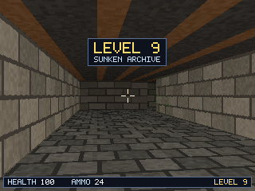

# Level 9: Sunken Archive (`level09`)

| Id | Theme | Size | Difficulty | Human time | New idea |
|---|---|---|---|---|---|
| `level09` | `stone` | 38×36 | 9 | 10–13 min | A non-linear hub with three wings; an optional sealed vault |



*Start view (headless `--frames 5` screenshot, 320×240).*

## Design intent

A **hub level**. The Great Reading Room is crossed four or five times, and every visit shows the
locked doors still waiting (pairs on Db, Dr and the vault). The three wings have three characters: the
**flooded stacks** (long aisles, and a hidden passage to a close-quarters key room), the **catalogue vaults**
(small rooms off a corridor, and a brute seen across a big room) and the **map room** (a mixed squad behind the
blue door). The **sealed vault** is the optional detour the player passes every time. The red and blue keys
can be fetched in either order; the exit needs red and gold.

## Map

`game/maps/level09.map` (grid only; the file starts with two `;` comment lines). Coordinates are (column, row) from the top-left, starting at 0.

```text
AAAAAAAAAAA###########################
A#........A#..............############
A#........A#..............############
A#........A#..............############
A.........A#...AA....AA....###########
A#........A#...AA....AA...############
A#........A#..............############
A#........A#..............############
AAAAAAAAA.A#..............############
#.........########.###################
#.################.###################
#.################.###################
#.###########AAAAADAAAAAA#....#....###
#.........###A..........A#....#....###
#.........###A..........A#....#....###
#.AAAAAA..###A..A....A..A##.#####.####
#.........###A......................##
#.......................A###.######.##
#.........###A..........A#.....####.##
#.AAAAAA..###A..........A#.....####.##
#.........###A..A....A..A#.....####.##
#.........###...........A#.....####.##
#.........#.............A##########.##
#.AAAAAA..#..AAAADAAAADAA##########.##
#.........#..####.####.....AAAAAAAA.AA
#.........#..#.......#.....A.........A
###########..#.......#.....A.........A
###########..#.......#.....A..A......A
###########..#.......#.....A.........A
##############.......######A.........A
###########BBBBBBDBBBBBB###A.........A
###########B...........B###A......A..A
###########B...........B###A.........A
###########B...........B###A.........A
###########B...........B###AAAAAAAAAAA
###########BBBBBBBBBBXBB##############
```

Legend: `.` floor, `#` wall, `A` wall variant A, `B` wall variant B, `D` door (see the doors below), `T` checkpoint trigger, `X` exit switch.

The same grid with the entities (generated from the entity file): `P` player, `g` guard, `b` brute, `r` runner, `h` health, `a` ammo, `k` key card, `v` decoration (vase), drawn on its floor cell.

```text
   0         1         2         3
   01234567890123456789012345678901234567
 0 AAAAAAAAAAA###########################
 1 A#........A#..............############
 2 A#........A#.r............############
 3 A#........A#...........r..############
 4 Akh.......A#...AA....AA..hk###########
 5 A#........A#...AA....AA...############
 6 A#........A#..b...........############
 7 A#......b.A#..............############
 8 AAAAAAAAA.A#....g...g.....############
 9 #.........########.###################
10 #.################a###################
11 #.################.###################
12 #.###########AAAAADAAAAAA#....#...h###
13 #.........###A...v.v....A#..g.#.g..###
14 #...g.....###A.r....g...A#....#....###
15 #.AAAAAA..###A..A....A..A##.#####.####
16 #.........###A................a.....##
17 #.....r....a......vv..r.A###.######.##
18 #.........###A....vv....A#.....####.##
19 #.AAAAAA..###A..........A#.....####.##
20 #....g....###A..A....A..A#.g...####.##
21 #.........###.......g...A#.....####.##
22 #..r......#...a.v.v..v.vA##########.##
23 #.AAAAAA..#..AAAADAAAADAA##########.##
24 #.g.......#..####.####....aAAAAAAAA.AA
25 #.........#..#.....b.#.....A.........A
26 ###########..#.g.....#...r.A.k.......A
27 ###########..#.......#..r..A..A......A
28 ###########P.#.g.....#....hA.........A
29 ##############a.v.v.h######A.........A
30 ###########BBBBBBDBBBBBB###A.........A
31 ###########B...........B###A......A..A
32 ###########B...........B###A.b.......A
33 ###########B...........B###A.........A
34 ###########B......vvv..B###AAAAAAAAAAA
35 ###########BBBBBBBBBBXBB##############
```

### Areas

- **Spawn corridor** x 11–12, y 22–28 (2 wide), entering the hub at its south-west corner (13, 21–22); spawn
  (11, 28) facing north.
- **Hub** (Great Reading Room) x 14–23, y 13–22 (`A` walls, four `A` pillars, the cluster in the centre); wing
  mouths west (13, 17) and east (24, 16); Db (18, 12) north, Dr (17, 23) and Dv (22, 23) south.
- **W wing (flooded stacks)**: mouth corridor (10–13, 17); stacks hall x 1–9, y 13–25 with `A` shelving rows
  (y 15, 19, 23, and x 3–7 on y 17). A winding 1-wide passage (1, 9–12) and (1–9, 9) leads to the **west key
  room** x 2–9, y 1–7 (`A` walls), entered at its south-east doorway (9, 8); red key in a nook (1, 4).
- **E wing (catalogue vaults)**: corridor along y 16 (x 24–35); vaults **V1** x 26–29, y 12–14 (doorway (27, 15)),
  **V2** x 31–34, y 12–14 (doorway (33, 15)), **V3** x 26–30, y 18–21 (doorway (28, 17)); a south leg x 35
  (y 17–24) to the **east key room** x 28–36, y 25–33 (`A` walls, two pillars).
- **N wing (map room)** behind Db: a corridor (18, 9–11), the room x 12–25, y 1–8 with two `A` map tables; gold
  key in a nook (26, 4).
- **Sealed vault** x 22–26, y 24–28 behind Dv.
- **S antechamber** behind Dr: a vestibule (17, 24), the room x 14–20, y 25–29; Dg (17, 30); the **exit
  cistern** x 12–22, y 31–34 (`B` walls), switch `X` at (21, 35).

## Enemies

| Type | Cell | Where |
|---|---|---|
| guard | (20, 14) | hub |
| guard | (20, 21) | hub |
| guard | (4, 14) | W stacks |
| guard | (5, 20) | W stacks |
| guard | (2, 24) | W stacks |
| guard | (28, 13) | E vault V1 |
| guard | (32, 13) | E vault V2 |
| guard | (27, 20) | E vault V3 |
| guard | (16, 8) | map room, beside the entrance |
| guard | (20, 8) | map room, beside the entrance |
| guard | (15, 26) | S antechamber |
| guard | (15, 28) | S antechamber |
| brute | (8, 7) | west key room, beside the doorway (round the corner) |
| brute | (29, 32) | east key room, seen across the room (9.2 cells from its doorway) |
| brute | (14, 6) | map room |
| brute | (19, 25) | S antechamber, round the corner from Dr's vestibule |
| runner | (15, 14) | hub |
| runner | (22, 17) | hub |
| runner | (6, 17) | W stacks |
| runner | (3, 22) | W stacks |
| runner | (13, 2) | map room |
| runner | (23, 3) | map room |
| runner | (25, 26) | vault |
| runner | (24, 27) | vault |

Total 12/4/8 (guard/brute/runner) = 24, as in the design table. Threat T = 2·12 + 4·4 + 8 = 48 shots.

## Pickups

All at the default values (+25 HP, +12 ammo).

| Kind | Cell | Where | On the critical path? |
|---|---|---|---|
| ammo | (14, 22) | hub, where the spawn corridor enters | yes |
| ammo | (11, 17) | W mouth corridor | yes |
| health | (2, 4) | west key room, in front of the red key nook (after the brute) | yes |
| ammo | (30, 16) | E corridor | yes |
| health | (34, 12) | E vault V2 | side |
| ammo | (18, 10) | N corridor behind Db | yes |
| health | (25, 4) | map room, in front of the gold key nook | yes |
| ammo | (26, 24) | sealed vault | side (optional) |
| health | (26, 28) | sealed vault | side (optional) |
| ammo | (14, 29) | S antechamber corner | side |
| health | (20, 29) | S antechamber, 3 cells before Dg | side |

5 health (125 HP), 6 ammo (72 rounds): as in the economy table.

## Keys, locks and doors

| Door | Cell | Lock | Key card at | Notes |
|---|---|---|---|---|
| Db | (18, 12) | blue | (29, 26) | Hub's north wall; pair |
| Dr | (17, 23) | red | (1, 4) | Hub's south wall; pair |
| Dv | (22, 23) | none | – | Sealed vault (optional); pair; 5 cells from Dr |
| Dg | (17, 30) | gold | (26, 4) | 7 cells behind Dr; pair |

**Red** (W wing) and **blue** (E wing) in either order; **gold** behind Db (N wing); the exit behind Dr, then
Dg. `inspect-map --level 9`: keys `blue, red, gold`. The bot went blue → gold → red, crossing the hub four times.

## Decorations (landmarks)

- **Pairs**: Db (17, 13) / (19, 13); Dr (16, 22) / (18, 22); Dv (21, 22) / (23, 22); Dg (16, 29) / (18, 29).
- **Cluster**: four vases round the centre of the hub, (18–19, 17–18).
- **Line**: (18, 34), (19, 34), (20, 34) along the cistern's south wall, pointing at the switch.

## Light zones

None (full light everywhere).

## Intended route (walkthrough)

1. Up the spawn corridor into the hub (ammo at the entry): 2 guards and 2 runners among the pillars. From
   here: the blue door north, the red door and the vault door south, wing mouths west and east.
2. **E wing**: ammo on the corridor, a guard in each of the three vaults (health in V2), then down the south leg
   into the key room. The brute is across the room. Blue key.
3. Back across the hub to **Db**; ammo in the corridor. The map-room squad: 2 guards either side of the
   entrance, the brute and 2 runners further in. Health and the gold key in the east nook.
4. **W wing**: ammo in the mouth; 3 guards and 2 runners in the stacks' aisles; the winding passage; the key
   room, where the brute waits beside the doorway. Health, red key.
5. Optional: the **vault** (2 runners, ammo, health).
6. **Dr**: the brute round the corner of the vestibule, 2 guards; health and ammo in the corners. **Dg**: the
   cistern and the exit at (21, 35).

## Bot results

Measured 2026-11-16 on macOS with the existing `build/macos/neo_wolf_autoplay` (build of commit `04b86d0`, no rebuild); runs are deterministic per build.

| Run | Result | Time s | Damage | HP start → exit | Ammo start → exit | Kills | Pickups | Keys | Shots |
|---|---|---|---|---|---|---|---|---|---|
| Fresh (`--level 9`) | complete | 106.00 | 62 | 100 → 75 | 24 → 27 | 21/24 | 9/14 | blue, gold, red | 45 |
| Campaign (`--all`) | complete | 106.00 | 62 | 82 → 70 | 62 → 65 | 21/24 | 9/14 | blue, gold, red | 45 |

| Target (README) | Value | Met |
|---|---|---|
| Fresh: damage taken 35–80 | 62 | yes |
| Fresh: HP at exit ≥ 30 | 75 | yes |
| Fresh: kills ≥ 12 of 24 | 21 | yes |
| Fresh: bot time ≤ 160 s | 106.0 | yes |
| Campaign: HP at exit ≥ 30 | 70 | yes |
| Campaign: ammo at exit ≥ 20 | 65 | yes |

The campaign run used builder A's levels 1–5 as they were in the working tree at the time (still in progress); the integrator re-measures the final campaign.

Where the bot takes its damage (fresh run, from `--time-limit` cut-offs and removing one enemy at a time in a scratch copy):

- N map room: **12**; west key-room brute: **25**; S antechamber brute: **25**;
- hub, W stacks and E wing: **0**.

## Deviations from the brief

- None in the counts.
- The W wing has a winding 12-cell passage between the stacks and the key room. Without it, the key-room
  brute heard the stacks fight and walked out into the open (0 damage), which lost the close encounter the
  brief asks for.
