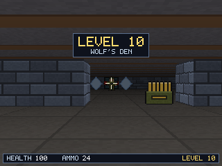
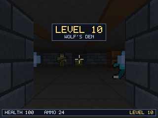
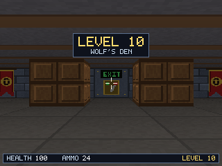

# level10: Wolf's Den

| Id | Name | Theme | Size | Difficulty | Human time | New mechanic |
|---|---|---|---|---|---|---|
| `level10` | Wolf's Den | `classic` | 40 × 40 | 10 of 10 | 12–15 min | Finale: a gauntlet of the earlier ideas, a supply room with a checkpoint, a final arena |



*Start view (headless `--frames 5` screenshot, 320×240): the gatehouse in the `classic` theme's blue-grey stone, the ammo crate, and across the courtyard the vase pair of the red door Dr with a guard in front of it.*



*The dim chapel (0.5) from its corridor at (11, 9), looking west down the nave.*



*The throne room's north wall from (33, 6): the exit switch between red banners, framed by the throne's oak arms.*

## Idea

The finale replays the campaign's ideas at full strength, in a clear order with one breather:
1. an open courtyard warm-up (levels 1–4);
2. a brute round a corner (4, 7);
3. a pincer hall (3, 6);
4. an ambush room behind a signposted door (6);
5. a quiet **supply room with a checkpoint** (the breather);
6. a dim area (5, 7) with a brute seen across;
7. a final **arena** where the pillars keep the two brutes from arriving together.

The `classic` theme (blue-grey castle stone, oak panelling, red banners) makes the castle look unlike every earlier level.

## Map

`game/maps/level10.map` as shipped:

```text
; level10 - Wolf's Den (classic)
; Finale: courtyard, tower brute, pincer hall, barracks ambush, supply checkpoint, dim chapel, throne-room arena.
###########################AAABBBXBBBAAA
#####.#####################A...........A
##........#################A....A.A....A
##........#################A...........A
##..A..A..#################A..A.....A..A
#.........####AAAAAAAAAA###A...........A
##........####A........A###A...........A
##..A..A..####A........A###A...........A
##........####A........A...A...........A
#..........................D..A.....A..A
##........####A........A...A...........A
##........####A........A###A...........A
##############A....T...A###A...........A
#AAAAAAAAAA##.AAAAADAAAA###AAAAAAAAAAAAA
#A#......#A..................##.......##
#A#......#....................#...A...##
#A#.......A...A..A....A..A...##.......##
#A#......#A..................##.......##
#A#......#...................D........##
#A.......#A..................##.......##
#A.AAAAAAAA..................##.......##
##.#######....A..A....A..A....#...A...##
##.########..................##.......##
##.########..................###########
##.################D####################
##.###............................######
##.###............................######
##.###............................######
##.###.....A................A.....######
##.###............................######
##.###.....A................A.....######
##.###............................######
##................................######
######............................######
###################..###################
################........################
################........################
################........################
################........################
########################################
```

The same grid with the entities of `game/defs/level10.entities.json` drawn in (generated by `python3 -m tools.devkit.level_docs --write`):

```text
   0         1         2         3
   0123456789012345678901234567890123456789
 0 ###########################AAABBBXBBBAAA
 1 #####y#####################A...........A
 2 ##....n...#################A....A.A..n.A
 3 ##.b....g.#################A...........A
 4 ##..A..A..#################A..A.....A..A
 5 #h........####AAAAAAAAAA###A...........A
 6 ##........####A........A###A.b..v..g...A
 7 ##..A..A..####A...v.v..A###A...g.......A
 8 ##......nv####A........A..vA....v......A
 9 #a.............ah....ha....3..A.....A..A
10 ##.g.....v####A........Ah.vA....v......A
11 ##........####A...v.v..A###A.n.......b.A
12 ##############A....t...A###A...........A
13 #AAAAAAAAAA##gAAAAA2AAAA###AAAAAAAAAAAAA
14 #A#......#A.......v.v........##.......##
15 #A#......#g..................n#...A.a.##
16 #A#.....hrA...A..A....A..A...##.......##
17 #A#b.....#A.................v##..g....##
18 #A#......#n..................db.....u.##
19 #A.......#A.................v##..g....##
20 #A.AAAAAAAA..................##.......##
21 ##.#######g...A..A....A..A...h#...A...##
22 ##.########..................##.......##
23 ##.########........a.........###########
24 ##.################1####################
25 ##.###............v.v.............######
26 ##a###..g......................g..######
27 ##.###.............g..............######
28 ##.###.....A................A.....######
29 ##.###............................######
30 ##.###.....A................A.....######
31 ##.###............................######
32 ##.....n........................n.######
33 ######............................######
34 ###################.a###################
35 ################........################
36 ################........################
37 ################........################
38 ################...p....################
39 ########################################
```

Legend (documentation only: lower case and digits are not valid map tiles; the shipped `.map` above has `.` or `D`/`T` there): `p` player start, `g` guard, `b` brute, `n` runner, `h` health, `a` ammo, `r` / `u` / `y` red / blue / gold key card, `d` unlocked door, `1` / `2` / `3` red / blue / gold locked door, `t` checkpoint trigger, `v` decoration (vase); `#` wall, `A` / `B` wall variants, `X` exit switch. Column numbers run along the top (tens, then units), row numbers down the left. Coordinates are cells `(x, y)`: column, row from the top-left, starting at 0; entities stand at cell centres unless a position is given.

## Areas

- **R1 drawbridge gate** x 16–23, y 35–38: spawn (19, 38) facing north; the gate opening (19–20, 34).
- **R2 outer courtyard** x 6–33, y 25–33 (four `A` statues); the red door Dr (19, 24) in its north wall.
- **West tower**: from the courtyard's west side a 1-wide stair runs west (2–5, 32), turns north up x 2
  (y 20–31), then turns east into the **tower top** x 3–8, y 14–19 (`A` walls) at (2, 19) → (3, 19). Red key in
  a nook (9, 16).
- **R3 great hall** x 11–28, y 14–23, eight `A` pillars; alcoves west (10, 15), (10, 18), (10, 21), north
  (13, 13), east (29, 15), (29, 21). The barracks door Dk (29, 18) is in the east wall, the blue door Db
  (19, 13) in the north wall.
- **Barracks** x 31–37, y 14–22 (two bunks), behind Dk and a 1-cell vestibule (30, 18).
- **R4 armoury / supply** x 15–22, y 6–12 (`A` walls): the trigger (19, 12) just inside Db; exits west (14, 9) to
  the chapel and east (23, 9) to the lobby.
- **R5 chapel**: a corridor (10–14, 9) and the nave x 2–9, y 2–11 (four `A` columns), dark side alcoves (1, 5)
  and (1, 9), the gold key in the apse (5, 1).
- **Lobby** x 24–26, y 8–10 in front of the gold door Dg (27, 9).
- **R6 throne room arena** x 28–38, y 1–12 (`A` walls), four `A` pillars, the throne's arms (32, 2) and (34, 2);
  switch `X` at (33, 0) behind the throne, on a wall of red banners (`B`, (30–32, 0) and (34–36, 0)).

## Enemies

| Type | Cell | Where |
|---|---|---|
| guard | (8, 26) | courtyard |
| guard | (31, 26) | courtyard |
| guard | (19, 27) | courtyard, in front of Dr |
| guard | (10, 15) | hall, west alcove |
| guard | (10, 21) | hall, west alcove |
| guard | (13, 13) | hall, north alcove |
| guard | (33, 17) | barracks, 3.2 cells back |
| guard | (33, 19) | barracks, 3.2 cells back |
| guard | (8, 3) | chapel |
| guard | (3, 10) | chapel |
| guard | (31, 7) | arena |
| guard | (35, 6) | arena |
| brute | (3, 17) | tower top, round the last corner (2 cells north of the room's first cell) |
| brute | (30, 18) at x 30.7, y 18.5 | barracks (ambush): 1.2 cells behind Dk, in its vestibule |
| brute | (3, 3) | chapel, far end of the nave (seen across from the corridor) |
| brute | (29, 6) | arena, 3.2 cells north of the entrance |
| brute | (37, 11) | arena, far south-east corner behind a pillar |
| runner | (7, 32) | courtyard |
| runner | (32, 32) | courtyard |
| runner | (10, 18) | hall, west alcove |
| runner | (29, 15) | hall, east alcove |
| runner | (6, 2) | chapel |
| runner | (8, 8) | chapel |
| runner | (37, 2) | arena |
| runner | (29, 11) | arena |

Total 12/5/8 (guard/brute/runner) = 25, as in the design table. Threat T = 2·12 + 4·5 + 8 = 52 shots.

## Pickups

All at the default values (+25 HP, +12 ammo).

| Kind | Cell | Where | On the critical path? |
|---|---|---|---|
| ammo | (20, 34) | courtyard gate | yes for a person walking straight in (the bot passes the gate's other half) |
| ammo | (2, 26) | tower stair, on the way up | yes |
| health | (8, 16) | tower top, in front of the red key nook (after the brute) | yes |
| ammo | (19, 23) | hall, just inside Dr | yes |
| health | (29, 21) | hall's east alcove, 3 cells from Dk | side |
| ammo | (36, 15) | barracks | side |
| ammo | (15, 9) | supply room, in front of its west exit | yes |
| health | (16, 9) | supply room, west exit | yes |
| health | (21, 9) | supply room, east exit | yes |
| ammo | (22, 9) | supply room, in front of its east exit | yes |
| health | (1, 5) | chapel's dark north-west alcove | side |
| ammo | (1, 9) | chapel's dark south-west alcove | side |
| health | (24, 10) | lobby, 3 cells before Dg | side |

6 health (150 HP), 7 ammo (84 rounds): as in the economy table.

## Keys, doors and triggers

| Door | Cell | Lock | Key card at | Notes |
|---|---|---|---|---|
| Dr | (19, 24) | red | (9, 16) | Courtyard's north wall, in view from the spawn; pair |
| Dk | (29, 18) | none | – | Barracks ambush (unlocked); pair; health 3 cells before |
| Db | (19, 13) | blue | (36, 18) | Hall's north wall; pair |
| Dg | (27, 9) | gold | (5, 1) | Throne room; pair; health in the lobby |

Chain: **red** (tower) → Dr → **blue** (barracks) → Db → **gold** (chapel) → Dg. `inspect-map --level 10`: keys `red, blue, gold`.

Checkpoint trigger `T` at (19, 12): the first cell inside Db: `CHECKPOINT REACHED` as the player enters the quiet supply room. It does not save; a death restarts the level.

## Landmarks (decorations)

- **Pairs**: Dr (18, 25) / (20, 25); Dk (28, 17) / (28, 19); Db (18, 14) / (20, 14); Dg (26, 8) / (26, 10); the dim
  chapel's entrance (9, 8) / (9, 10).
- **Cluster**: (18, 7), (20, 7), (18, 11), (20, 11) in the supply room.
- **Line**: (32, 10), (32, 8), (32, 6) along the west side of the throne aisle, pointing north to the throne.

## Light zones

From the `lights` array of the entity file, applied in order (later zones win); every other cell is 1.0.

| # | x | y | w | h | Level | Covers |
|---|---|---|---|---|---|---|
| 0 | 1 | 1 | 13 | 11 | 0.5 | **Chapel**: the corridor (10–13, 9) and the whole nave, dim |
| 1 | 1 | 5 | 1 | 1 | 0.35 | The north-west side alcove (health), dark |
| 2 | 1 | 9 | 1 | 1 | 0.35 | The south-west side alcove (ammo), dark |

The gold key (5, 1) and the nave brute are in the 0.5 zone, so they stay readable; only off-path
pickups are in the two 0.35 pockets. The supply room, the lobby and the arena are 1.0. Checked by screenshot:
a guard in the nave reads clearly from the corridor (image above).

## Walkthrough (critical path)

1. Through the gate (ammo) into the courtyard: 3 guards and 2 runners in the open, the red door ahead.
2. West to the **tower**: the stair turns twice (ammo on the way up). At the top the brute waits just round
   the last corner. Health and the red key in the nook.
3. **Dr**; ammo inside. The first shot in the hall wakes the five alcove enemies, and they converge from both
   sides. Health in the east alcove, then the **barracks door** (pair): the brute is right behind it, two guards
   further back. Blue key at the far end, ammo in the corner.
4. **Db** (pair): the checkpoint, and the quiet supply room with 2 health and 2 ammo by its two exits and
   the cluster.
5. West through the pair into the **dim chapel**: the brute at the far end of the nave, 2 guards and 2 runners
   among the columns, dark alcoves with health and ammo. Gold key in the apse.
6. Back through the supply room to the lobby (health, pair) and **Dg**: the throne room. One brute stands near
   the entrance, the other in the far corner behind a pillar, so they arrive one at a time; 2 guards and 2
   runners. The exit is behind the throne, at the end of the aisle.

## Bot results

Measured 2026-11-16 by the integrator on macOS (the Phase 8 integration build). The JSON reports are byte-identical for the arm64 and x86_64 (Rosetta) slices of the universal `build/macos` binary and for the `ci-macos` build; runs are deterministic per build.

| Run | Start HP / ammo | Time s | Damage | HP at exit | Ammo at exit | Kills | Pickups | Keys | Shots |
|---|---|---|---|---|---|---|---|---|---|
| Fresh (`--level 10`) | 100 / 24 | 95.07 | 81 | 75 | 23 | 23/25 | 10/16 | red, blue, gold | 49 |
| Campaign (`--all`) | 70 / 65 | 100.03 | 81 | 75 | 64 | 23/25 | 11/16 | red, blue, gold | 49 |

| Target ([README](README.md#bot-difficulty-targets)) | Value | Met |
|---|---|---|
| Fresh: damage taken 45–95 | 81 | yes |
| Fresh: HP at exit ≥ 25 | 75 | yes |
| Fresh: kills ≥ 15 of 25 | 23 | yes |
| Fresh: bot time ≤ 180 s | 95.1 | yes |
| Campaign: HP at exit ≥ 25 | 75 | yes |

The campaign run ends `Carry-over: OK` and `Result: PASS (10 of 10 level(s) completed, campaign complete)`.

**Where the bot takes its damage** (fresh run, `hit-taken` lines of `--trace`; the cell is where the enemy stood when it hit):

- 15.4 s: brute #12 at (3, 19), 25 damage (HP 75 after)
- 47.1 s: brute #18 at (30, 18), 25 damage (HP 75 after)
- 47.6 s: runner #16 at (28, 17), 6 damage (HP 69 after)
- 90.7 s: brute #26 at (28, 9), 25 damage (HP 75 after)

The tower brute round the last corner, the barracks ambush (the brute behind Dk, plus an alcove runner) and the near arena brute. The chapel costs nothing (its brute is seen across the nave).

**Robustness:** with every enemy moved by up to ±0.15 cells (8 seeded variants in scratch copies), the bot's damage was 56–81 (all 8 completed). The arena's squad timing is not fragile: moving each arena enemy alone by up to 0.2 cells (36 variants) gave 81 every time.

## Deviations and exceptions

- None in the counts.
- **Classic theme (integrator, Phase 8):** the builder found that the old `classic` theme used its `B` wall texture as the plain door, so doors did not read as doors; the barracks door therefore has no `B` walls near it and the exit's `B` frame was only the two cells beside the switch. The theme now has its own 32×32 textures (blue-grey stone, oak panelling `A`, a red banner `B`, a riveted steel door with brass handles; [ASSET_GUIDE.md](../ASSET_GUIDE.md#4-texture-themes)), and the throne room's north wall carries six banner cells, (30–32, 0) and (34–36, 0), either side of the switch (a wall-tile change only: the bot's results are unchanged).
- Rule 11: the switch itself is first seen about 4 cells into the arena (from (31, 8) or (31, 10)); from the entrance the banner wall either side of it is in view and the decoration line points up the aisle to it.
- The barracks brute stands at (30.7, 18.5), 0.2 cells east of its cell's centre, 1.2 cells behind Dk (the designated ambush; the one allowed close enemy, rule 9), 0.5 from the walls above and below (rule 4 holds).
- The supply-room cluster is a 2 × 4 rectangle round the trigger rather than a square, and the line stands in the middle of the throne room along the aisle rather than against a wall: both still read from the doorways.
