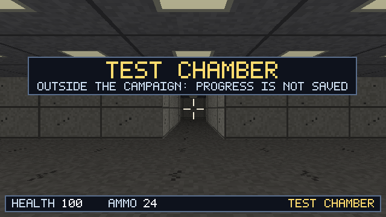
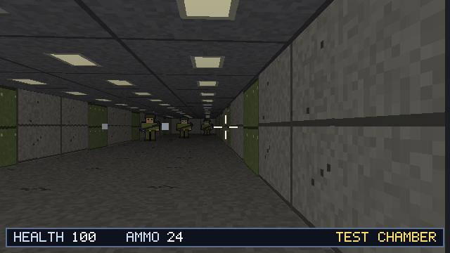
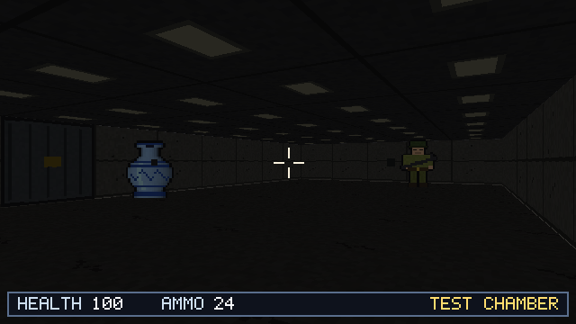

# testchamber: Test Chamber

| Id | Name | Theme | Size | Part of the campaign | Purpose |
|---|---|---|---|---|---|
| `testchamber` | Test Chamber | `bunker` | 44 × 30 | no (`campaign.json` `"testLevel"`) | A development level: every enemy type, pickup, key, lock, prop and light level of the game in one place, each in its own signposted area |



*Start view: the hub, looking north up the corridor to the enemy gallery; the banner says the
level is outside the campaign.*

## Idea

The Test Chamber is on the main menu, and with `"bootIntoTestLevel": true` in
[`campaign.json`](../CONTENT_DEFINITIONS.md#test-level) the game opens straight into it, so a new
feature can be tried the moment the game starts, without playing into the campaign first (the
shipped demo starts on the main menu). The player starts in a
central hub; every area hangs off it and tests one thing. Walking into an area's entrance shows
its name on the HUD (a trigger with a `"message"`; once per start of the level, like any
trigger), so it is always clear what an area is for.
The level grows with the engine: new enemies, weapons and breakable props each get an area here
([Extending it](#extending-it)).

How it behaves (details in [GAMEPLAY.md](../GAMEPLAY.md#the-test-chamber)):

- It starts at full health and the starting ammo (`gameplay.json`), with no keys.
- It is **outside the campaign**: it never writes `progress.json`, never unlocks a level and is
  not in Level Select; the HUD shows `TEST CHAMBER` instead of a level number.
- The exit switch (in the gold room) **restarts** it, as does dying and then `R` or `Enter` on
  the game-over screen, or `R` at any time.
- To play the campaign: `Esc`, then `Q` (quit to the main menu), then **New Game** or
  **Continue**. The main menu's **TEST CHAMBER** item comes back here.
- `--level N` still starts campaign level N and `--preview` still shows its screen; the Test
  Chamber is only the default start.

## Map

`game/maps/testchamber.map` as shipped:

```text
; testchamber - Test Chamber (bunker), a development level outside the campaign
; Hub in the middle; enemy gallery (north), pickups and props (west), lock test (east),
; weapon range and dark room (south). The exit switch in the gold room restarts the level.
############################################
#######...##...##...###.......##############
#######...##...##...###.......##############
#######...##...##...###.......##############
#######...##...##...###.......##############
#######ADA##ADA##ADA#####ADA################
######..T....T....T.......T....#############
######.........................#############
#####################.######################
#####################.######################
#####################.################BXB###
#............########T########...#...#...###
#............########.########...#...#...###
#..............T..........####...#...#.T.###
#............####.........####BDB#BDB#BDB###
#################.........###..............#
#............####..........T...............#
#............####.........###..............#
#..............T..........##################
#............####.........##################
##################.#####.###################
##################T#####T###################
##################.#####.###################
###A##A##A##A##A##D#####D###################
#..................###.........#############
#.................####.........#############
#.................####.........#############
###A##A##A##A##A######.........#############
######################.........#############
############################################
```

The same grid with the entities of `game/defs/testchamber.entities.json` drawn in (generated by `python3 -m tools.devkit.level_docs --write`):

```text
   0         1         2         3         4
   01234567890123456789012345678901234567890123
 0 ############################################
 1 #######...##...##...###...n...##############
 2 #######.g.##.b.##.n.###.g...b.##############
 3 #######...##...##...###.......##############
 4 #######...##...##...###.......##############
 5 #######AdA##AdA##AdA#####AdA################
 6 ######..t....t....t.......t....#############
 7 ######.........................#############
 8 #####################.######################
 9 #####################.######################
10 #####################.################BXB###
11 #..h.a.r.u.y.########t########...#...#...###
12 #............########.########.h.#.a.#...###
13 #..............t..........####...#...#.t.###
14 #............####.........####B1B#B2B#B3B###
15 #################.........###..............#
16 #.v.v.v.v.v..####....p.....t...............#
17 #............####.........###..............#
18 #..v..v........t..........##################
19 #............####.........##################
20 ##################.#####.###################
21 ##################t#####t###################
22 ##################.#####.###################
23 ###A##A##A##A##A##d#####d###################
24 #..g...............###.v.v.....#############
25 #......g..........####.........#############
26 #........g........####.........#############
27 ###A##A##A##A##A######h......g.#############
28 ######################.........#############
29 ############################################
```

Legend (documentation only: lower case and digits are not valid map tiles; the shipped `.map` above has `.` or `D`/`T` there): `p` player start, `g` guard, `b` brute, `n` runner, `h` health, `a` ammo, `r` / `u` / `y` red / blue / gold key card, `d` unlocked door, `1` / `2` / `3` red / blue / gold locked door, `t` sign (a trigger with a message), `v` decoration (vase); `#` wall, `A` / `B` wall variants, `X` exit switch. Column numbers run along the top (tens, then units), row numbers down the left. Coordinates are cells `(x, y)`: column, row from the top-left, starting at 0.

## Areas

Each area's entrance has a sign: a trigger that shows the text in the last column on the HUD
when the player walks over it (once per start of the level).

| Area | Cells | Entrance from the hub | What it tests | Sign |
|---|---|---|---|---|
| Hub | (17, 13)–(25, 19) | – | the player start, facing north (angle 270) | – |
| Enemy gallery | hall (6, 6)–(30, 7); cells above it | north corridor (21, 8)–(21, 12) | one cell per enemy type behind its own (unlocked) door, plus a mixed group; the player opens a door to start that fight | `ENEMY GALLERY`; in front of each door `CELL: GUARD`, `CELL: BRUTE`, `CELL: RUNNER`, `CELL: MIXED GROUP` |
| Pickups row | (1, 11)–(12, 14) | west corridor at row 13 | health, ammo and the red, blue and gold key cards in a row along the north wall | `PICKUPS: HEALTH AMMO AND KEYS` |
| Props row | (1, 16)–(12, 19) | west corridor at row 18 | seven vases: five along the north wall, two standing free (they become breakable later) | `PROPS: VASES (BREAKABLE LATER)` |
| Lock test | hall (29, 15)–(42, 17); rooms (30–32, 34–36, 38–40; 11–13) | east corridor at row 16 | red, blue and gold locked doors in a row (framed by `B` hazard stripes), each to a small room: red has a health pack, blue an ammo box, gold the exit switch | `LOCK TEST: RED BLUE AND GOLD DOORS`; in the gold room `EXIT SWITCH: RESTARTS THE CHAMBER` |
| Weapon range | (1, 24)–(18, 26), 18 cells long | south-west corridor (18, 20)–(18, 22), door (18, 23) | three guards at 9, 11 and 15 cells from the firing booth (18, 24) just inside the door, each on its own row so none hides another; `A` markers in both side walls every 3 cells from the booth (columns 15, 12, 9, 6, 3 = 3, 6, 9, 12, 15 cells). The weapon reaches 12 cells (the marker at column 6), so the guards at 9 and 11 can be hit and the one at 15 cannot. See [The weapon range](#the-weapon-range) | `WEAPON RANGE: TARGETS AT 9 11 AND 15` |
| Dark room | (22, 24)–(30, 28) | south-east corridor (24, 20)–(24, 22), door (24, 23) | the darkest light zone (0.2) with a guard and a health pack in it; a pair of vases either side of the doorway marks where the dark zone starts | `DARK ROOM: DARKEST LIGHT ZONE` |



*The weapon range from the firing booth, turned slightly north: the guards at 9, 11 and 15 cells
(left to right), and the green distance markers in the side walls.*



*The dark room at light level 0.2 from its south-west corner, looking north-east: the guard
stays visible (sprites are never drawn darker than 0.35); on the left, the door and one of the
two vases that mark the doorway.*

## The weapon range

Fire from the booth just inside the door, (18, 24): that is where the distances on the sign and
the wall markers count from. The targets are ordinary guards (a static target comes later), so
they are placed to stay where they are until they are hit:

- each is more than 6.5 cells away (a guard's `alertRadius`), so none notices the player in the
  booth;
- each is more than 10 cells away along the floor (the shot's `noiseRadius`, counted cell by
  cell around walls: 11, 12 and 15 from the booth), so a shot wakes none of them;
- each stands on its own row, so no guard is in the line of fire to another.

A guard that is hit wakes up and walks to the player; the others stay put. Firing from further
into the range brings the targets within hearing, and `R` puts everything back.

## Enemies

| Type | Cell | Area |
|---|---|---|
| guard | (8, 2) | gallery, guard cell |
| brute | (13, 2) | gallery, brute cell |
| runner | (18, 2) | gallery, runner cell |
| guard, runner, brute | (24, 2), (26, 1), (28, 2) | gallery, mixed group |
| guard × 3 | (9, 26), (7, 25), (3, 24) | weapon range: 9, 11 and 15 cells from the firing booth |
| guard | (29, 27) | dark room |

Total: 6 guards, 2 brutes, 2 runners, every one behind a closed door: none can see or hear the
player at the start (closed doors block sight and sound).

## Pickups

| Kind | Cell | Area |
|---|---|---|
| health, ammo | (3, 11), (5, 11) | pickups row |
| red, blue, gold key card | (7, 11), (9, 11), (11, 11) | pickups row |
| health | (31, 12) | lock test, red room |
| ammo | (35, 12) | lock test, blue room |
| health | (22, 27) | dark room |

All at the default values (+25 HP, +12 ammo).

## Keys, doors and triggers

| Thing | Cell | Notes |
|---|---|---|
| doors (unlocked) | (8, 5), (13, 5), (18, 5), (26, 5) | the gallery cells, framed by `A` walls |
| door (unlocked) | (18, 23) | weapon range |
| door (unlocked) | (24, 23) | dark room |
| red, blue, gold locked doors | (31, 14), (35, 14), (39, 14) | lock test, framed by `B` walls |
| exit switch `X` | (39, 10) | the gold room's north wall, framed by `B` walls; it restarts the Test Chamber |
| decorations (vases) | (2, 16), (4, 16), (6, 16), (8, 16), (10, 16), (3, 18), (6, 18); (23, 24), (25, 24) | the props row; the pair either side of the dark room's doorway |
| signs (triggers with a message) | (21, 11), (8, 6), (13, 6), (18, 6), (26, 6), (15, 13), (15, 18), (27, 16), (39, 13), (18, 21), (24, 21) | see [Areas](#areas) |

Keys in the order `validate` reaches them: blue, gold, red (all three lie in the pickups row,
before every lock).

## Light zones

| Zone | Cells | Level |
|---|---|---|
| the dark room's approach and door | (24, 22)–(24, 23) | 0.5 (a step down before the dark room) |
| the dark room | (22, 24)–(30, 28) | 0.2 (the darkest allowed) |

Every other cell is at 1.0.

## Extending it

The Test Chamber is meant to grow with the engine. To add an area (say, for a new weapon):

1. Pick free space: the solid blocks north-east of the lock test (columns 31–42, rows 1–9) and
   south-east of it (columns 31–42, rows 18–28) are kept free for new areas; the map can also
   grow (keep the outer wall closed).
2. Connect the area to the hub or to an existing hall with a corridor, and put a door in front
   of anything that fights back, so the player chooses when to start it.
3. Put a sign at its entrance: a `T` cell and a trigger entity with a `"message"` naming the
   area and what it tests (at most 40 characters; no comma, control character or space at
   either end;
   [CONTENT_DEFINITIONS.md](../CONTENT_DEFINITIONS.md#entity-fields)).
4. Run `neo_devkit validate --strict` (the Test Chamber gets the same checks as a campaign
   level), `neo_devkit sync-entities --level testchamber`, then update this page: copy the map
   into the first block and run `python3 -m tools.devkit.level_docs --write` for the second.
5. Look at it: `neo_devkit inspect-map --level testchamber`, and a headless screenshot from a
   scratch copy with the player moved ([LEVEL_AUTHORING.md](../LEVEL_AUTHORING.md#the-test-chamber)).

The autoplay bot does not play the Test Chamber (it plays the campaign); `validate` proves that
the exit switch can be reached with the keys collected first.

## Before a release

Set `"bootIntoTestLevel": false` in `game/defs/campaign.json` (or remove it) so that the game
starts on the main menu again; the **TEST CHAMBER** menu item stays as long as `"testLevel"` is
there. Remove `"testLevel"` as well to hide the Test Chamber completely
([RELEASE.md](../RELEASE.md)). A release package (`package --expect-version`) is refused while
the flag is `true`.
